<p align="center">
  
</p>

#  EH3D-VISION-STUDIO
<p align="center">🇺🇸 <b>English</b> | <a href="README_spa.md">🇪🇸 Español</a> | <a href="README_fra.md">🇫🇷 Français</a> | <a href="README_ita.md">🇮🇹 Italiano</a> | <a href="README_deu.md">🇩🇪 Deutsch</a> | <a href="README_zho.md">🇨🇳 中文</a> | <a href="README_jpn.md">🇯🇵 日本語</a> | <a href="README_por.md">🇵🇹 Português</a></p>

### Fiducials in a camera image: marks, scale and the correction of a board

<p align="center">
  
  
  
  
  
</p>

---

**Honesty check - what actually runs today:** a Rust library and a command line program (`eh3d-vision`) with 972 tests that run on a computer: finds round fiducial marks in an image, turns pixels into millimetres and works out the turn and the shift that put a board where its design says. It has a window (built with `--features gui`, the program `eh3d-vision-gui`) that opens a picture, shows the marks with their coordinates, sets the scale, fits the distortion of the lens from a grid, aligns with the design and exports the options of ISOCAM, but the window has not been looked at on a screen yet; it has not been tried on a machine and it has not been checked against a collection of real files.

---

> **Safety and security status:** this program does not control any machine and is not a safety system. What it produces must be checked by a person before anything is run on a machine; nothing here has run on real hardware.


## 📋 At a glance

| | |
|---|---|
| Version | `0.1.4` |
| Maturity | Functional |
| Tests | 972 |
| Stack | Rust |
| On real hardware | Not tried: nothing here has run on a machine |

**Jump to:** [Overview](#-overview) · [Architecture](#-architecture) · [Quick start](#-quick-start) · [Testing](#-testing) · [Structure](#-repository-structure) · [Related](#-related-projects)

## 🚦 Project status

Each line is one part of this repository and the light says how far it is today. It is written from what the repository can show (tests, builds, runs), not from what is planned.

🟢 Done and verified · 🟡 Works, with known limits · 🟠 Partly done or not verified yet · 🔴 Not done or not working

| Area | State | What it means here |
|---|---|---|
| Core | 🟡 | finds round fiducial marks in an image, turns pixels into millimetres and works out the turn and the shift that put a board where its design says; tested on a computer with normal and damaged input, not with a collection of real files. |
| Command line | 🟡 | `eh3d-vision` runs the same functions as the library and prints the result; every error comes back as a message and a non-zero exit code. |
| Tests | 🟡 | 972 tests pass (`cargo test`), with normal cases, edge cases and damaged input, and a simulated camera over a board that adds noise, wrong exposure, a dead or missing frame, dust that looks like a mark or a cut picture file, and is asked again. |
| Security | 🟡 | Plain safe Rust (`forbid(unsafe_code)`; a small unsafe edge only in the camera backends built with their own feature): nothing panics on the files it is given and a bad value is an error with its reason; no independent review. |
| Window | 🟠 | Written (egui, `--features gui`, the program `eh3d-vision-gui`): open or drop a picture, see the marks with their coordinates, set the scale from a mark of known size, fit the distortion of the lens from a grid, align with a CSV design and export the options of ISOCAM; its logic is tested, but it has not been built or looked at on a screen yet. |
| Live camera | 🟠 | the camera layer, the calibration board and the alignment of a board are written and tested on a simulated camera and stage; the backends of Windows, V4L2 and libcamera are skeletons and nothing has been run on a real camera, lens or board. |
| Real hardware | 🔴 | Not tried: nothing here has been run on a machine. |
| Documentation | 🟡 | README in eight languages, the changelog and the two pictures drawn from `docs/`. |

## 🎯 Overview

* **The marks** (`src/fiducial.rs`): the image is cut in dark and light with the threshold of Otsu, the connected spots are measured, and the ones that are discs of the expected size (the area, the fill of the circle that holds them and how elongated they are) are the marks, the best first; a spot cut by the edge of the picture is left out because its centre cannot be trusted, and the marks can be dark on light or light on dark.
* **The scale and the lens** (`src/scale.rs`): the millimetres of a pixel come from a mark of a known size, the machine axes go up while the image goes down, and the radial distortion of the lens is recovered by least squares from a grid of marks and corrected.
* **The board** (`src/align.rs`): from two or more fiducials of the design and the same ones as the camera found them, the turn, the shift and (if allowed) the size are worked out by least squares, with the residual in millimetres; a transform whose residual is too big (a wrong mark) or whose size is off (a stretched board) is not accepted.

## 🧩 Role in EH3D

EH3D-VISION-STUDIO is one program of the EH3D Fabrication Suite. It works as a library and a command line and, built with `--features gui`, as a window in the look the other programs of the suite share. It reads and writes plain files, so it can be used on its own or between the other programs.

## 🏛️ Architecture

<p align="center">
  
</p>


How the parts of this repository fit together: who uses it, what it holds and what it depends on. The picture is drawn from `docs/architecture.json` and checked against the code.

## 🖼️ Screenshots

<p align="center">
  
</p>

<p align="center"><em>The window with the example picture and the example design: the two marks found, each with its centre and its number, and the settings of the search at the left.</em></p>

## ✨ Features

* **A library and a command line:** every command of `eh3d-vision` is a function of the library, so another program of the suite can call it without starting a process.
* **Strict command line:** an option that is written wrong (`--powr`) or a word too many is an error that names it, not something to ignore; the program would otherwise make its output with the default values.
* **Tests with damaged input:** the tests also feed empty files, garbage, huge numbers and cut files, and none of them may panic.
* **No guessing:** a value that does not make sense is an error that says which value and why, never a result that only looks right.
* **Size limit on the files it reads:** the command line reads a picture or a file of points only when it is not larger than `max_file_mib` of `vision.cfg` (64 MiB by default); a bigger file is refused with the code `file_too_large` and its name, a file that cannot be read with `file_unreadable` and a file of points that is not text with `file_not_text`, and nothing is loaded.
* **No unsafe code in the default build:** `#![forbid(unsafe_code)]` in the library and the program; only the backends of live cameras, built with their own feature, have a small unsafe edge (a few calls, with the sizes of the structures checked when the program is built).
* **The marks for ISOCAM:** `align --isocam-args` prints each pair of marks as the option `--fiducial DESIGN_X,DESIGN_Y,MEASURED_X,MEASURED_Y` of `eh3d-isocam`.
* **A window:** built with `--features gui` as the program `eh3d-vision-gui` (on Windows it opens without a console): it opens a PNG or PGM picture with zoom and pan, finds the marks with values that can be edited, draws them with their coordinates, sets the scale from a mark of known size, fits the distortion of the lens from a grid of marks, aligns with a design from a CSV file (the marks are paired with it by their places, so their order does not matter) and exports the options `--fiducial` of ISOCAM only when the alignment is accepted. It speaks the eight languages and needs no network.
* **A configuration file:** `vision.cfg` holds every value that is tuned (what a mark looks like, the grid of the target, the limits of an accepted alignment, the largest file read); a mistake in it is refused with its line, and `examples/vision.cfg` lists them all.
* **The centre to a fraction of a pixel, with a confidence:** `find --refine` (or `refine_subpixel` in `vision.cfg`) weighs the grey pixels at the edge of each mark, so its centre is found to a fraction of a pixel, and prints a confidence that falls when the mark hardly stands out from the board.
* **Uneven light:** `--flatten PX` (or `flatten_window`) divides the picture by the light around each pixel before the search, so a lamp that fades across the board or a shadow does not hide the marks on the dark side.
* **Cross-shaped marks:** `eh3d-vision crosses IMAGE` finds plus signs with their arms along the axes of the picture (a square box, two arms of one width, empty corners); discs and squares are left out, and `--turned` finds crosses at any angle (see below).
* **The scale from the pitch of a target:** `eh3d-vision calibrate IMAGE --pitch-mm D` takes the median distance between neighbouring marks of a grid, refuses a target that is not seen square-on, and prints the line `mm_per_px = ...` for `vision.cfg`.
* **Parts for other programs, as plain files:** `eh3d-vision measure IMAGE --mm-per-px V` gives each part's centre (mm from the centre of the picture, x right, y up), turn (-90 excluded to 90 degrees), length, width and area as CSV (`index,x_mm,y_mm,angle_deg,length_mm,width_mm,area_mm2`) or as JSON (`--format json`: `format` `eh3d-vision-parts`, `version` 1, `unit`, `image_width_px`, `image_height_px`, `mm_per_px`, `parts`); nothing else is shared with the program that reads them. `--output FILE` never writes over a file without `--replace`, nor over a link.
* **A folder at once:** `eh3d-vision batch FOLDER --report FILE.csv` reads every PNG and PGM picture within the size limit (at most `batch_max_files`) and writes one line each (`file,status,marks,mean_score,min_score,mean_diameter_px,detail`) with the status `ok`, `no_marks`, `picture_unreadable` or the code of the refusal; a file name that a spreadsheet would run as a formula is written with a quote in front.
* **Squares and crosses at any angle:** `eh3d-vision squares IMAGE` finds square marks turned by any angle (centre, side and the angle counter-clockwise as the machine sees it, -45 excluded to 45 degrees) and `eh3d-vision crosses IMAGE --turned` finds crosses whose arms are not along the axes; the least fill of a square and the least score of a cross (`square_min_fill`, `cross_min_score`) are in `vision.cfg`.
* **Ring marks of one size or of two:** `eh3d-vision rings IMAGE` finds round marks with a hole (donuts): each has its centre, its outer and inner diameter, the score of its shape, a confidence (the score lowered when the ring stands out only a little from the board, `full_contrast`) and, when the rings are of two sizes, whether it is small or large (`--split PX` or `ring_split` gives the diameter that tells them apart, else it is found where the diameters fall in two groups with a gap of at least `ring_size_gap`). A disc, a ring with a gap, a ring cut by the edge, one that is not round and one whose hole is too small or too large (`ring_min_ratio`, `ring_max_ratio`) are left out. The window has a section for them that draws the outer and the inner circle in a colour for each size.
* **Where a picked part is held:** `eh3d-vision offset IMAGE --package NAME` takes a picture of a part seen from below (one part in it), measures it as `measure` does, compares its size with the body of its package as `inspect` does and gives its offset from the axis of the nozzle (`--nozzle-x`, `--nozzle-y` or `nozzle_x_mm`, `nozzle_y_mm`, millimetres from the centre of the picture, x right and y up), its turn from the way it should be held (`--nominal-angle`; a part as long as wide is turned the short way within a quarter of a turn, any other within half a turn) and the correction that puts it where the nozzle would have it: the same distances and turn the other way. CSV or JSON, never written over a file without `--replace`; the exit code is 1 when the part is the wrong size, held farther than `--max-offset` (`pick_max_offset_mm`) or turned more than `--max-turn` (`pick_max_turn_deg`), after the file is written, and a picture with no part or with more than one part is refused (`no_parts`, `parts_count`). It is geometry on a picture: no camera, nozzle or machine was used.
* **A table of corrections for a tray, and a window panel for it:** `eh3d-vision offset IMAGE --package NAME --each` takes every part of the picture (a tray), each on its own, and writes a table with the column `part` (the number of the part, from 1) and then the columns of `offset`, one row for each part; the exit code is 1 when any part fails. The window has a panel for the same thing (`nozzle_x_mm`, `nozzle_y_mm`, `nominal_angle_deg`, `pick_max_offset_mm`, `pick_max_turn_deg`): it works out the table for the open picture, lists the correction of each part in the language of the window and saves it as `<picture>-offsets.csv`. `nominal_angle_deg` is the turn of a part that is held right, also in `vision.cfg`.
* **A mirrored camera and the axis of the nozzle:** `--mirror` (`pick_mirror`) is for a camera that sees the parts turned over left to right: the x and the turn of each part change sign. `eh3d-vision nozzle IMAGE IMAGE... --package NAME` takes pictures of parts picked with the same nozzle (one part in each, at least two pictures) and writes the lines `nozzle_x_mm` and `nozzle_y_mm` for `vision.cfg`, the mean place of the parts (it does not depend on the axis that was in use when they were measured); on the error output it says how spread the parts are (the standard deviation in x and in y, the farthest part and the mean turn). A part whose length or width is not that of the package (a speck of dirt, a neighbour) stops the command, so it does not move the axis.
* **Is the picture good enough to measure from:** `eh3d-vision quality IMAGE` gives the sharpness (the variance of the Laplacian), the contrast (the standard deviation of the grey levels) and the mean grey level of a picture, as CSV or JSON, and refuses it (exit code 1, after the file is written) as `flat`, `dark`, `bright` or, when `--min-sharpness` is above 0, `blurry`; the least values are `--min-contrast`, `--min-mean`, `--max-mean` and `--min-sharpness`, or the keys of `vision.cfg`. With `quality_check = yes`, `offset`, `nozzle` and the window refuse a poor picture (`poor_picture`) before they measure a part from it, and the window has a panel to check the picture and show its numbers. The values depend on the camera and the lens, so they are in the configuration file and the sharpness starts off; none of it has been tried with a real camera.
* **The lens with two factors, refused when it does not fit:** `eh3d-vision lens IMAGE` works out `k1` and `k2` of the radial distortion from a grid of marks and prints the lines `lens_k1 = ...` and `lens_k2 = ...` for `vision.cfg`; it refuses a fit that leaves the marks farther than `lens_max_rms` pixels from their lattice (`lens_residual_too_large`) or a factor above 0.5 (`lens_out_of_range`), and `find --undistort` straightens the places with them.
* **A verdict for each part:** `eh3d-vision inspect IMAGE --package NAME --table packages.csv` measures the parts of a picture and compares each one with the body of its package (`package`, `body_long_mm`, `body_short_mm`, optionally `tolerance_mm`, in a CSV file; `examples/packages.csv` has some): `pass` or `fail` with the reason (`length`, `width`, `angle`) as CSV or JSON, the exit code 1 when a part fails; the tolerance and the largest turn (`inspect_tolerance`, `inspect_max_angle`) are in `vision.cfg`.
* **An HTML report of the folder:** `eh3d-vision batch FOLDER --html report.html` writes one page that stands alone (no script, no link, no other file): a table of the pictures, a small drawing of each one with a circle on every mark found, and the warnings (a picture that could not be used, without marks, or with a score below `report_low_score`), in the language of `--lang` or `vision.cfg`.
* **The new tools in the window:** the side panel has the centre to a fraction of a pixel with the confidence of each mark, the window of the light, squares and crosses at any angle (drawn on the picture), the parts in millimetres (saved as `<picture>-parts.csv`), the report of the folder, read in a thread with a progress bar and a cancel button (`eh3d-vision-report.html`, never written over a file without `replace_output`) and the scale from the pitch of a target, with the texts in the eight languages and the values in `vision.cfg`; it has not been looked at on a screen yet.
* **The lens in the window, with both factors:** the button of the grid fits `k1` and `k2` as `eh3d-vision lens` does (refused above `lens_max_rms`, a field of the panel), the window draws the places where the fitted lens puts the lattice of the grid, to be compared with the marks that were found (`show_lens_grid`), takes the factors from `lens_k1` and `lens_k2` of `vision.cfg` without a grid, and saves them as `<picture>-lens.cfg`.
* **Parts against their package and the pictures of a big part, in the window:** the side panel reads the table of packages (`package_table`), judges the measured parts against the package `inspect_package` (green or red line for each part, with why a part fails; `inspect_tolerance` and `inspect_max_angle` are fields of the panel) and saves the verdicts as `<picture>-inspection.csv`, the file of `eh3d-vision inspect`; and plans the pictures a part bigger than the field needs (the field is the picture in millimetres, the part is `shots_part_width` by `shots_part_height` or the body of the package, with `shots_overlap` and `shots_margin`), lists where the camera goes and saves `<picture>-shots.csv`, the file of `eh3d-vision shots`. The command line takes the same two new keys when `--package` or the size of the part is not given.
* **The pictures of a big part, planned:** `eh3d-vision shots --package NAME --fov-w MM --fov-h MM` (or `--body-long` and `--body-short`) lists as CSV the places of the camera, in millimetres from the centre of the part, that see all of a part bigger than the field, with neighbouring pictures overlapping by `shots_overlap` and a margin of `shots_margin`; it needs no camera.
* **Marks by correlation:** `eh3d-vision correlate IMAGE --diameter PX` slides a disc of that diameter over the picture and works out the normalised correlation at every place (it does not change when the light is brighter or the contrast lower), so a mark that the threshold loses on uneven light is found; the places are given to a fraction of a pixel with the score, the best first, none closer to a better one than a diameter. It needs the diameter (`correlate_diameter`, `correlate_min_score`) and is slower than the search by threshold, so a picture that would take too long is refused (`correlate_too_big`).
* **Perspective corrected:** `eh3d-vision rectify IMAGE --corners X1,Y1,...,X4,Y4 --output FILE.pgm` draws the picture again as seen from straight above, from the four corners of a rectangle in it (a homography with bilinear sampling); corners that are not a convex four-sided shape are refused (`bad_corners`) and the largest side is `rectify_max_side`.
* **A row of pads:** `eh3d-vision pads IMAGE --mm-per-px V` takes the parts of the picture as pads and gives the pitch (the median distance along the line of best fit), how much it varies, how far a pad lies from the row and their mean size, as CSV or JSON; the verdict is `fail` with the reasons `pitch`, `row` and `expected` (`--expect-pitch`), against `pads_tolerance`, and the exit code is 1.
* **Before and after:** `eh3d-vision diff BEFORE AFTER` compares two pictures of the same size: the pixels whose grey level differs by more than `diff_threshold`, their share, the mean and the largest difference, the box around them and the regions of at least `diff_min_area` pixels; `--mask FILE.pgm` writes the picture of the changes and the exit code is 1 when more than `diff_max_changed` changed.
* **Which way a part is held:** `eh3d-vision orientation IMAGE --mm-per-px V` finds the part (what differs from the board) and the mark on it (the band of a diode, the dot of pin 1: what differs from the body inside it, even when it looks like the board) and gives the direction from the middle of the part to the mark (degrees counter-clockwise from the x axis, y up), the quarter of a turn it is nearest to and how far from it, and, with `--expect-deg`, how far from the wanted direction. The part is refused (exit code 1, after the file is written) as `no_mark`, `centred`, `mark_big`, `wrong_way` or, with no wanted direction, `skewed`.
* **The footprint of the pads:** `eh3d-vision footprint IMAGE --pad-length MM --pad-width MM` measures every pad and judges each one on its own against the design with a tolerance in millimetres (`--tolerance`, `footprint_tolerance_mm`): one line per pad, from the top row down and from left to right, with the differences and the reasons `length` and `width`; `--count` also checks the number of pads (`count`), and the exit code is 1 when a pad is off.
* **A map of where the picture is sharp:** `eh3d-vision sharpmap IMAGE --cells N` cuts the picture into a grid and gives the sharpness of each cell (the variance of the Laplacian), the median, the weakest cell, the tilt of the sharpness along x and along y and the weak cells (below `--min-share` of the median); a cell with almost no contrast is `empty` and is not judged. `--heat FILE.pgm` writes the picture of the map, dark where the picture is blurred, and the exit code is 1 when a cell is weak (`uneven`).
* **The scale from a board of squares, with a report:** `eh3d-vision board IMAGE --pitch-mm D --square-mm S` finds the squares, works out the turn of the board and the distance between neighbours along each axis, and gives the millimetres of a pixel along x, along y and from the side, with how square the pixels are (`aspect`) and how much the distances differ (`spread`); `--report FILE.txt` writes the account for a person with the line `mm_per_px = ...` for `vision.cfg`. It is refused (exit code 1) when the pixels are not square (`aspect`), the distances differ (`spread`) or the side and the pitch do not agree (`disagree`).
* **Four more panels in the window:** the side panel has the search by correlation (the marks found are listed with their place and score), the picture straightened from the four marks that were found (saved as `<picture>-rectified.pgm`), the row of pads judged from the measured parts (saved as `<picture>-pads.csv`) and the comparison of the open picture with another one (saved as `<picture>-diff.csv` and `<picture>-changes.pgm`); their values are fields of the panels (`correlate_diameter`, `correlate_min_score`, `rectify_max_side`, `pads_tolerance`, `diff_threshold`, `diff_min_area`, `diff_max_changed`) and their words are in the eight languages. Their logic is tested; the window has not been looked at on a screen.
* **The server of the machine:** `eh3d-vision server health|config|discover|check|detect|send` uses the same keys as the other programs of the suite (`server_address`, `server_token`, `server_machine`, `server_timeout_s`, `server_retries`, `server_mdns`) through the shared client of the suite (`eh3d-serverclient` of EH3D-COMMON): `config` reads the values of `vision.cfg` that the server keeps for the machine (the newest artifact `vision-<machine>.cfg` of the format `text/x-eh3d-vision-config`, written as the lines of the file or as a JSON object; all or nothing; the keys of the link are never taken from the server) and writes them as lines for the file, and `send quality|offset|pads|diff|orientation|footprint|sharpmap|board` keeps the JSON result of that command on the server as the artifact `vision-<kind>.json` (`POST /api/v1/artifacts`, with the machine and the kind in its parameters). The retries and the state of the link are those of the shared client (a request that may have arrived is never sent twice), the refusals of the server can be said by their code in eight languages, the token is never printed, and a token that would go over plain HTTP to an address that is not local is warned of. The server has a `vision` plugin, so results are also kept in its convention (the bullets below); this is tested against a server in memory (`server::SimServer`) and a socket on the loopback, not against the real server.
* **Results in the convention of the server:** `eh3d-vision server send fiducials|focus|blobs IMAGE` keeps a result in the form that the `vision` plugin of EH3D-SERVER and the programs that look through a camera share: a file `vision-<kind>.json` of format `application/json` and schema `eh3d.vision.result/1`, with the size and the SHA-256 of the picture, the findings of the kind (`fiducials` `{x, y, radius_px, score}`, `focus` `{score, sharp}`, `blobs` `{x, y, area_px}`; `barcode` is checked but never made, since nothing here reads codes), the units (`px`) and the evidence (`picture` unless `--evidence camera|simulator` says otherwise: the program cannot know that a file came from a camera). `server check FILE.json` tells whether any document follows the convention and names the part that does not, and a document that does not follow it is refused before it is sent. The score of a focus check is 50 when the sharpness is `focus_reference`.
* **The simulated station of the server:** `eh3d-vision server detect fiducials|barcode|focus|blobs IMAGE [--seed N] [--artifact]` asks the `vision` plugin of the server (`POST /api/v1/work/jobs`, started and read until it ends) for the result that it makes up from the size and the hash of the picture and the seed, the same one every time (`evidence: simulator`), in the view of the job or kept as an artifact. `station::simulate` is a port of the plugin that the server in memory answers with, so the whole chain of job, result and artifact is tested here without a network; it has not been run against the real server.
* **The search for the server on the network, as a real switch:** `eh3d-vision server discover` lists the `host:port` of the servers that answer to `_eh3d._tcp` on the local network. It does nothing while `server_mdns` is off (the default), and the program has to be built with `--features mdns` (the release programs are) to have the resolver of the shared client. What it finds are candidates for the person to choose, never connected to by themselves, since any device of the network can answer.
* **Marks trained from an example, a board turned a lot, and a safe list of servers:** `eh3d-vision train IMAGE --rect X,Y,W,H --output FILE` keeps the average of rectangles cut around one mark as the file of a mark (never written over a file that exists unless `--replace`), and `eh3d-vision locate --mark FILE IMAGE` finds it again by correlation, turned a step at a time when asked, with its place, its angle and its score (the `train_*` keys of `vision.cfg`); `eh3d-vision pair DESIGN.csv MEASURED.csv --any-turn` pairs the marks with the design whatever the turn of the board, with a mark missing or an extra one, and refuses what two ways explain equally well (the `pair_*` keys); `discovery` turns what answers on the network into a few well formed local candidates (the `find_server_*` keys), and `server discover` and the window list only those. The commands answer in the language of `vision.cfg` or `--lang`, give JSON with `--json` and end with the exit code 0 (done), 1 (could not be carried out) or 2 (carried out, but the check was not passed: examples that do not agree, a mark that could not be told from its neighbours, a mark not found, marks that cannot be paired). All of it is tried on drawn pictures with the truth that drew them; the loop of looking, moving and looking again still pairs by place and the window does not train marks yet.
* **A reader of motion JPEG frames, a card of dots to print, the light of a picture and the holes of a tape:** `eh3d-vision jpeg FRAME` reads a baseline JPEG frame to its brightness within `mjpeg_max_bytes` and `mjpeg_max_pixels`, and a frame that is cut, has a marker where none can be, a table that cannot be or a size of billions of pixels is refused with a code that does not change (`jpeg_truncated`, `jpeg_bad_marker`, `jpeg_bad_table`, `jpeg_bad_size`, `jpeg_unsupported`, `jpeg_bad_data`), never with a panic; `eh3d-vision calib-card` draws a card of round dots in millimetres to print at 100 %, the same every time and refused when it does not fit its page (the `card_*` keys); `eh3d-vision light-check IMAGE` says whether the light of a picture is good (mean, share burnt out, zones, tilt; the `light_*` keys) and why not, with the exit code 2 when it is not; `eh3d-vision tape-locate IMAGE` finds the holes of a tape of parts, the pitch against the pitch of the tape and the pockets (the `tape_*` keys). All of it is tried on drawn pictures and frames with a fixed seed: no camera was used, no card was printed and no tape was photographed.
* **An edge to a fraction of a pixel, with its uncertainty:** `eh3d-vision edge IMAGE --from X,Y --to X,Y` reads the picture along a line laid across an edge (bilinear, `edge_step_px` apart), takes the two ends of the line as the two flat grounds, finds where the profile crosses the level half way between them and gives the position along the line and in the picture, the contrast, the width of the transition and the uncertainty (one standard deviation: the noise of the grounds, with the rounding of 8 bits added, over the slope where it crosses). The exit code is 1 when the uncertainty is above `edge_max_uncertainty_px`; a line without an edge is `edge_flat`. An edge sharper than a pixel can lean by up to 0.05 px.
* **The histogram and the automatic threshold:** `eh3d-vision histogram IMAGE --bins N` gives the grey levels in 8 to 256 groups and the cuts of Otsu (the one the search for marks uses), isodata and the triangle method, how much of the variance the two groups of Otsu explain, the share of black and white pixels and whether the three cuts agree (within 8 levels); when they do not, the lighting or the `threshold` of `vision.cfg` should be looked at.
* **A picture against a reference, through a mask of tolerance:** `eh3d-vision refcheck REFERENCE PICTURE --tolerance MASK.pgm` compares two pictures of the same size where the allowed difference can change from place to place: a pixel of the mask at 0 keeps the general `diff_threshold`, from 1 to 254 allows that many grey levels more, and 255 is not looked at. It gives the pixels outside the tolerance, how far they pass it, in how many regions (`diff_min_area`) and where; `--map FILE.pgm` writes them as a picture and the exit code is 1 above `diff_max_changed`.
* **The residuals of the lens, mark by mark:** `eh3d-vision lens IMAGE --residuals` writes, for each mark of the grid, how far it lies from its place before and after the correction, the mark that is farthest, the three bands of distance from the centre and the ratio of the outer band to the inner one: a ratio well above 1 says that two radial terms are not enough for the lens (or that the target is not flat).
* **More in the window:** the side panel has the settings of the server (the panel of the suite from `eh3d-view`: address, token, machine, retries, the switch of the search on the network, login and sessions), the state of the link in the corner, the search for servers (only with the switch on, in a thread, with candidates to pick), a histogram with the three cuts, the edge across a line of four numbers, the check against a reference with a mask of tolerance, and a closed line of help under the headings of the panels, in the eight languages. The window has not been looked at on a screen.
* **Tests with a fixed seed:** `tests/fuzz.rs` feeds pictures of any size, corners anywhere, pads of any size, squares in any place, and damaged configuration files, JSON, Base64 and HTTP answers from a generator that reads no clock; nothing may panic and what comes out must make sense, and the panels of the window go through random pictures the same way. `tests/fuzz_camera.rs` does the same for an edge across any line of any picture, the histogram, a picture against a reference through any mask, the residuals of any marks and documents of the convention that are cut, flipped or filled with garbage.
* **A live camera behind one trait, tried only on a simulated one (`src/capture/`):** the cameras are listed by name with a key that does not change (`vendor:product:serial@port`), opened at a format (YUYV, motion JPEG, RGB, grey) and give frames with a counter and their original bytes; each of 13 properties has its range or the camera says it has none. The load of a USB bus (`capture_usb_mbps`), black, frozen, lost and cut frames and the flicker of the light are found, new frames are waited for by count and not by seconds, and the log goes to a function. The simulated camera fails on purpose; the backends of Windows, V4L2 and libcamera are skeletons behind the features `mfoundation`, `v4l2` and `libcamera` (off by default) and have not been run on a real camera, and motion JPEG frames are checked but not decoded yet.
* **A calibration board with numbered markers (`src/charuco/`):** `eh3d-vision charuco card` draws a chessboard whose white squares hold markers, in millimetres to print at 100 %; `eh3d-vision charuco calibrate IMAGE` reads the markers, finds the corners to a fraction of a pixel at any turn and fits the map from pixels to millimetres three ways (homography, affine, similarity). It is refused when too much is left at the corners (`calib_max_residual_px`), when the methods put the corners too far apart (`calib_max_method_gap`) or when it does not match the distance measured with a ruler between the two outer corners of a row (`calib_check_mm`); with no ruler it is not used unless `calib_allow_unchecked` says so. The only offset is the one of `camera_offset_x_mm`, `camera_offset_y_mm` and `camera_offset_deg`, and a calibration of simulated frames is refused for a real camera.
* **A board put right by looking, moving and looking again (`src/boardaim.rs`):** the fiducials are looked at from a pose that does not change, the turn and the shift are worked out and the stage is told to move the board by the opposite (never more than `align_max_step_mm` and `align_max_step_deg` at a time, nor `align_max_total_mm` in all); after waiting for frames taken after the move it looks again, until the board is inside `align_tolerance_mm` and `align_tolerance_deg`. When anything goes wrong it only goes toward the safest state (whole steps, half steps, hold, abort): an error that grows halves the step and then stops, and no marks, black or repeated frames, a limit or a failure of the stage stop the moves. It has run against a simulated stage only.

## 🔒 Security & Safety

| Threat | Defense |
|---|---|
| A damaged, truncated or empty file | no panic: the tests cut valid input at every position and feed garbage |
| A number that makes no sense (negative, not finite, absurdly large) | refused with an error that names the value; nothing is rounded into something plausible |
| A report or a measure file that would write over another file | a file is written only where there is none; `--replace` is needed to write over one, and a link is never written through |
| Unsafe memory use | plain safe Rust with `forbid(unsafe_code)`; a small unsafe edge only in the camera backends built with their own feature |
| A token shown or sent where it should not be | the token is never printed or put in a result; the values a server sends are taken all or nothing and the keys of the link (`server_*`) are never taken from it; a token that would go over plain HTTP to an address that is not local is warned of |

**What is not defended:** a result that was produced cleanly is not a verified result. Nothing here knows the limits of a machine, and the program has had no independent review. Report a vulnerability privately (see [SECURITY.md](SECURITY.md)).

## 🔌 Interfaces

The library is `eh3d_vision_studio` (`use eh3d_vision_studio::...`); the command line is `eh3d-vision`. The commands are these; each prints its result on the standard output and reports an error on the standard error with a non-zero exit code. Only the command `server` uses the network (plain HTTP to the server of the machine named in `vision.cfg`); every other command works on local files.

```text
eh3d-vision find IMAGE [--light] [--min-diam PX] [--max-diam PX] [--known-mm D] [--refine] [--undistort] [--flatten PX]   the round marks found (--known-mm gives millimetres, --refine the centre to a fraction of a pixel with a confidence, --undistort straightens the places with lens_k1 and lens_k2 of vision.cfg, --flatten takes uneven light out first)
eh3d-vision align DESIGN.csv MEASURED.csv [--scale] [--pair-nearest] [--isocam-args] [--max-rms 0.1] [--max-stretch 0.01]
eh3d-vision crosses IMAGE [--turned] [--light] [--min-size PX] [--max-size PX] [--flatten PX]   the cross-shaped marks found (plus signs; with --turned the arms may have any angle and the angle is printed)
eh3d-vision inspect IMAGE --package NAME [--table FILE] [--mm-per-px V] [--tolerance MM] [--max-angle DEG] [--light] [--flatten PX] [--format csv|json] [--output FILE] [--replace]   each part of a picture compared with the body of its package from a table (CSV with package, body_long_mm, body_short_mm), one verdict per part; exit 1 when a part fails
eh3d-vision shots (--package NAME [--table FILE] | --body-long MM --body-short MM) --fov-w MM --fov-h MM [--overlap F] [--margin MM] [--output FILE] [--replace]   the places of the camera that cover a part bigger than its field (millimetres from the centre of the part), row after row, as CSV; no camera is needed
eh3d-vision lens IMAGE [--columns C] [--rows R] [--max-rms PX] [--light] [--flatten PX] [--residuals] [--format csv|json] [--output FILE] [--replace]   the two radial factors of the lens from a grid of marks (columns and rows as grid_columns and grid_rows), refused when the marks stay farther than --max-rms pixels from their lattice; --residuals writes, mark by mark, how far each lies from its place before and after the correction, the farthest mark, three bands of distance from the centre and the ratio of the outer band to the inner one (a ratio well above 1: two radial terms are not enough)
eh3d-vision squares IMAGE [--light] [--min-size PX] [--max-size PX] [--flatten PX]   the square marks found, turned by any angle (centre, side and angle)
eh3d-vision rings IMAGE [--light] [--min-size PX] [--max-size PX] [--split PX] [--flatten PX]   the ring marks found (donuts: a round mark with a hole), with the outer and inner diameter, the size class when the rings are of two sizes (--split gives the diameter that tells small from large, else it is found from the diameters), the score of the shape and a confidence
eh3d-vision offset IMAGE --package NAME [--table FILE] [--mm-per-px V] [--nozzle-x MM] [--nozzle-y MM] [--nominal-angle DEG] [--tolerance MM] [--max-offset MM] [--max-turn DEG] [--mirror] [--each] [--light] [--flatten PX] [--format csv|json] [--output FILE] [--replace]   where a picked part is held, from a picture of it taken from below (one part in it): its offset from the axis of the nozzle and its turn from the way it should be held, the correction that puts it right, its size against the body of the package; --mirror when the camera sees the part turned over left to right; --each takes every part of the picture (a tray) and writes a table of corrections, one row for each; exit 1 when a part is the wrong size, too far off or turned too much
eh3d-vision nozzle IMAGE IMAGE... --package NAME [--table FILE] [--mm-per-px V] [--mirror] [--light] [--flatten PX] [--output FILE] [--replace]   where the axis of the nozzle is, from pictures of parts picked with it (one part in each, at least two pictures): the lines nozzle_x_mm and nozzle_y_mm for vision.cfg, with how spread the parts are
eh3d-vision quality IMAGE [--min-contrast V] [--min-mean V] [--max-mean V] [--min-sharpness V] [--format csv|json] [--output FILE] [--replace]   whether a picture is good enough to measure from: its sharpness, contrast and mean grey level, and why it is refused (flat, dark, bright or blurry); exit 1 when it is refused
eh3d-vision calibrate IMAGE --pitch-mm D [--light] [--tolerance 0.05] [--flatten PX]   the millimetres of a pixel from a target whose neighbouring marks are D millimetres apart
eh3d-vision measure IMAGE [--mm-per-px V] [--light] [--flatten PX] [--format csv|json] [--output FILE] [--replace]   the parts of a picture: centre, turn, length, width and area in millimetres, as a CSV or JSON file
eh3d-vision batch FOLDER [--light] [--flatten PX] [--report FILE.csv] [--html FILE.html] [--lang CODE] [--replace]   every PNG and PGM picture of a folder: marks, scores and diameters, or the code of what went wrong, one line each; --html writes a page that stands alone, with a drawing of each picture and the warnings, in the language of --lang or of vision.cfg
eh3d-vision correlate IMAGE [--diameter PX] [--min-score S] [--light] [--flatten PX]   the round marks found by sliding a disc of that diameter over the picture and working out the correlation at every place (a mark that the search by threshold loses on uneven light), with the place to a fraction of a pixel and the score
eh3d-vision rectify IMAGE --corners X1,Y1,X2,Y2,X3,Y3,X4,Y4 --output FILE.pgm [--size WxH] [--fill V] [--replace]   the picture drawn again as seen from straight above, from the four corners of a rectangle in it (top left, top right, bottom right, bottom left, in pixels)
eh3d-vision pads IMAGE [--mm-per-px V] [--expect-pitch MM] [--tolerance F] [--light] [--flatten PX] [--format csv|json] [--output FILE] [--replace]   a row of pads: the pitch, how much it varies, how far the pads lie from the row and their size; exit 1 when the pitch varies, a pad is off the row or the pitch is not the one asked for
eh3d-vision diff BEFORE AFTER [--threshold V] [--min-area PX] [--max-changed F] [--mask FILE.pgm] [--format csv|json] [--output FILE] [--replace]   two pictures of the same size compared: how many pixels changed, how much, where and in how many regions; exit 1 when more than --max-changed of the pixels changed
eh3d-vision orientation IMAGE [--expect-deg D] [--tolerance DEG] [--body-contrast V] [--mark-contrast V] [--min-mark-px N] [--mm-per-px V] [--format csv|json] [--output FILE] [--replace]   which way a part with a mark on it (the band of a diode, the dot of pin 1) is held: the direction from the middle of the part to the mark, the quarter of a turn it is nearest to and how far from it, and how far from the wanted direction; exit 1 when there is no mark, it is in the middle, or it points off the wanted direction (or off a quarter of a turn when none is asked for)
eh3d-vision footprint IMAGE --pad-length MM --pad-width MM [--tolerance MM] [--count N] [--mm-per-px V] [--light] [--flatten PX] [--format csv|json] [--output FILE] [--replace]   each pad of a picture judged on its own against the size of the design, with a tolerance in millimetres: one line per pad with the differences; exit 1 when a pad is off or the count is not the one asked for
eh3d-vision sharpmap IMAGE [--cells N] [--min-share F] [--heat FILE.pgm] [--format csv|json] [--output FILE] [--replace]   a map of where the picture is sharp: a grid of cells with the sharpness of each, the weak ones, the tilt along x and y and (with --heat) a picture of the map; exit 1 when a cell is much less sharp than the median
eh3d-vision board IMAGE [--square-mm D] [--pitch-mm D] [--max-aspect F] [--max-spread F] [--light] [--flatten PX] [--format csv|json] [--output FILE] [--report FILE.txt] [--replace]   the millimetres of a pixel from a board of squares (D is the side or the distance between centres), along x, along y and from the side, with a report; exit 1 when the pixels are not square, the distances between neighbours differ or the side and the pitch do not agree
eh3d-vision edge IMAGE --from X,Y --to X,Y [--step PX] [--max-uncertainty PX] [--flatten PX] [--format csv|json] [--output FILE] [--replace]   where an edge is, to a fraction of a pixel, along a line laid across it (from a point on one side to a point on the other, both inside the picture), with the uncertainty of the position (one standard deviation, from the noise of the two flat grounds and the slope of the edge), the contrast and the width of the transition; exit 1 when the uncertainty is above the limit
eh3d-vision histogram IMAGE [--bins N] [--flatten PX] [--format csv|json] [--output FILE] [--replace]   the histogram of the grey levels in 8 to 256 groups and the thresholds that Otsu, isodata and the triangle method pick, how much of the variance two groups explain and whether the three agree (the value for `threshold` of vision.cfg when the automatic one is not good)
eh3d-vision refcheck REFERENCE PICTURE [--tolerance MASK.pgm] [--threshold V] [--min-area PX] [--max-changed F] [--map FILE.pgm] [--format csv|json] [--output FILE] [--replace]   a picture compared with a reference of the same size through a mask of tolerance (a mask pixel at 0 keeps the general threshold, 1 to 254 allows that many levels more, 255 is not looked at): the pixels outside the tolerance, how much they pass it, in how many regions and where; --map writes them as a picture; exit 1 when the share is above the limit
eh3d-vision charuco card [--lang CODE] [--output FILE.svg] [--replace]   the board of calibration (squares and markers, calib_squares_x, calib_squares_y, calib_square_mm and calib_marker_seed of vision.cfg) as a drawing in millimetres to print at 100 %, with the guide in the language
eh3d-vision charuco calibrate IMAGE [--check-mm D] [--allow-unchecked] [--output FILE.cal] [--replace]   the calibration of the camera from a picture of that board: the markers are read, the corners found, the map from pixels to millimetres fitted three ways and refused when the residual, the gap between the methods or the distance D measured with a ruler between the two outer corners of a row (calib_check_mm) do not hold; without D the calibration is refused unless --allow-unchecked or calib_allow_unchecked
eh3d-vision train IMAGE --rect X,Y,W,H [--rect X,Y,W,H ...] --output FILE [--replace|--overwrite|--create] [--flatten PX] [--json]   a mark that is none of the known shapes, trained from one or more rectangles cut around it (all of the same size, from train_min_side to train_max_side): their average is kept in a file of a mark (the first line is EH3DMARK 1); a file that exists is never written over unless --replace (--overwrite says the same, --create asks for a new file, the default); exit 2 when the examples do not look like each other, have no contrast, or the mark looks like itself a few pixels away (it could not be told from its neighbours)
eh3d-vision locate --mark FILE IMAGE [--turn DEG] [--min-score S] [--flatten PX] [--json]   the places of the picture that look like a trained mark, with the angle and the score of each (--turn lets the search turn the mark up to DEG each way, 180 is every angle; train_turn_max_deg of vision.cfg when it is not given); exit 2 when the mark is not found, is ambiguous or is found more times than max_parts
eh3d-vision pair DESIGN.csv MEASURED.csv [--any-turn] [--max-turn DEG] [--tolerance MM] [--min-marks N] [--json]   which mark found goes with which mark of the design: by place by default (the same number of marks, the board nearly where it should be), or with --any-turn whatever the turn of the board, up to --max-turn (pair_max_turn_deg of vision.cfg), with a mark missing or an extra one told apart, and the turn, the shift and what is left over; exit 2 when the pairing is ambiguous (a design that looks the same when turned: narrow --max-turn), none is found or fewer marks than --min-marks are paired
eh3d-vision light-check IMAGE [--cells N] [--max-saturated F] [--max-uneven F] [--max-tilt F] [--format text|json|csv] [--output FILE] [--replace]   whether the light of a picture is good to measure from: its mean, the share burnt out, how much the zones differ and the tilt from one side to the other, and why not when it is not (light_* of vision.cfg); exit 2 when the light is not good
eh3d-vision tape-locate IMAGE [--mm-per-px V] [--light] [--pitch-mm MM] [--hole-mm MM] [--format text|json] [--output FILE] [--replace]   the holes along the edge of a tape of parts, the pitch measured against the pitch of the tape, how far the holes lie from their line, the pockets and the one nearest to the centre of the picture, where a part would be picked (tape_* of vision.cfg); exit 2 when there are too few holes, one is missing or off the line, or the pitch or the size is not right
eh3d-vision calib-card [--columns N] [--rows N] [--pitch-mm MM] [--lang CODE] [--output FILE.svg] [--replace]   the card of calibration of round dots (card_* of vision.cfg) as a drawing in millimetres to print at 100 %, with the larger dot at the top left and a bar to measure; a card that does not fit its page is refused, never drawn smaller
eh3d-vision jpeg FRAME [--output FILE.pgm] [--replace] [--json]   the brightness of the picture of a baseline JPEG frame, read within the limits mjpeg_max_bytes and mjpeg_max_pixels; a frame that is cut or wrong is refused with a code that does not change (jpeg_truncated, jpeg_bad_marker, jpeg_bad_table, jpeg_bad_size, jpeg_unsupported, jpeg_bad_data)
eh3d-vision server health|config|discover|check|detect|send KIND ... [--address HOST:PORT] [--machine ID]   the EH3D server of the machine (server_address, server_token, server_machine and server_mdns of vision.cfg): health asks whether it answers, config reads the values of the configuration file that the server keeps for the machine (written as lines for vision.cfg with --output, never over a file without --replace), discover lists the servers that answer on the local network (only with server_mdns = on and a program built with the feature mdns; they are candidates for the person to choose, never connected to by themselves), check FILE tells whether a result follows the convention of the server (schema, kind, picture, findings, units, evidence), detect fiducials|barcode|focus|blobs IMAGE [--seed N] [--artifact] asks the simulated station of the server for a result about the picture (evidence simulator), send quality|offset|pads|diff|orientation|footprint|sharpmap|board takes the arguments of the command of that name and keeps its result as JSON on the server, and send fiducials|focus|blobs IMAGE [--evidence camera|picture|simulator] [--max-findings N] keeps the result in the convention of the server with its schema
eh3d-vision-gui [IMAGE] [DESIGN.csv]   the window (a build with --features gui); on Windows it opens with no console
```

The commands `train`, `locate`, `pair`, `light-check` and `tape-locate` end with the exit code 0 when they are done, 1 when they could not be carried out (a wrong option, a file that cannot be read or written, a limit passed) and 2 when they were carried out but their check was not passed.

## ⚙️ Configuration

The values that are tuned live in a plain `key = value` file, not in the code: `vision.cfg` in the folder where the program starts or beside it (the variable `EH3D_VISION_CONFIG` names another file). It sets the language of the window, whether the marks are dark or light, the threshold, the range of the diameter, the fill and the elongation of a mark, the size of the mark that sets the scale, the columns and rows of the grid, whether the alignment may change the size, the limits that an alignment must meet and the largest file read. `examples/vision.cfg` lists every key with its meaning and the value the program starts with; a missing file means those values and a file with a mistake is refused with its line. On the command line the same things are given as options (see Interfaces). It also holds the other tuned values: the confidence (`refine_subpixel`, `full_contrast`), the window of the light (`flatten_window`), the scale and the size of a part (`mm_per_px`, `part_min_area`, `part_max_area`, `max_parts`), the range of a cross (`cross_min_size`, `cross_max_size`, `cross_max_elongation`), the tolerance of a target (`pitch_tolerance`) and the most pictures of a folder (`batch_max_files`). The least fill of a square and the least score of a cross turned by any angle are `square_min_fill` and `cross_min_score`. The range of the side of a square and how much longer than wide its box may be are `square_min_size`, `square_max_size` and `square_max_elongation`, apart from those of the cross. The lens is `lens_k1` and `lens_k2` (as `lens` works them out) and the most a grid may be from its lattice after the correction is `lens_max_rms`. The table of packages that `inspect` reads is `package_table`, and the most a part may differ from its package and be turned are `inspect_tolerance` and `inspect_max_angle`. The score below which the HTML report warns about a picture is `report_low_score`. The distance between the marks of the target that sets the scale is `pitch_mm`, and `replace_output` says whether the files that are written may be written over a file that is there (no by default). The overlap of neighbouring pictures of a plan of `shots` and the margin around the part are `shots_overlap` and `shots_margin`. Whether the window draws the lattice of the lens is `show_lens_grid`. The package that `inspect` and the window judge the parts against is `inspect_package`, and the size of the part that `shots` and the window plan the pictures for is `shots_part_width` and `shots_part_height` (0 and 0: the body of the package). The ring marks have the range of their outer diameter (`ring_min_diameter`, `ring_max_diameter`), of the ratio of the inner to the outer diameter (`ring_min_ratio`, `ring_max_ratio`), the least fill of their band (`ring_min_fill`), the elongation (`ring_max_elongation`), the diameter that tells the two sizes apart (`ring_split`, 0 to find it) and the gap between the sizes (`ring_size_gap`). The axis of the nozzle in the picture of a picked part is `nozzle_x_mm` and `nozzle_y_mm`, and the farthest it may be held and the most it may be turned are `pick_max_offset_mm` and `pick_max_turn_deg` (0: not checked). The turn of a part held right is `nominal_angle_deg`, whether the camera sees the parts mirrored is `pick_mirror`, and the check of the picture is `quality_check` with the least values `quality_min_contrast`, `quality_min_mean`, `quality_max_mean` and `quality_min_sharpness` (0: not checked). The server is `server_address`, `server_token`, `server_machine`, `server_timeout_s` and `server_retries` (an empty address: no server); the search by correlation is `correlate_diameter` and `correlate_min_score`; the largest side of a rectified picture is `rectify_max_side`; the tolerance of a row of pads is `pads_tolerance`; and the comparison of two pictures is `diff_threshold`, `diff_min_area` and `diff_max_changed`. Whether the server is looked for on the local network is `server_mdns` (off by default). The reading of a marked part is `orientation_body_contrast`, `orientation_mark_contrast`, `orientation_min_mark_px` and `orientation_tolerance_deg`; the tolerance of a pad is `footprint_tolerance_mm`; the map of sharpness is `sharpmap_cells`, `sharpmap_min_share` and `sharpmap_min_contrast`; and the scale from a board is `board_square_mm` (the distance between centres is `pitch_mm`), `board_max_aspect` and `board_max_spread`. A `vision.cfg` that holds a token should be kept private. The sharpness that counts as 50 points in a focus result is `focus_reference`, and the step along the line of an edge and the largest uncertainty of its position are `edge_step_px` and `edge_max_uncertainty_px`. The live camera, the calibration board and the alignment of a board have their own keys (`capture_*`, `calib_*`, `camera_offset_*` and `align_*`): each has a range, a value out of it is refused, and an error that a key governs names the key. The reader of motion JPEG frames, the card of dots, the check of the light and the search for the holes of a tape have their own keys (`mjpeg_*`, `card_*`, `light_*` and `tape_*`): each has a range, and a value outside it is refused with the key named. With such a file no command does anything (exit code 1), and the window makes no correction of a picked part and no options for ISOCAM, so a default value never takes the place of yours in what moves a machine.

## 🚀 Quick start

You need a stable Rust toolchain (1.88 or newer). The repository EH3D-COMMON must be cloned beside this one: the reader of pictures is taken from it by path.

```bash
cargo build --release
cargo test
cargo run --release -- align examples/design.csv examples/measured.csv
cargo run --release --features gui --bin eh3d-vision-gui   # the window
cargo run --release --features gui --bin eh3d-vision-gui -- --shot screen.png --open examples/marks.pgm --open examples/design.csv   # a picture of the window
```

To take a picture of the window without opening it by hand, run it with `--shot FILE.png` (also `--size WxH`, `--theme forge|dark|light`, `--wait N`, `--lang CODE`, `--open FILE`, `--replace`, `--mark N`, `--align`): it opens at that size, saves the PNG, keeps no settings and closes by itself (exit code 0 when the file was written, 1 when it was not, 2 for wrong arguments). With `--mark N` the mark number N (from 1) sets the scale, and with `--align` the design is aligned with the marks, so the picture shows the lines of the alignment: from the place the design puts each mark to the mark that was found, with the distance in millimetres (`show_residuals` in `vision.cfg` switches them off). `examples/design_pair.csv` is a design for the two marks of `examples/marks.pgm`.

## 🧪 Testing

The suite has 972 tests (`cargo test`, run on Windows and Linux in the CI). They check the normal cases, the edge cases and damaged input: empty files, garbage and cut files never panic. The CI also runs `cargo fmt --check`, `cargo clippy` with warnings as errors and `python -I tools/ci_validate.py`.

## 🏗️ Build & Release

The version lives in `Cargo.toml` and in `eh3d.project.json`; each version has its entry in [CHANGELOG.md](CHANGELOG.md). `build.bat` / `build.sh` build the program, `test.bat` / `test.sh` run the tests and `run.bat` / `run.sh` run it with a sample. Releases are published on GitHub.

### Downloads

Each release has the program with its window for Windows (64 and 32 bits), Linux (64 bits) and macOS (Apple silicon and Intel), as `<name>-<version>-<system>.zip` (Windows) or `.tar.gz` with the program, the licence, the readme, the icon and the examples. The files are built by GitHub Actions, listed in `SHA256SUMS` and signed with the EH3D key. To check a download, compare its hash with the `.sha256` file next to it (`sha256sum -c`) and check its signature with the `.sig` file next to it (`ssh-keygen -Y verify`).

## 📂 Repository Structure

<p align="center">
  
</p>

<details>
<summary>Text version of the tree</summary>

```text
EH3D-VISION-STUDIO/
├── src/
│   ├── lib.rs                                   the library: what every command uses
│   ├── main.rs                                  the command line
│   ├── gui_main.rs                              the window as a program of its own (gui feature)
│   ├── cli_args.rs                              the arguments of the command line, the same file in every small utility
│   ├── align.rs                                 the turn, shift and size of a board and its pairing with the design
│   ├── batch.rs                                 a folder of pictures at once, with a CSV report
│   ├── board.rs                                 the scale from a board of squares: along x, along y and from the side, with a report
│   ├── boardaim.rs                              a board put where its design says: look, move, look again, always toward the safest state
│   ├── capture/                                 the live camera: trait, formats, properties, USB budget, stream health, the simulated camera
│   ├── charuco/                                 the calibration board with numbered markers: its corners, the calibration, its file, the card
│   ├── config.rs                                the configuration file: every tuned value
│   ├── correlate.rs                             round marks found by correlation with a disc of the wanted diameter
│   ├── diff.rs                                  two pictures of the same place compared: what changed, where and how much
│   ├── discovery.rs                             answers of the network as a short list of safe candidates, and a scripted resolver
│   ├── cross.rs                                 cross-shaped fiducial marks
│   ├── edge.rs                                  an edge to a fraction of a pixel along a line, with its uncertainty
│   ├── fiducial.rs                              the round marks of a picture: threshold, spots and checks
│   ├── flatten.rs                               uneven light taken out of a picture
│   ├── footprint.rs                             each pad judged against the size of the design, with a tolerance in millimetres
│   ├── grid.rs                                  the distortion of the lens from a grid of marks
│   ├── inspect.rs                               each part compared with the body of its package from a table, with a verdict
│   ├── job.rs                                   the report of a folder read in a thread, with progress and cancel
│   ├── lens.rs                                  the two factors of the lens from a grid of marks, refused when they do not fit
│   ├── points.rs                                the files of points of a design
│   ├── quality.rs                               whether a picture is good enough to measure from: its sharpness, contrast and mean level
│   ├── reference.rs                             a picture against a reference through a mask of tolerance
│   ├── histogram.rs                             the histogram and the cuts of Otsu, isodata and the triangle method
│   ├── report.rs                                the report of a folder as one HTML page that stands alone, in eight languages
│   ├── ring.rs                                  the ring marks: round marks with a hole, of one size or of two, with a confidence
│   ├── limit.rs                                 reading a file with a size limit and a code for each refusal
│   ├── measure.rs                               parts measured in millimetres, CSV and JSON files
│   ├── offset.rs                                where a picked part is held, with the correction, the table for a tray and the axis of the nozzle
│   ├── orientation.rs                           which way a part with a mark is held, from the direction of the mark
│   ├── pads.rs                                  a row of pads: the pitch, how much it varies and how far a pad is from the row
│   ├── panels.rs                                the panels of the window: lens, packages, plan of pictures, pick offsets and picture check
│   ├── perspective.rs                           perspective corrected: a picture drawn again as seen from above, from four corners
│   ├── scale.rs                                 pixels to millimetres and the radial distortion of the lens
│   ├── server.rs                                the way to the EH3D server by the shared client, and a server in memory for tests
│   ├── convention.rs                            the vision result of the server's convention: make it, check it, SHA-256
│   ├── station.rs                               the simulated vision station of the server: the job, its answer, a port
│   ├── sharpmap.rs                              a map of where the picture is sharp: a grid of cells, the weak ones and the tilt
│   ├── square.rs                                square marks and cross marks turned by any angle
│   ├── tools.rs                                 the tools of the side panel on the picture: shapes, parts, folder report, pitch scale
│   ├── train.rs                                 a mark trained from examples, found again by correlation at the angle it is turned
│   ├── turnpair.rs                              the marks paired with the design for a board turned by any angle, a mark missing or extra
│   ├── dotcard.rs                               the card of round dots to print at 100 %, as a drawing in millimetres
│   ├── light.rs                                 whether the light of a picture is good: mean, burnt out, zones and tilt
│   ├── mjpeg.rs                                 a reader of motion JPEG frames that never trusts its bytes
│   ├── tape.rs                                  the holes and pockets of a tape of parts, and the pitch against the tape's
│   ├── verbs.rs                                 the commands train, locate, pair, light-check, tape-locate, calib-card and jpeg
│   ├── shot.rs                                  the picture mode of the window (--shot): its arguments, read and checked without a screen
│   ├── shots.rs                                 the places of the camera that cover a part bigger than its field, from the sizes alone
│   ├── browse.rs                                the list of files of the window that opens a file
│   ├── checks.rs                                window panels for correlation, straightening, a row of pads and comparing pictures
│   ├── readings.rs                              window panels: histogram, edge, reference, and the server settings
│   ├── gui.rs                                   the window (egui, with the gui feature): draws the state and passes on what the person does
│   ├── lang.rs                                  the words of the window in the eight languages
│   ├── viewport.rs                              zoom and pan of the picture, in plain numbers
│   └── window.rs                                the state of the window without a screen: picture, marks, scale, lens and alignment
├── tests/
│   ├── readme.rs                                tests that run what the README and the run scripts promise
│   ├── strict.rs                                tests of the command line: options and words it does not know
│   ├── read_limit.rs                            tests of the size limit of the files the command line reads
│   ├── exchange.rs                              tests of the commands that read a picture and write a file
│   ├── commands.rs                              tests of the commands correlate, rectify, pads, diff and server
│   ├── analysis.rs                              tests of the commands orientation, footprint, sharpmap and board
│   ├── capture.rs                               live camera, calibration and alignment on the simulated camera, and the command
│   ├── fuzz.rs                                  tests with random input and a fixed seed: nothing may panic
│   ├── camera.rs                                the new commands run as a program: edge, histogram, refcheck, lens residuals, server
│   ├── fuzz_camera.rs                           random input with a fixed seed for the new readings and the convention
│   ├── fuzz_capture.rs                          random input with a fixed seed for frame readers, calibration files, alignment
│   ├── training.rs                              a trained mark found at the place and angle that drew it, and its files and rectangles
│   ├── pairing.rs                               marks of a board turned by any angle paired as the truth says, with random points
│   ├── mjpeg.rs                                 coded frames read back, cut at every place, changed bytes, huge sizes, noise
│   ├── newcli.rs                                the new commands run: text, JSON, files kept, exit codes, the help examples
│   ├── lightfuzz.rs                             light, tape and card against any picture and any setting, with a fixed seed
│   ├── discovery.rs                             answers of the network, hostile or many, never make an unsafe candidate
│   ├── shot_sample.rs                           tests that the samples open in the window of a picture
│   ├── vision.rs                                tests of the library and the command line
│   └── reqs.rs                                  tests of the register of requirements
├── examples/
│   ├── design.csv                               a sample to try the program with
│   ├── design_pair.csv                          a design for the two marks of marks.pgm
│   ├── marks.pgm                                a sample to try the program with
│   ├── measured.csv                             a sample to try the program with
│   ├── packages.csv                             a table of package bodies for inspect
│   └── vision.cfg                               the configuration file with every value and its meaning
├── docs/
│   ├── architecture.json                        data of the Architecture picture
│   ├── NOT_YET.md                               good ideas that are left out of this version, with why and when
│   ├── REQUIREMENTS.md                          the register of requirements: state, evidence and the test of each
│   ├── SCOPE.md                                 what the program is for, what it will not do and what it never decides
│   ├── STATUS.md                                what exists, what is missing and what is still open
│   └── structure.json                           data of the Repository Structure picture
├── tools/                                       CI check, README check and the picture tools
├── images/                                      banner and the Architecture and Repository Structure pictures
├── .github/                                     CI and release workflows, issue and pull-request templates
├── eh3d.project.json                            manifest: version, role, maturity and build command
├── Cargo.toml Cargo.lock                        the workspace and its locked dependencies
├── rust-toolchain.toml                          the pinned Rust toolchain
├── CHANGELOG.md                                 what changed in each version
├── AGENTS.md                                    the rules for anyone who changes the repository
├── SECURITY.md SUPPORT.md                       how to report a vulnerability and where to ask
└── CONTRIBUTING.md CODE_OF_CONDUCT.md LICENSE   how to contribute, the code of conduct and the licence
```

</details>

## 🗺️ Roadmap & Known limits

**Known limits today**

* The window has not been looked at on a screen yet; `align` and the loop of looking, moving and looking again pair the marks with the design by their places, so a board that is turned a lot or a mark that is missing is refused there (`pair --any-turn` pairs them).
* It has not been tried on a machine nor with a collection of real files, and it has had no independent review.
* It reads picture files, and a live camera only in the simulation (the backends of Windows, V4L2 and libcamera are skeletons that have not been run on a real camera); it finds round, cross-shaped and square marks only, and it has been tried on pictures drawn by the tests, not on photographs of real boards. The turn of a part is measured from its pixels as for a rectangle, so a part that is not a rectangle gets the turn of its long axis.
* The server has no plugin of vision, so the program uses the artifacts of the store (`POST /api/v1/artifacts` for a result, `GET /api/v1/artifacts` and `GET /api/v1/artifacts/{id}` for the configuration of a machine) with names and a format of its own (`vision-<kind>.json`, `vision-<machine>.cfg`); today it is tested against a server in memory and a socket on the loopback only, and the look for the server by mDNS (`server_mdns`) is a switch with no resolver linked in.

**Next**

* Read the live camera of the machine (EH3D-NODE-BUNGARD-AUX), try photographs of real boards and put the training of new marks, which the commands have, in the window.
* Look at the window on a screen and finish it.
* Try it with real files and with the other programs of the suite.
* Write the live backends (frames from Media Foundation, V4L2 and libcamera), try the calibration board with a real lens, the card of dots on paper and the alignment with a real stage.

## 🌍 Languages

README and texts exist in English, Spanish, French, Italian, German, Chinese, Japanese and European Portuguese.

## 🔗 Related Projects

* [EH3D-COMMON](https://github.com/JuanenRac/EH3D-COMMON): the shared crates, among them the reader of pictures
* [EH3D-PHOENIX-PNP](https://github.com/JuanenRac/EH3D-PHOENIX-PNP): pick and place assembly
* [EH3D-ISOCAM](https://github.com/JuanenRac/EH3D-ISOCAM): isolation milling of copper
* [EH3D-PHOENIX-CNC](https://github.com/JuanenRac/EH3D-PHOENIX-CNC): the machine control program
* [EH3D-NODE-BUNGARD-AUX](https://github.com/JuanenRac/EH3D-NODE-BUNGARD-AUX): the node of the drill head with the camera
* [EH3D-SUITE-LAUNCHER](https://github.com/JuanenRac/EH3D-SUITE-LAUNCHER): the hub that finds and starts the programs of the suite

## 📚 Documentation

* [Changelog](CHANGELOG.md)
* [Scope](docs/SCOPE.md): what the program is for, what it will not do and what it never decides.
* [Requirements](docs/REQUIREMENTS.md): the register of capabilities, the state of each and the test that shows it.
* [Status](docs/STATUS.md): what exists, what is missing and what is still open.
* [Not yet](docs/NOT_YET.md): good ideas that are left out of this version.
* [Rules for changing the repository](AGENTS.md): the rules for anyone who changes the repository.
* [Architecture and structure data](docs/architecture.json): the data the two pictures are drawn from.

## 🤝 Contributing & Community

* Before a pull request run `cargo fmt --check`, `cargo clippy --all-targets -- -D warnings`, `cargo test` and `python -I tools/ci_validate.py`: all must pass. See [CONTRIBUTING.md](CONTRIBUTING.md) and the [code of conduct](CODE_OF_CONDUCT.md).
* The README exists in eight languages: a change to the text is made in all eight files, and the two pictures are drawn from `docs/architecture.json` and `docs/structure.json` by `tools/make_architecture.py` and `tools/make_structure.py`.
* Report a vulnerability privately: [SECURITY.md](SECURITY.md). Questions, ideas and reports: electrohobby3d@gmail.com ([SUPPORT.md](SUPPORT.md)).

## 👤 AUTHOR

**JuanenRac (Electro Hobby 3D)** · electrohobby3d@gmail.com

## 📜 LICENSE

Software: GPL-3.0-or-later. See [LICENSE](LICENSE). Hardware designs of the suite use CERN OHL-S.
