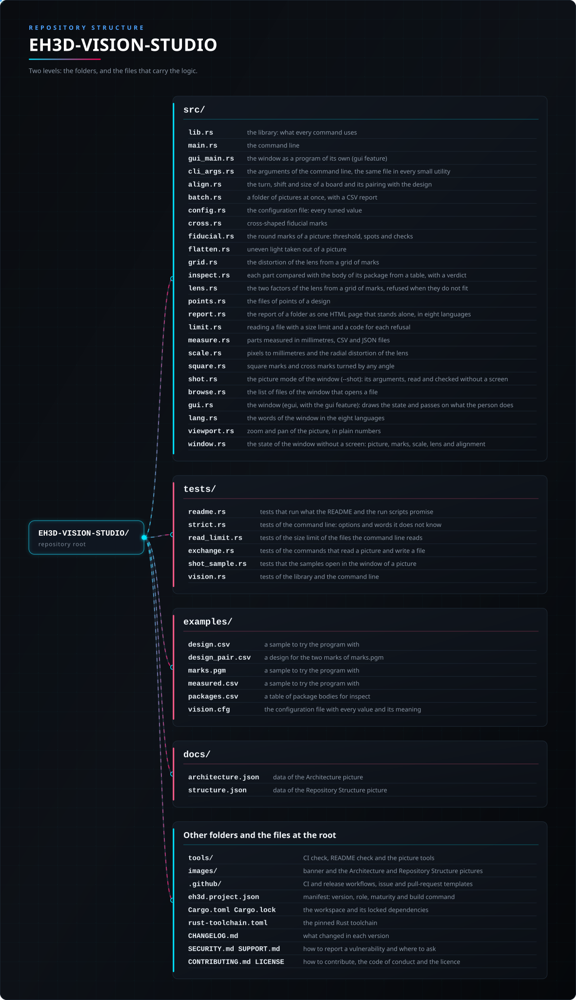

<p align="center">
  
</p>

#  EH3D-VISION-STUDIO
<p align="center"><a href="README.md">🇺🇸 English</a> | <a href="README_spa.md">🇪🇸 Español</a> | <a href="README_fra.md">🇫🇷 Français</a> | <a href="README_ita.md">🇮🇹 Italiano</a> | 🇩🇪 <b>Deutsch</b> | <a href="README_zho.md">🇨🇳 中文</a> | <a href="README_jpn.md">🇯🇵 日本語</a> | <a href="README_por.md">🇵🇹 Português</a></p>

### Passmarken in einem Kamerabild: Marken, Maßstab und Korrektur einer Platine

<p align="center">
  
  
  
  
  
</p>

---

**Ehrlichkeitscheck - was heute wirklich läuft:** eine Rust-Bibliothek und ein Kommandozeilenprogramm (`eh3d-vision`) mit 246 Tests, die auf einem Computer laufen: findet runde Passmarken in einem Bild, wandelt Pixel in Millimeter um und berechnet Drehung und Verschiebung, die eine Platine dorthin bringen, wo ihr Entwurf sie haben will. Es hat ein Fenster (mit `--features gui` gebaut, das Programm `eh3d-vision-gui`), das ein Bild öffnet, die Marken mit ihren Koordinaten zeigt, den Maßstab setzt, die Verzeichnung des Objektivs aus einem Raster bestimmt, am Entwurf ausrichtet und die Optionen für ISOCAM exportiert, aber das Fenster wurde noch nicht auf einem Bildschirm angesehen; es wurde an keiner Maschine ausprobiert und nicht an einer Sammlung echter Dateien geprüft.

---

> **Sicherheitsstatus:** Dieses Programm steuert keine Maschine und ist kein Sicherheitssystem. Was es erzeugt, muss ein Mensch prüfen, bevor etwas an einer Maschine läuft; nichts davon lief auf echter Hardware.


## 📋 Auf einen Blick

| | |
|---|---|
| Version | `0.0.5` |
| Reifegrad | Funktionsfähig |
| Tests | 246 |
| Technologie-Stack | Rust |
| Auf echter Hardware | Nicht erprobt: nichts davon lief an einer Maschine |

**Springe zu:** [Überblick](#-überblick) · [Architektur](#-architektur) · [Schnellstart](#-schnellstart) · [Tests](#-tests) · [Struktur](#-struktur-des-repositorys) · [Verwandte](#-verwandte-projekte)

## 🚦 Projektstatus

Jede Zeile ist ein Teil dieses Repositorys, und die Ampel sagt, wie weit er heute ist. Sie beruht auf dem, was das Repository zeigen kann (Tests, Builds, Läufe), nicht auf dem, was geplant ist.

🟢 Fertig und überprüft · 🟡 Funktioniert, mit bekannten Grenzen · 🟠 Teilweise fertig oder noch nicht überprüft · 🔴 Nicht gemacht oder funktioniert nicht

| Bereich | Stand | Was das hier bedeutet |
|---|---|---|
| Kern | 🟡 | findet runde Passmarken in einem Bild, wandelt Pixel in Millimeter um und berechnet Drehung und Verschiebung, die eine Platine dorthin bringen, wo ihr Entwurf sie haben will; am Computer mit normalen und beschädigten Eingaben getestet, nicht mit einer Sammlung echter Dateien. |
| Kommandozeile | 🟡 | `eh3d-vision` führt dieselben Funktionen wie die Bibliothek aus und gibt das Ergebnis aus; jeder Fehler kommt als Meldung mit einem Exit-Code ungleich null zurück. |
| Tests | 🟡 | 246 Tests bestehen (`cargo test`), mit Normalfällen, Grenzfällen und beschädigten Eingaben sowie einer simulierten Kamera über einer Platine, die Rauschen, falsche Belichtung, ein totes oder fehlendes Bild, wie eine Marke aussehenden Staub oder eine abgeschnittene Bilddatei hinzufügt und erneut abgefragt wird. |
| Sicherheit | 🟡 | Reines sicheres Rust (`forbid(unsafe_code)`): nichts gerät bei den übergebenen Dateien in Panik und ein schlechter Wert ist ein Fehler mit Begründung; keine unabhängige Prüfung. |
| Fenster | 🟠 | Geschrieben (egui, `--features gui`, das Programm `eh3d-vision-gui`): ein Bild öffnen oder ablegen, die Marken mit ihren Koordinaten sehen, den Maßstab mit einer Marke bekannter Größe setzen, die Verzeichnung des Objektivs aus einem Raster bestimmen, an einem CSV-Entwurf ausrichten und die Optionen für ISOCAM exportieren; die Logik ist getestet, aber das Fenster wurde noch nicht gebaut oder auf einem Bildschirm angesehen. |
| Echte Hardware | 🔴 | Nicht erprobt: nichts davon wurde an einer Maschine ausgeführt. |
| Dokumentation | 🟡 | README in acht Sprachen, das Changelog und die zwei aus `docs/` gezeichneten Bilder. |

## 🎯 Überblick

* **Die Marken** (`src/fiducial.rs`): Das Bild wird mit der Otsu-Schwelle in dunkel und hell geteilt, die zusammenhängenden Flecken werden vermessen, und die, die Scheiben der erwarteten Größe sind (Fläche, Füllung des umschließenden Kreises und Elongation), sind die Marken, die besten zuerst; ein vom Bildrand abgeschnittener Fleck bleibt draußen, weil sein Mittelpunkt nicht vertrauenswürdig ist, und die Marken können dunkel auf hell oder hell auf dunkel sein.
* **Maßstab und Objektiv** (`src/scale.rs`): Die Millimeter eines Pixels kommen von einer Marke bekannter Größe, die Maschinenachsen gehen nach oben, während das Bild nach unten geht, und die radiale Verzeichnung des Objektivs wird mit kleinsten Quadraten aus einem Raster von Marken gewonnen und korrigiert.
* **Die Platine** (`src/align.rs`): Aus zwei oder mehr Passmarken des Entwurfs und denselben, wie die Kamera sie fand, werden Drehung, Verschiebung und (wenn erlaubt) Größe mit kleinsten Quadraten berechnet, samt Restfehler in Millimetern; eine Transformation mit zu großem Rest (eine falsche Marke) oder abweichender Größe (eine gedehnte Platine) wird nicht akzeptiert.

## 🧩 Rolle in EH3D

EH3D-VISION-STUDIO ist ein Programm der EH3D Fabrication Suite. Es arbeitet als Bibliothek und Kommandozeile und, mit `--features gui` gebaut, als Fenster im gemeinsamen Aussehen der Suite. Es liest und schreibt einfache Dateien und lässt sich allein oder zwischen den anderen Programmen nutzen.

## 🏛️ Architektur

<p align="center">
  
</p>


Wie die Teile dieses Repositorys zusammenpassen: wer es nutzt, was es enthält und wovon es abhängt. Das Bild wird aus `docs/architecture.json` gezeichnet und gegen den Code geprüft.

## ✨ Funktionen

* **Bibliothek und Kommandozeile:** Jeder Befehl von `eh3d-vision` ist eine Funktion der Bibliothek, sodass ein anderes Programm der Suite ihn ohne Prozessstart aufrufen kann.
* **Strenge Kommandozeile:** Eine falsch geschriebene Option (`--powr`) oder ein überzähliges Wort ist ein Fehler, der sie nennt, und wird nicht ignoriert; sonst würde das Programm seine Ausgabe mit den Standardwerten erzeugen.
* **Tests mit beschädigten Eingaben:** Die Tests füttern auch leere Dateien, Datenmüll, riesige Zahlen und abgeschnittene Dateien; keiner darf in Panik geraten.
* **Kein Raten:** Ein unsinniger Wert ist ein Fehler, der sagt welcher und warum, nie ein Ergebnis, das nur richtig aussieht.
* **Größenlimit für gelesene Dateien:** Die Kommandozeile liest ein Bild oder eine Punktdatei nur, wenn sie nicht größer ist als `max_file_mib` in `vision.cfg` (standardmäßig 64 MiB); eine größere Datei wird mit dem Code `file_too_large` und ihrem Namen abgelehnt, eine nicht lesbare mit `file_unreadable` und eine Punktdatei, die kein Text ist, mit `file_not_text`; es wird nichts geladen.
* **Kein unsafe-Code:** `#![forbid(unsafe_code)]` in Bibliothek und Programm.
* **Die Marken für ISOCAM:** `align --isocam-args` gibt jedes Markenpaar als Option `--fiducial ENTWURF_X,ENTWURF_Y,GEMESSEN_X,GEMESSEN_Y` von `eh3d-isocam` aus.
* **Ein Fenster:** mit `--features gui` gebaut als Programm `eh3d-vision-gui` (unter Windows öffnet es sich ohne Konsole): es öffnet ein PNG- oder PGM-Bild mit Zoom und Verschieben, findet die Marken mit editierbaren Werten, zeichnet sie mit ihren Koordinaten, setzt den Maßstab mit einer Marke bekannter Größe, bestimmt die Verzeichnung des Objektivs aus einem Raster von Marken, richtet an einem Entwurf aus einer CSV-Datei aus (die Marken werden ihm nach ihrer Lage zugeordnet, die Reihenfolge ist also egal) und exportiert die Optionen `--fiducial` für ISOCAM nur, wenn die Ausrichtung angenommen wird. Es spricht die acht Sprachen und braucht kein Netzwerk.
* **Eine Konfigurationsdatei:** `vision.cfg` enthält jeden abgestimmten Wert (wie eine Marke aussieht, das Raster der Vorlage, die Grenzen einer angenommenen Ausrichtung, die größte gelesene Datei); ein Fehler darin wird mit seiner Zeile abgelehnt, und `examples/vision.cfg` listet alle auf.
* **Das Zentrum auf Bruchteile eines Pixels, mit einer Zuverlässigkeit:** `find --refine` (oder `refine_subpixel` in `vision.cfg`) gewichtet die grauen Pixel am Rand jeder Marke, sodass ihr Zentrum auf Bruchteile eines Pixels gefunden wird, und gibt eine Zuverlässigkeit aus, die sinkt, wenn sich die Marke kaum von der Platine abhebt.
* **Ungleichmäßiges Licht:** `--flatten PX` (oder `flatten_window`) teilt das Bild vor der Suche durch das Licht um jedes Pixel, damit eine Lampe, die über der Platine nachlässt, oder ein Schatten die Marken auf der dunklen Seite nicht verdeckt.
* **Kreuzförmige Marken:** `eh3d-vision crosses BILD` findet Pluszeichen, deren Arme entlang der Bildachsen liegen (quadratischer Rahmen, zwei Arme gleicher Breite, leere Ecken); Scheiben und Quadrate werden ausgelassen, und `--turned` findet Kreuze in jedem Winkel (siehe unten).
* **Der Maßstab aus dem Raster eines Targets:** `eh3d-vision calibrate BILD --pitch-mm D` nimmt den Median der Abstände benachbarter Marken eines Rasters, weist ein Target ab, das nicht frontal gesehen wird, und gibt die Zeile `mm_per_px = ...` für `vision.cfg` aus.
* **Teile für andere Programme, als einfache Dateien:** `eh3d-vision measure BILD --mm-per-px V` liefert zu jedem Teil Mitte (mm von der Bildmitte, x nach rechts, y nach oben), Drehung (von -90 ausgeschlossen bis 90 Grad), Länge, Breite und Fläche als CSV (`index,x_mm,y_mm,angle_deg,length_mm,width_mm,area_mm2`) oder als JSON (`--format json`: `format` `eh3d-vision-parts`, `version` 1, `unit`, `image_width_px`, `image_height_px`, `mm_per_px`, `parts`); mit dem lesenden Programm wird sonst nichts geteilt. `--output DATEI` überschreibt nie eine Datei ohne `--replace` und nie einen Link.
* **Ein Ordner auf einmal:** `eh3d-vision batch ORDNER --report DATEI.csv` liest jedes PNG- und PGM-Bild innerhalb der Größengrenze (höchstens `batch_max_files`) und schreibt je eine Zeile (`file,status,marks,mean_score,min_score,mean_diameter_px,detail`) mit dem Status `ok`, `no_marks`, `picture_unreadable` oder dem Code der Ablehnung; ein Dateiname, den eine Tabellenkalkulation als Formel ausführen würde, wird mit einem Anführungszeichen davor geschrieben.
* **Quadrate und Kreuze in jedem Winkel:** `eh3d-vision squares BILD` findet quadratische Marken in jedem Drehwinkel (Mitte, Seite und der Winkel gegen den Uhrzeigersinn, wie ihn die Maschine sieht, von -45 ausgeschlossen bis 45 Grad) und `eh3d-vision crosses BILD --turned` findet Kreuze, deren Arme nicht entlang der Achsen liegen; die Mindestfüllung eines Quadrats und die Mindestpunktzahl eines Kreuzes (`square_min_fill`, `cross_min_score`) stehen in `vision.cfg`.
* **Das Objektiv mit zwei Faktoren, abgelehnt, wenn es nicht passt:** `eh3d-vision lens BILD` berechnet `k1` und `k2` der radialen Verzeichnung aus einem Raster von Marken und gibt die Zeilen `lens_k1 = ...` und `lens_k2 = ...` für `vision.cfg` aus; es lehnt eine Anpassung ab, die die Marken weiter als `lens_max_rms` Pixel von ihrem Gitter lässt (`lens_residual_too_large`), oder einen Faktor über 0,5 (`lens_out_of_range`), und `find --undistort` entzerrt die Orte damit.
* **Ein Urteil für jedes Teil:** `eh3d-vision inspect BILD --package NAME --table packages.csv` misst die Teile eines Bildes und vergleicht jedes mit dem Körper seiner Bauform (`package`, `body_long_mm`, `body_short_mm`, auf Wunsch `tolerance_mm`, in einer CSV-Datei; `examples/packages.csv` enthält einige): `pass` oder `fail` mit dem Grund (`length`, `width`, `angle`) als CSV oder JSON, der Exit-Code ist 1, wenn ein Teil durchfällt; die Toleranz und die größte Drehung (`inspect_tolerance`, `inspect_max_angle`) stehen in `vision.cfg`.
* **Ein HTML-Bericht über den Ordner:** `eh3d-vision batch ORDNER --html bericht.html` schreibt eine Seite, die für sich allein steht (kein Skript, kein Link, keine weitere Datei): eine Tabelle der Bilder, eine kleine Zeichnung jedes Bildes mit einem Kreis um jede gefundene Marke und die Warnungen (ein Bild, das nicht genutzt werden konnte, ohne Marken oder mit einer Punktzahl unter `report_low_score`), in der Sprache von `--lang` oder `vision.cfg`.
* **Die neuen Werkzeuge im Fenster:** Die Seitenleiste bietet die Mitte auf einen Bruchteil eines Pixels mit dem Vertrauen jeder Marke, das Lichtfenster, Quadrate und Kreuze in jedem Winkel (auf das Bild gezeichnet), die Teile in Millimetern (gespeichert als `<Bild>-parts.csv`), den Bericht über den Ordner (`eh3d-vision-report.html`, nie ohne `replace_output` über eine vorhandene Datei geschrieben) und den Maßstab aus dem Abstand eines Rasters, mit den Texten in den acht Sprachen und den Werten in `vision.cfg`; auf einem Bildschirm wurde es noch nicht angesehen.
* **Die Bilder eines großen Teils, geplant:** `eh3d-vision shots --package NAME --fov-w MM --fov-h MM` (oder `--body-long` und `--body-short`) listet als CSV die Orte der Kamera auf, in Millimetern von der Mitte des Teils, die ein Teil sehen, das größer als das Feld ist, wobei benachbarte Bilder um `shots_overlap` überlappen und ein Rand von `shots_margin` bleibt; es braucht keine Kamera.

## 🔒 Sicherheit und Schutz

| Bedrohung | Schutz |
|---|---|
| Eine beschädigte, abgeschnittene oder leere Datei | keine Panik: die Tests schneiden gültige Eingaben an jeder Stelle ab und füttern Datenmüll |
| Eine unsinnige Zahl (negativ, nicht endlich, absurd groß) | wird mit einem Fehler abgelehnt, der den Wert nennt; nichts wird zu etwas Plausiblem gerundet |
| Ein Bericht oder eine Messdatei, die eine andere Datei überschreiben würde | geschrieben wird nur, wo keine Datei ist; zum Überschreiben braucht es `--replace`, und durch einen Link wird nie geschrieben |
| Unsichere Speichernutzung | reines sicheres Rust mit `forbid(unsafe_code)` |

**Was nicht abgesichert ist:** Ein fehlerfrei erzeugtes Ergebnis ist kein geprüftes Ergebnis. Nichts hier kennt die Grenzen einer Maschine, und das Programm hatte keine unabhängige Prüfung. Eine Schwachstelle bitte privat melden (siehe [SECURITY.md](SECURITY.md)).

## 🔌 Schnittstellen

Die Bibliothek ist `eh3d_vision_studio` (`use eh3d_vision_studio::...`); die Kommandozeile ist `eh3d-vision`. Die Befehle sind diese; jeder gibt sein Ergebnis auf der Standardausgabe aus und meldet einen Fehler auf der Fehlerausgabe mit einem Exit-Code ungleich null. Es gibt keinen Netzwerkzugriff.

```text
eh3d-vision find IMAGE [--light] [--min-diam PX] [--max-diam PX] [--known-mm D] [--refine] [--undistort] [--flatten PX]   the round marks found (--known-mm gives millimetres, --refine the centre to a fraction of a pixel with a confidence, --undistort straightens the places with lens_k1 and lens_k2 of vision.cfg, --flatten takes uneven light out first)
eh3d-vision align DESIGN.csv MEASURED.csv [--scale] [--pair-nearest] [--isocam-args] [--max-rms 0.1] [--max-stretch 0.01]
eh3d-vision crosses IMAGE [--turned] [--light] [--min-size PX] [--max-size PX] [--flatten PX]   the cross-shaped marks found (plus signs; with --turned the arms may have any angle and the angle is printed)
eh3d-vision inspect IMAGE --package NAME [--table FILE] [--mm-per-px V] [--tolerance MM] [--max-angle DEG] [--light] [--flatten PX] [--format csv|json] [--output FILE] [--replace]   each part of a picture compared with the body of its package from a table (CSV with package, body_long_mm, body_short_mm), one verdict per part; exit 1 when a part fails
eh3d-vision shots (--package NAME [--table FILE] | --body-long MM --body-short MM) --fov-w MM --fov-h MM [--overlap F] [--margin MM] [--output FILE] [--replace]   the places of the camera that cover a part bigger than its field (millimetres from the centre of the part), row after row, as CSV; no camera is needed
eh3d-vision lens IMAGE [--columns C] [--rows R] [--max-rms PX] [--light] [--flatten PX]   the two radial factors of the lens from a grid of marks (columns and rows as grid_columns and grid_rows), refused when the marks stay farther than --max-rms pixels from their lattice
eh3d-vision squares IMAGE [--light] [--min-size PX] [--max-size PX] [--flatten PX]   the square marks found, turned by any angle (centre, side and angle)
eh3d-vision calibrate IMAGE --pitch-mm D [--light] [--tolerance 0.05] [--flatten PX]   the millimetres of a pixel from a target whose neighbouring marks are D millimetres apart
eh3d-vision measure IMAGE [--mm-per-px V] [--light] [--flatten PX] [--format csv|json] [--output FILE] [--replace]   the parts of a picture: centre, turn, length, width and area in millimetres, as a CSV or JSON file
eh3d-vision batch FOLDER [--light] [--flatten PX] [--report FILE.csv] [--html FILE.html] [--lang CODE] [--replace]   every PNG and PGM picture of a folder: marks, scores and diameters, or the code of what went wrong, one line each; --html writes a page that stands alone, with a drawing of each picture and the warnings, in the language of --lang or of vision.cfg
eh3d-vision-gui [IMAGE] [DESIGN.csv]   the window (a build with --features gui); on Windows it opens with no console
```

## ⚙️ Konfiguration

Die abgestimmten Werte stehen in einer einfachen Datei mit `Schlüssel = Wert`, nicht im Code: `vision.cfg` im Ordner, in dem das Programm startet, oder neben ihm (die Variable `EH3D_VISION_CONFIG` nennt eine andere Datei). Sie legt die Sprache des Fensters fest, ob die Marken dunkel oder hell sind, den Schwellwert, den Bereich des Durchmessers, die Füllung und die Streckung einer Marke, die Größe der Marke, die den Maßstab setzt, die Spalten und Zeilen des Rasters, ob die Ausrichtung die Größe ändern darf, die Grenzen, die eine Ausrichtung einhalten muss, und die größte gelesene Datei. `examples/vision.cfg` listet jeden Schlüssel mit seiner Bedeutung und dem Wert auf, mit dem das Programm startet; fehlt die Datei, gelten diese Werte, und eine Datei mit einem Fehler wird mit ihrer Zeile abgelehnt. In der Kommandozeile werden dieselben Dinge als Optionen angegeben (siehe Schnittstellen). Sie enthält auch die weiteren abgestimmten Werte: die Zuverlässigkeit (`refine_subpixel`, `full_contrast`), das Fenster des Lichts (`flatten_window`), den Maßstab und die Größe eines Teils (`mm_per_px`, `part_min_area`, `part_max_area`, `max_parts`), den Bereich eines Kreuzes (`cross_min_size`, `cross_max_size`, `cross_max_elongation`), die Toleranz eines Targets (`pitch_tolerance`) und die höchste Zahl von Bildern eines Ordners (`batch_max_files`). Die Mindestfüllung eines Quadrats und die Mindestpunktzahl eines in jedem Winkel gedrehten Kreuzes sind `square_min_fill` und `cross_min_score`. Das Objektiv sind `lens_k1` und `lens_k2` (wie `lens` sie berechnet), und der größte Abstand eines Rasters von seinem Gitter nach der Korrektur ist `lens_max_rms`. Die Tabelle der Bauformen, die `inspect` liest, ist `package_table`, und wie weit ein Teil von seiner Bauform abweichen und gedreht sein darf, sind `inspect_tolerance` und `inspect_max_angle`. Die Punktzahl, unter der der HTML-Bericht vor einem Bild warnt, ist `report_low_score`. Der Abstand der Marken des Rasters, das den Maßstab setzt, ist `pitch_mm`, und `replace_output` sagt, ob geschriebene Dateien eine vorhandene Datei überschreiben dürfen (standardmäßig nein). Die Überlappung benachbarter Bilder eines Plans von `shots` und der Rand um das Teil sind `shots_overlap` und `shots_margin`.

## 🚀 Schnellstart

Sie brauchen eine stabile Rust-Toolchain (1.88 oder neuer). Das Repository EH3D-COMMON muss neben diesem geklont sein: der Bildleser wird daraus per Pfad übernommen.

```bash
cargo build --release
cargo test
cargo run --release -- align examples/design.csv examples/measured.csv
cargo run --release --features gui --bin eh3d-vision-gui   # the window
cargo run --release --features gui --bin eh3d-vision-gui -- --shot screen.png --open examples/marks.pgm --open examples/design.csv   # a picture of the window
```

Um ein Bild des Fensters aufzunehmen, ohne es von Hand zu öffnen, starten Sie es mit `--shot DATEI.png` (auch `--size WxH`, `--theme forge|dark|light`, `--wait N`, `--lang CODE`, `--open FILE`, `--replace`, `--mark N`, `--align`): Es öffnet sich in dieser Größe, speichert das PNG, behält keine Einstellungen und schließt sich selbst (Exit-Code 0, wenn die Datei geschrieben wurde, 1, wenn nicht, 2 bei falschen Argumenten). Mit `--mark N` legt die Marke Nummer N (ab 1) den Maßstab fest, und mit `--align` wird der Entwurf an den Marken ausgerichtet, sodass das Bild die Linien der Ausrichtung zeigt: von der Stelle, an die der Entwurf jede Marke setzt, zur gefundenen Marke, mit dem Abstand in Millimetern (`show_residuals` in `vision.cfg` schaltet sie ab). `examples/design_pair.csv` ist ein Entwurf für die zwei Marken von `examples/marks.pgm`.

## 🧪 Tests

Die Suite hat 246 Tests (`cargo test`, in der CI unter Windows und Linux). Sie prüfen Normalfälle, Grenzfälle und beschädigte Eingaben: leere Dateien, Datenmüll und abgeschnittene Dateien lösen nie eine Panik aus. Die CI führt außerdem `cargo fmt --check`, `cargo clippy` mit Warnungen als Fehlern und `python -I tools/ci_validate.py` aus.

## 🏗️ Build und Veröffentlichung

Die Version steht in `Cargo.toml` und in `eh3d.project.json`; jede Version hat ihren Eintrag in [CHANGELOG.md](CHANGELOG.md). `build.bat` / `build.sh` bauen das Programm, `test.bat` / `test.sh` führen die Tests aus und `run.bat` / `run.sh` starten es mit einem Beispiel. Releases erscheinen auf GitHub.

### Downloads

Jede Version enthält das Programm mit seinem Fenster für Windows (64 und 32 Bit), Linux (64 Bit) und macOS (Apple Silicon und Intel) als `<Name>-<Version>-<System>.zip` (Windows) oder `.tar.gz` mit dem Programm, der Lizenz, der Readme, dem Symbol und den Beispielen. Die Dateien werden von GitHub Actions gebaut, stehen in `SHA256SUMS` und sind mit dem EH3D-Schlüssel signiert. Um einen Download zu prüfen, vergleiche seinen Hash mit der danebenliegenden `.sha256`-Datei (`sha256sum -c`) und prüfe die Signatur mit der danebenliegenden `.sig`-Datei (`ssh-keygen -Y verify`).

## 📂 Struktur des Repositorys

<p align="center">
  
</p>

<details>
<summary>Textversion des Baums</summary>

```text
EH3D-VISION-STUDIO/
├── src/
│   ├── lib.rs                                   die Bibliothek: was jeder Befehl nutzt
│   ├── main.rs                                  die Kommandozeile
│   ├── gui_main.rs                              das Fenster als eigenes Programm (Feature gui)
│   ├── cli_args.rs                              die Argumente der Kommandozeile, dieselbe Datei in jedem kleinen Werkzeug
│   ├── align.rs                                 Drehung, Verschiebung und Größe einer Platine und ihre Zuordnung zum Entwurf
│   ├── batch.rs                                 ein Ordner voller Bilder auf einmal, mit CSV-Bericht
│   ├── config.rs                                die Konfigurationsdatei: jeder abgestimmte Wert
│   ├── cross.rs                                 kreuzförmige Fiducial-Marken
│   ├── fiducial.rs                              die runden Marken eines Bildes: Schwellwert, Flecken und Prüfungen
│   ├── flatten.rs                               ungleichmäßiges Licht aus einem Bild entfernt
│   ├── grid.rs                                  die Verzeichnung des Objektivs aus einem Raster von Marken
│   ├── inspect.rs                               jedes Teil mit dem Körper seiner Bauform aus einer Tabelle verglichen, mit Urteil
│   ├── lens.rs                                  die zwei Faktoren des Objektivs aus einem Markenraster, abgelehnt, wenn sie nicht passen
│   ├── points.rs                                die Punktdateien eines Entwurfs
│   ├── report.rs                                der Bericht über einen Ordner als eigenständige HTML-Seite in acht Sprachen
│   ├── limit.rs                                 Lesen einer Datei mit Größenlimit und einem Code für jede Ablehnung
│   ├── measure.rs                               Teile in Millimetern vermessen, CSV- und JSON-Dateien
│   ├── scale.rs                                 von Pixeln zu Millimetern und die radiale Verzeichnung des Objektivs
│   ├── square.rs                                quadratische Marken und in jedem Winkel gedrehte Kreuze
│   ├── tools.rs                                 die Werkzeuge der Seitenleiste am Bild: Formen, Teile, Ordnerbericht, Abstandsmaßstab
│   ├── shot.rs                                  der Bildmodus des Fensters (--shot): seine Argumente, ohne Bildschirm gelesen und geprüft
│   ├── shots.rs                                 die Kameraorte, die ein Teil größer als das Feld abdecken, allein aus den Größen
│   ├── browse.rs                                die Dateiliste des Fensters zum Öffnen einer Datei
│   ├── gui.rs                                   das Fenster (egui, mit dem Feature gui): zeichnet den Zustand und gibt weiter, was die Person tut
│   ├── lang.rs                                  die Wörter des Fensters in den acht Sprachen
│   ├── viewport.rs                              Zoom und Verschiebung des Bildes, in einfachen Zahlen
│   └── window.rs                                der Zustand des Fensters ohne Bildschirm: Bild, Marken, Maßstab, Objektiv und Ausrichtung
├── tests/
│   ├── readme.rs                                Tests, die ausführen, was README und run-Skripte versprechen
│   ├── strict.rs                                Tests der Kommandozeile: Optionen und Wörter, die sie nicht kennt
│   ├── read_limit.rs                            Tests des Größenlimits der Dateien, die die Kommandozeile liest
│   ├── exchange.rs                              Tests der Befehle, die ein Bild lesen und eine Datei schreiben
│   ├── shot_sample.rs                           Tests, dass die Beispiele im Fenster eines Bildes öffnen
│   └── vision.rs                                Tests von Bibliothek und Kommandozeile
├── examples/
│   ├── design.csv                               ein Beispiel zum Ausprobieren
│   ├── design_pair.csv                          ein Entwurf für die zwei Marken von marks.pgm
│   ├── marks.pgm                                ein Beispiel zum Ausprobieren
│   ├── measured.csv                             ein Beispiel zum Ausprobieren
│   ├── packages.csv                             eine Tabelle von Bauformkörpern für inspect
│   └── vision.cfg                               die Konfigurationsdatei mit jedem Wert und seiner Bedeutung
├── docs/
│   ├── architecture.json                        Daten des Architektur-Bildes
│   └── structure.json                           Daten des Struktur-Bildes
├── tools/                                       CI-Prüfung, README-Prüfung und die Bildwerkzeuge
├── images/                                      Banner und die Bilder von Architektur und Repository-Struktur
├── .github/                                     CI- und Release-Workflows, Vorlagen für Issues und Pull Requests
├── eh3d.project.json                            Manifest: Version, Rolle, Reifegrad und Build-Befehl
├── Cargo.toml Cargo.lock                        der Workspace und seine festgelegten Abhängigkeiten
├── rust-toolchain.toml                          die festgelegte Rust-Toolchain
├── CHANGELOG.md                                 was sich in jeder Version geändert hat
├── SECURITY.md SUPPORT.md                       Schwachstellen melden und Fragen stellen
└── CONTRIBUTING.md CODE_OF_CONDUCT.md LICENSE   Mitwirken, Verhaltenskodex und Lizenz
```

</details>

## 🗺️ Roadmap und bekannte Grenzen

**Bekannte Grenzen heute**

* Das Fenster wurde noch nicht auf einem Bildschirm angesehen; die Marken werden dem Entwurf nach ihrer Lage zugeordnet, eine stark gedrehte Platine oder eine fehlende Marke wird daher abgelehnt, statt geraten zu werden.
* Es wurde weder an einer Maschine noch mit einer Sammlung echter Dateien erprobt und hatte keine unabhängige Prüfung.
* Es liest eine Bilddatei, keine Live-Kamera, findet nur runde, quadratische und kreuzförmige Marken und wurde an von den Tests gezeichneten Bildern erprobt, nicht an Fotos echter Platinen. Die Drehung eines Teils wird aus seinen Pixeln wie bei einem Rechteck gemessen, ein Teil, das kein Rechteck ist, erhält also die Drehung seiner langen Achse.

**Als Nächstes**

* Die Live-Kamera der Maschine lesen (EH3D-NODE-BUNGARD-AUX), Fotos echter Platinen ausprobieren und dem Fenster das Training neuer Marken hinzufügen.
* Das Fenster auf einem Bildschirm ansehen und fertigstellen.
* Mit echten Dateien und den anderen Programmen der Suite ausprobieren.

## 🌍 Sprachen

README und Texte gibt es auf Englisch, Spanisch, Französisch, Italienisch, Deutsch, Chinesisch, Japanisch und europäischem Portugiesisch.

## 🔗 Verwandte Projekte

* [EH3D-COMMON](https://github.com/JuanenRac/EH3D-COMMON): die gemeinsamen Crates, darunter der Bildleser
* [EH3D-PHOENIX-PNP](https://github.com/JuanenRac/EH3D-PHOENIX-PNP): die Pick-and-Place-Bestückung
* [EH3D-ISOCAM](https://github.com/JuanenRac/EH3D-ISOCAM): das Isolationsfräsen von Kupfer
* [EH3D-PHOENIX-CNC](https://github.com/JuanenRac/EH3D-PHOENIX-CNC): das Maschinensteuerungsprogramm
* [EH3D-NODE-BUNGARD-AUX](https://github.com/JuanenRac/EH3D-NODE-BUNGARD-AUX): der Knoten des Bohrkopfs mit der Kamera
* [EH3D-SUITE-LAUNCHER](https://github.com/JuanenRac/EH3D-SUITE-LAUNCHER): die Zentrale, die die Programme der Suite findet und startet

## 📚 Dokumentation

* [Changelog](CHANGELOG.md)
* [Architektur- und Strukturdaten](docs/architecture.json): die Daten, aus denen die beiden Bilder gezeichnet werden.

## 🤝 Mitwirken und Community

* Vor einem Pull Request `cargo fmt --check`, `cargo clippy --all-targets -- -D warnings`, `cargo test` und `python -I tools/ci_validate.py` ausführen: alles muss bestehen. Siehe [CONTRIBUTING.md](CONTRIBUTING.md) und den [Verhaltenskodex](CODE_OF_CONDUCT.md).
* Die README gibt es in acht Sprachen: Eine Textänderung erfolgt in allen acht Dateien, und die zwei Bilder werden aus `docs/architecture.json` und `docs/structure.json` mit `tools/make_architecture.py` und `tools/make_structure.py` gezeichnet.
* Eine Schwachstelle privat melden: [SECURITY.md](SECURITY.md). Fragen, Ideen und Berichte: electrohobby3d@gmail.com ([SUPPORT.md](SUPPORT.md)).

## 👤 AUTOR

**JuanenRac (Electro Hobby 3D)** · electrohobby3d@gmail.com

## 📜 LIZENZ

Software: GPL-3.0-or-later. Siehe [LICENSE](LICENSE). Die Hardware-Entwürfe der Suite verwenden die CERN OHL-S.
