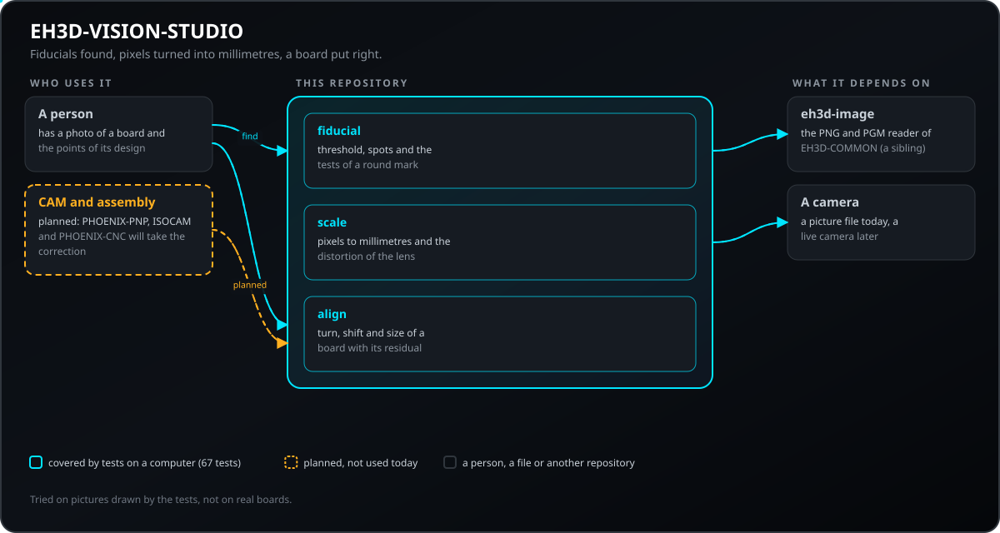
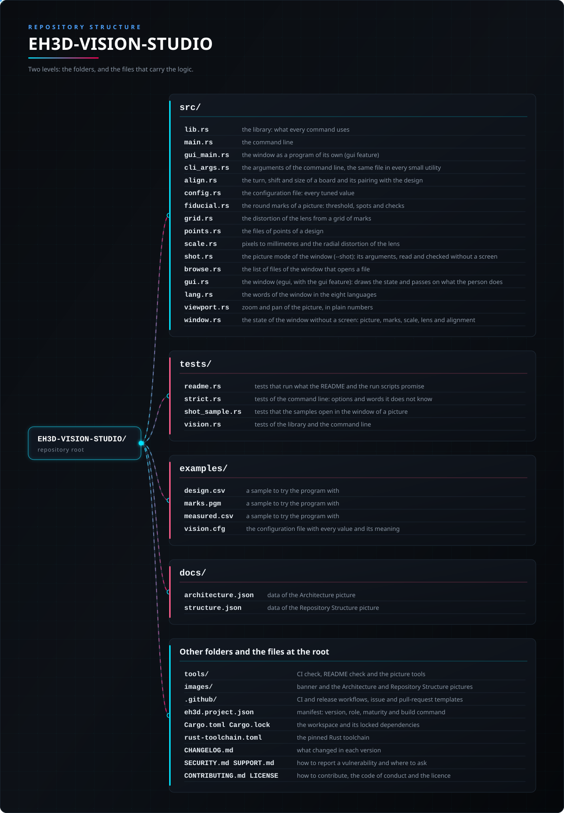

<p align="center">
  
</p>

#  EH3D-VISION-STUDIO
<p align="center"><a href="README.md">🇺🇸 English</a> | 🇪🇸 <b>Español</b> | <a href="README_fra.md">🇫🇷 Français</a> | <a href="README_ita.md">🇮🇹 Italiano</a> | <a href="README_deu.md">🇩🇪 Deutsch</a> | <a href="README_zho.md">🇨🇳 中文</a> | <a href="README_jpn.md">🇯🇵 日本語</a> | <a href="README_por.md">🇵🇹 Português</a></p>

### Fiduciales en una imagen de cámara: marcas, escala y corrección de una placa

<p align="center">
  
  
  
  
  
</p>

---

**Comprobación de honestidad - lo que funciona hoy:** una biblioteca Rust y un programa de línea de comandos (`eh3d-vision`) con 66 pruebas que se ejecutan en un ordenador: encuentra marcas fiduciales redondas en una imagen, convierte píxeles en milímetros y calcula el giro y el desplazamiento que colocan una placa donde dice su diseño. Todavía no tiene ventana, no se ha probado en una máquina y no se ha comprobado con una colección de ficheros reales.

---

> **Estado de seguridad:** este programa no controla ninguna máquina y no es un sistema de seguridad. Lo que produce debe revisarlo una persona antes de ejecutar nada en una máquina; nada de esto se ha ejecutado en hardware real.


## 📋 De un vistazo

| | |
|---|---|
| Versión | `0.0.2` |
| Madurez | Andamiaje |
| Pruebas | 66 |
| Pila tecnológica | Rust |
| En hardware real | No probado: nada de esto se ha ejecutado en una máquina |

**Ir a:** [Resumen](#-resumen) · [Arquitectura](#-arquitectura) · [Inicio rápido](#-inicio-rápido) · [Pruebas](#-pruebas) · [Estructura](#-estructura-del-repositorio) · [Relacionados](#-proyectos-relacionados)

## 🚦 Estado del proyecto

Cada línea es una parte de este repositorio y la luz dice hasta dónde llega hoy. Se escribe con lo que el repositorio puede demostrar (pruebas, compilaciones, ejecuciones), no con lo previsto.

🟢 Hecho y verificado · 🟡 Funciona, con límites conocidos · 🟠 Hecho a medias o sin verificar · 🔴 Sin hacer o sin funcionar

| Área | Estado | Qué significa aquí |
|---|---|---|
| Núcleo | 🟡 | encuentra marcas fiduciales redondas en una imagen, convierte píxeles en milímetros y calcula el giro y el desplazamiento que colocan una placa donde dice su diseño; probado en un ordenador con entradas normales y dañadas, no con una colección de ficheros reales. |
| Línea de comandos | 🟡 | `eh3d-vision` ejecuta las mismas funciones que la biblioteca e imprime el resultado; cada error vuelve como mensaje y un código de salida distinto de cero. |
| Pruebas | 🟡 | 66 pruebas pasan (`cargo test`), con casos normales, casos límite y entradas dañadas. |
| Seguridad | 🟡 | Rust seguro y simple (`forbid(unsafe_code)`): nada entra en pánico con los ficheros recibidos y un valor malo es un error con su motivo; sin revisión independiente. |
| Ventana | 🔴 | Previsto: la ventana egui común a la suite; hoy solo existe la línea de comandos. |
| Hardware real | 🔴 | No probado: nada de esto se ha ejecutado en una máquina. |
| Documentación | 🟡 | README en ocho idiomas, el registro de cambios y las dos imágenes dibujadas desde `docs/`. |

## 🎯 Resumen

* **Las marcas** (`src/fiducial.rs`): la imagen se parte en oscuro y claro con el umbral de Otsu, se miden las manchas conectadas y las que son discos del tamaño esperado (el área, lo que llenan del círculo que las contiene y lo alargadas que son) son las marcas, las mejores primero; una mancha cortada por el borde de la imagen se deja fuera porque no se puede fiar de su centro, y las marcas pueden ser oscuras sobre claro o claras sobre oscuro.
* **La escala y la lente** (`src/scale.rs`): los milímetros de un píxel salen de una marca de tamaño conocido, los ejes de la máquina suben mientras la imagen baja, y la distorsión radial de la lente se recupera por mínimos cuadrados desde una rejilla de marcas y se corrige.
* **La placa** (`src/align.rs`): con dos o más fiduciales del diseño y los mismos tal como los halló la cámara, se calculan por mínimos cuadrados el giro, el desplazamiento y (si se permite) el tamaño, con el residuo en milímetros; una transformación con residuo demasiado grande (una marca equivocada) o con el tamaño desviado (una placa estirada) no se acepta.

## 🧩 Papel en EH3D

EH3D-VISION-STUDIO es un programa de la EH3D Fabrication Suite. Hoy funciona como biblioteca y línea de comandos; su ventana, con el aspecto que comparten los demás programas de la suite, está prevista. Lee y escribe ficheros simples, así que puede usarse solo o entre los demás programas.

## 🏛️ Arquitectura

<p align="center">
  
</p>


Cómo encajan las partes de este repositorio: quién lo usa, qué contiene y de qué depende. La imagen se dibuja desde `docs/architecture.json` y se comprueba con el código.

## ✨ Funciones

* **Biblioteca y línea de comandos:** cada orden de `eh3d-vision` es una función de la biblioteca, así que otro programa de la suite puede llamarla sin lanzar un proceso.
* **Línea de comandos estricta:** una opción mal escrita (`--powr`) o una palabra de más es un error que la nombra, no algo que se ignora; si no, el programa haría su salida con los valores por defecto.
* **Pruebas con entradas dañadas:** las pruebas también dan ficheros vacíos, basura, números enormes y ficheros cortados, y ninguna puede provocar un pánico.
* **Sin adivinar:** un valor que no tiene sentido es un error que dice cuál y por qué, nunca un resultado que solo lo parece.
* **Sin código unsafe:** `#![forbid(unsafe_code)]` en la biblioteca y el programa.

## 🔒 Seguridad y protección

| Amenaza | Defensa |
|---|---|
| Un fichero dañado, cortado o vacío | sin pánico: las pruebas cortan una entrada válida en cada posición y dan basura |
| Un número sin sentido (negativo, no finito, absurdamente grande) | se rechaza con un error que nombra el valor; nada se redondea hasta parecer plausible |
| Uso inseguro de memoria | Rust seguro y simple con `forbid(unsafe_code)` |

**Lo que no se defiende:** un resultado producido sin errores no es un resultado verificado. Nada de esto conoce los límites de una máquina y el programa no ha tenido revisión independiente. Informe de una vulnerabilidad en privado (véase [SECURITY.md](SECURITY.md)).

## 🔌 Interfaces

La biblioteca es `eh3d_vision_studio` (`use eh3d_vision_studio::...`); la línea de comandos es `eh3d-vision`. Las órdenes son estas; cada una imprime su resultado por la salida estándar e informa de un error por la salida de errores con un código de salida distinto de cero. No hay acceso a la red.

```text
EH3D-VISION-STUDIO/
├── src/
│   ├── lib.rs                                   la biblioteca: lo que usa cada orden
│   ├── main.rs                                  la línea de comandos
│   ├── align.rs                                 una parte de la lógica
│   ├── cli_args.rs                              los argumentos de la línea de comandos, el mismo fichero en cada utilidad pequeña
│   ├── fiducial.rs                              una parte de la lógica
│   └── scale.rs                                 una parte de la lógica
├── tests/
│   ├── readme.rs                                pruebas que ejecutan lo que prometen el README y los scripts run
│   ├── strict.rs                                pruebas de la línea de comandos: opciones y palabras que no conoce
│   └── vision.rs                                pruebas de la biblioteca y la línea de comandos
├── examples/
│   ├── design.csv                               una muestra para probar el programa
│   ├── marks.pgm                                una muestra para probar el programa
│   └── measured.csv                             una muestra para probar el programa
├── docs/
│   ├── architecture.json                        datos de la imagen de Arquitectura
│   └── structure.json                           datos de la imagen de Estructura
├── tools/                                       comprobación del CI y del README y herramientas de imágenes
├── images/                                      banner y las imágenes de Arquitectura y Estructura del repositorio
├── .github/                                     flujos de CI y de publicación, plantillas de issues y pull requests
├── eh3d.project.json                            manifiesto: versión, rol, madurez y comando de compilación
├── Cargo.toml Cargo.lock                        el workspace y sus dependencias fijadas
├── CHANGELOG.md                                 qué cambió en cada versión
├── SECURITY.md SUPPORT.md                       cómo informar de una vulnerabilidad y dónde preguntar
└── CONTRIBUTING.md CODE_OF_CONDUCT.md LICENSE   cómo contribuir, el código de conducta y la licencia
```

## ⚙️ Configuración

Todavía no hay fichero de configuración: lo que elige la persona se da como argumentos de la línea de comandos (véase Interfaces) y cada valor por defecto está escrito en la ayuda de la orden (`eh3d-vision help`). Los límites fijos están en el código como constantes con nombre y las pruebas los cubren.

## 🚀 Inicio rápido

Necesita una cadena de herramientas Rust estable (1.75 o más reciente). El repositorio EH3D-COMMON debe estar clonado junto a este: el lector de imágenes se toma de él por ruta.

```bash
cargo build --release
cargo test
cargo run --release -- align examples/design.csv examples/measured.csv
```

## 🧪 Pruebas

El conjunto tiene 66 pruebas (`cargo test`, ejecutadas en Windows y Linux en el CI). Comprueban los casos normales, los casos límite y las entradas dañadas: ficheros vacíos, basura y ficheros cortados nunca provocan un pánico. El CI ejecuta además `cargo fmt --check`, `cargo clippy` con las advertencias como errores y `python -I tools/ci_validate.py`.

## 🏗️ Compilación y publicación

La versión está en `Cargo.toml` y en `eh3d.project.json`; cada versión tiene su entrada en [CHANGELOG.md](CHANGELOG.md). `build.bat` / `build.sh` compilan el programa, `test.bat` / `test.sh` ejecutan las pruebas y `run.bat` / `run.sh` lo ejecutan con un ejemplo. Las versiones se publican en GitHub.

## 📂 Estructura del repositorio

<p align="center">
  
</p>

<details>
<summary>Versión en texto del árbol</summary>

```text
EH3D-VISION-STUDIO/
├── src/
│   ├── lib.rs                                   la biblioteca: lo que usa cada orden
│   ├── main.rs                                  la línea de comandos
│   ├── align.rs                                 una parte de la lógica
│   ├── cli_args.rs                              los argumentos de la línea de comandos, el mismo fichero en cada utilidad pequeña
│   ├── fiducial.rs                              una parte de la lógica
│   ├── image.rs                                 una parte de la lógica
│   └── scale.rs                                 una parte de la lógica
├── tests/
│   ├── readme.rs                                pruebas que ejecutan lo que prometen el README y los scripts run
│   ├── strict.rs                                pruebas de la línea de comandos: opciones y palabras que no conoce
│   └── vision.rs                                pruebas de la biblioteca y la línea de comandos
├── examples/
│   ├── design.csv                               una muestra para probar el programa
│   ├── marks.pgm                                una muestra para probar el programa
│   └── measured.csv                             una muestra para probar el programa
├── docs/
│   ├── architecture.json                        datos de la imagen de Arquitectura
│   └── structure.json                           datos de la imagen de Estructura
├── tools/                                       comprobación del CI y del README y herramientas de imágenes
├── images/                                      banner y las imágenes de Arquitectura y Estructura del repositorio
├── .github/                                     flujos de CI y de publicación, plantillas de issues y pull requests
├── eh3d.project.json                            manifiesto: versión, rol, madurez y comando de compilación
├── Cargo.toml Cargo.lock                        el workspace y sus dependencias fijadas
├── CHANGELOG.md                                 qué cambió en cada versión
├── SECURITY.md SUPPORT.md                       cómo informar de una vulnerabilidad y dónde preguntar
└── CONTRIBUTING.md CODE_OF_CONDUCT.md LICENSE   cómo contribuir, el código de conducta y la licencia
```

</details>

## 🗺️ Hoja de ruta y límites conocidos

**Límites conocidos hoy**

* Todavía no tiene ventana: solo existen la biblioteca y la línea de comandos.
* No se ha probado en una máquina ni con una colección de ficheros reales y no ha tenido revisión independiente.
* Lee un fichero de imagen, no una cámara en vivo, solo encuentra marcas redondas (ni cruces ni cuadrados) y se ha probado con imágenes dibujadas por las pruebas, no con fotografías de placas reales.

**Siguiente**

* Leer la cámara en vivo de la máquina (EH3D-NODE-BUNGARD-AUX), encontrar cruces y cuadrados, probar fotografías de placas reales y añadir la ventana con el entrenamiento de marcas nuevas.
* Añadir la ventana con el aspecto compartido por los programas de la suite, en los ocho idiomas.
* Probarlo con ficheros reales y con los demás programas de la suite.

## 🌍 Idiomas

El README y los textos existen en inglés, español, francés, italiano, alemán, chino, japonés y portugués de Portugal.

## 🔗 Proyectos relacionados

* [EH3D-COMMON](https://github.com/JuanenRac/EH3D-COMMON): los crates compartidos, entre ellos el lector de imágenes
* [EH3D-PHOENIX-PNP](https://github.com/JuanenRac/EH3D-PHOENIX-PNP): el montaje pick and place
* [EH3D-ISOCAM](https://github.com/JuanenRac/EH3D-ISOCAM): el fresado de aislamiento del cobre
* [EH3D-PHOENIX-CNC](https://github.com/JuanenRac/EH3D-PHOENIX-CNC): el programa de control de máquina
* [EH3D-NODE-BUNGARD-AUX](https://github.com/JuanenRac/EH3D-NODE-BUNGARD-AUX): el nodo del cabezal de taladrado con la cámara
* [EH3D-SUITE-LAUNCHER](https://github.com/JuanenRac/EH3D-SUITE-LAUNCHER): el centro que encuentra y arranca los programas de la suite

## 📚 Documentación

* [Registro de cambios](CHANGELOG.md)
* [Datos de arquitectura y estructura](docs/architecture.json): los datos con los que se dibujan las dos imágenes.

## 🤝 Contribuir y comunidad

* Antes de una pull request ejecute `cargo fmt --check`, `cargo clippy --all-targets -- -D warnings`, `cargo test` y `python -I tools/ci_validate.py`: todo debe pasar. Véanse [CONTRIBUTING.md](CONTRIBUTING.md) y el [código de conducta](CODE_OF_CONDUCT.md).
* El README existe en ocho idiomas: un cambio de texto se hace en los ocho ficheros, y las dos imágenes se dibujan desde `docs/architecture.json` y `docs/structure.json` con `tools/make_architecture.py` y `tools/make_structure.py`.
* Informe de una vulnerabilidad en privado: [SECURITY.md](SECURITY.md). Preguntas, ideas e informes: electrohobby3d@gmail.com ([SUPPORT.md](SUPPORT.md)).

## 👤 AUTOR

**JuanenRac (Electro Hobby 3D)** · electrohobby3d@gmail.com

## 📜 LICENCIA

Software: GPL-3.0-or-later. Véase [LICENSE](LICENSE). Los diseños de hardware de la suite usan CERN OHL-S.
