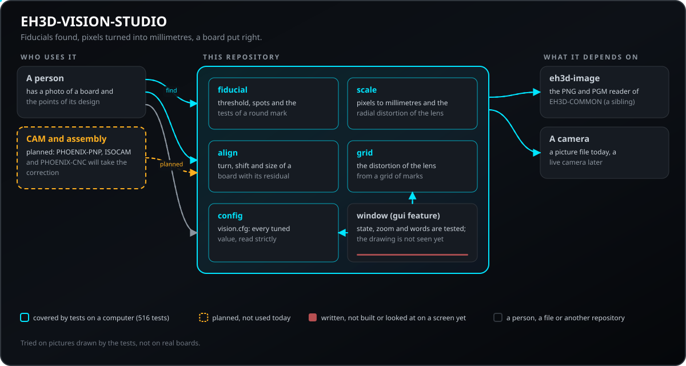

<p align="center">
  
</p>

#  EH3D-VISION-STUDIO
<p align="center"><a href="README.md">🇺🇸 English</a> | 🇪🇸 <b>Español</b> | <a href="README_fra.md">🇫🇷 Français</a> | <a href="README_ita.md">🇮🇹 Italiano</a> | <a href="README_deu.md">🇩🇪 Deutsch</a> | <a href="README_zho.md">🇨🇳 中文</a> | <a href="README_jpn.md">🇯🇵 日本語</a> | <a href="README_por.md">🇵🇹 Português</a></p>

### Fiduciales en una imagen de cámara: marcas, escala y corrección de una placa

<p align="center">
  
  
  
  
  
</p>

---

**Comprobación de honestidad - lo que funciona hoy:** una biblioteca Rust y un programa de línea de comandos (`eh3d-vision`) con 284 pruebas que se ejecutan en un ordenador: encuentra marcas fiduciales redondas en una imagen, convierte píxeles en milímetros y calcula el giro y el desplazamiento que colocan una placa donde dice su diseño. Tiene una ventana (se compila con `--features gui`, el programa `eh3d-vision-gui`) que abre una imagen, muestra las marcas con sus coordenadas, fija la escala, ajusta la distorsión del objetivo con una rejilla, alinea con el diseño y exporta las opciones de ISOCAM, pero todavía no se ha visto en una pantalla; no se ha probado en una máquina y no se ha comprobado con una colección de ficheros reales.

---

> **Estado de seguridad:** este programa no controla ninguna máquina y no es un sistema de seguridad. Lo que produce debe revisarlo una persona antes de ejecutar nada en una máquina; nada de esto se ha ejecutado en hardware real.


## 📋 De un vistazo

| | |
|---|---|
| Versión | `0.0.7` |
| Madurez | Funcional |
| Pruebas | 284 |
| Pila tecnológica | Rust |
| En hardware real | No probado: nada de esto se ha ejecutado en una máquina |

**Ir a:** [Resumen](#-resumen) · [Arquitectura](#-arquitectura) · [Inicio rápido](#-inicio-rápido) · [Pruebas](#-pruebas) · [Estructura](#-estructura-del-repositorio) · [Relacionados](#-proyectos-relacionados)

## 🚦 Estado del proyecto

Cada línea es una parte de este repositorio y la luz dice hasta dónde llega hoy. Se escribe con lo que el repositorio puede demostrar (pruebas, compilaciones, ejecuciones), no con lo previsto.

🟢 Hecho y verificado · 🟡 Funciona, con límites conocidos · 🟠 Hecho a medias o sin verificar · 🔴 Sin hacer o sin funcionar

| Área | Estado | Qué significa aquí |
|---|---|---|
| Núcleo | 🟡 | encuentra marcas fiduciales redondas en una imagen, convierte píxeles en milímetros y calcula el giro y el desplazamiento que colocan una placa donde dice su diseño; probado en un ordenador con entradas normales y dañadas, no con una colección de ficheros reales. |
| Línea de comandos | 🟡 | `eh3d-vision` ejecuta las mismas funciones que la biblioteca e imprime el resultado; cada error vuelve como mensaje y un código de salida distinto de cero. |
| Pruebas | 🟡 | 284 pruebas pasan (`cargo test`), con casos normales, casos límite y entradas dañadas, y una cámara simulada sobre una placa que añade ruido, mala exposición, un fotograma muerto o ausente, polvo que parece una marca o un archivo de imagen cortado, y se vuelve a pedir. |
| Seguridad | 🟡 | Rust seguro y simple (`forbid(unsafe_code)`): nada entra en pánico con los ficheros recibidos y un valor malo es un error con su motivo; sin revisión independiente. |
| Ventana | 🟠 | Escrita (egui, `--features gui`, el programa `eh3d-vision-gui`): abrir o soltar una imagen, ver las marcas con sus coordenadas, fijar la escala con una marca de tamaño conocido, ajustar la distorsión del objetivo con una rejilla, alinear con un diseño CSV y exportar las opciones de ISOCAM; su lógica está probada, pero todavía no se ha compilado ni visto en una pantalla. |
| Hardware real | 🔴 | No probado: nada de esto se ha ejecutado en una máquina. |
| Documentación | 🟡 | README en ocho idiomas, el registro de cambios y las dos imágenes dibujadas desde `docs/`. |

## 🎯 Resumen

* **Las marcas** (`src/fiducial.rs`): la imagen se parte en oscuro y claro con el umbral de Otsu, se miden las manchas conectadas y las que son discos del tamaño esperado (el área, lo que llenan del círculo que las contiene y lo alargadas que son) son las marcas, las mejores primero; una mancha cortada por el borde de la imagen se deja fuera porque no se puede fiar de su centro, y las marcas pueden ser oscuras sobre claro o claras sobre oscuro.
* **La escala y la lente** (`src/scale.rs`): los milímetros de un píxel salen de una marca de tamaño conocido, los ejes de la máquina suben mientras la imagen baja, y la distorsión radial de la lente se recupera por mínimos cuadrados desde una rejilla de marcas y se corrige.
* **La placa** (`src/align.rs`): con dos o más fiduciales del diseño y los mismos tal como los halló la cámara, se calculan por mínimos cuadrados el giro, el desplazamiento y (si se permite) el tamaño, con el residuo en milímetros; una transformación con residuo demasiado grande (una marca equivocada) o con el tamaño desviado (una placa estirada) no se acepta.

## 🧩 Papel en EH3D

EH3D-VISION-STUDIO es un programa de la EH3D Fabrication Suite. Funciona como biblioteca y línea de comandos y, compilado con `--features gui`, como ventana con el aspecto que comparten los demás programas de la suite. Lee y escribe ficheros simples, así que puede usarse solo o entre los demás programas.

## 🏛️ Arquitectura

<p align="center">
  
</p>


Cómo encajan las partes de este repositorio: quién lo usa, qué contiene y de qué depende. La imagen se dibuja desde `docs/architecture.json` y se comprueba con el código.

## ✨ Funciones

* **Biblioteca y línea de comandos:** cada orden de `eh3d-vision` es una función de la biblioteca, así que otro programa de la suite puede llamarla sin lanzar un proceso.
* **Línea de comandos estricta:** una opción mal escrita (`--powr`) o una palabra de más es un error que la nombra, no algo que se ignora; si no, el programa haría su salida con los valores por defecto.
* **Pruebas con entradas dañadas:** las pruebas también dan ficheros vacíos, basura, números enormes y ficheros cortados, y ninguna puede provocar un pánico.
* **Sin adivinar:** un valor que no tiene sentido es un error que dice cuál y por qué, nunca un resultado que solo lo parece.
* **Límite de tamaño de los ficheros que lee:** la línea de comandos lee una imagen o un fichero de puntos solo si no pesa más que `max_file_mib` de `vision.cfg` (64 MiB por defecto); un fichero mayor se rechaza con el código `file_too_large` y su nombre, uno que no se puede leer con `file_unreadable` y un fichero de puntos que no es texto con `file_not_text`, y no se carga nada.
* **Sin código unsafe:** `#![forbid(unsafe_code)]` en la biblioteca y el programa.
* **Las marcas para ISOCAM:** `align --isocam-args` escribe cada par de marcas como la opción `--fiducial X_DISEÑO,Y_DISEÑO,X_MEDIDA,Y_MEDIDA` de `eh3d-isocam`.
* **Una ventana:** se compila con `--features gui` como el programa `eh3d-vision-gui` (en Windows se abre sin consola): abre una imagen PNG o PGM con zoom y desplazamiento, encuentra las marcas con valores que se pueden editar, las dibuja con sus coordenadas, fija la escala con una marca de tamaño conocido, ajusta la distorsión del objetivo con una rejilla de marcas, alinea con un diseño de un fichero CSV (las marcas se emparejan con él por su posición, así que el orden no importa) y exporta las opciones `--fiducial` de ISOCAM solo cuando la alineación se acepta. Habla los ocho idiomas y no necesita red.
* **Un fichero de configuración:** `vision.cfg` guarda cada valor que se afina (cómo es una marca, la rejilla del patrón, los límites de una alineación aceptada, el mayor fichero que se lee); un error en él se rechaza con su línea y `examples/vision.cfg` los enumera todos.
* **El centro con fracción de píxel y una confianza:** `find --refine` (o `refine_subpixel` en `vision.cfg`) pondera los píxeles grises del borde de cada marca, así que su centro se halla con una fracción de píxel, y escribe una confianza que baja cuando la marca apenas destaca de la placa.
* **Luz desigual:** `--flatten PX` (o `flatten_window`) divide la imagen por la luz que rodea a cada píxel antes de la búsqueda, de modo que una lámpara que se apaga por un lado de la placa o una sombra no escondan las marcas del lado oscuro.
* **Marcas en forma de cruz:** `eh3d-vision crosses IMAGEN` halla signos más con los brazos a lo largo de los ejes de la imagen (caja cuadrada, dos brazos del mismo ancho, esquinas vacías); los discos y los cuadrados se descartan y `--turned` halla cruces con cualquier giro (véase abajo).
* **La escala desde el paso de un patrón:** `eh3d-vision calibrate IMAGEN --pitch-mm D` toma la mediana de la distancia entre marcas vecinas de una rejilla, rechaza un patrón que no se ve de frente y escribe la línea `mm_per_px = ...` para `vision.cfg`.
* **Piezas para otros programas, en ficheros simples:** `eh3d-vision measure IMAGEN --mm-per-px V` da de cada pieza el centro (mm desde el centro de la imagen, x a la derecha, y arriba), el giro (de -90 sin incluir a 90 grados), el largo, el ancho y el área, en CSV (`index,x_mm,y_mm,angle_deg,length_mm,width_mm,area_mm2`) o en JSON (`--format json`: `format` `eh3d-vision-parts`, `version` 1, `unit`, `image_width_px`, `image_height_px`, `mm_per_px`, `parts`); no se comparte nada más con el programa que los lee. `--output FICHERO` nunca escribe sobre un fichero sin `--replace`, ni sobre un enlace.
* **Una carpeta de una vez:** `eh3d-vision batch CARPETA --report FICHERO.csv` lee cada imagen PNG y PGM dentro del límite de tamaño (como mucho `batch_max_files`) y escribe una línea por imagen (`file,status,marks,mean_score,min_score,mean_diameter_px,detail`) con el estado `ok`, `no_marks`, `picture_unreadable` o el código del rechazo; un nombre de fichero que una hoja de cálculo ejecutaría como fórmula se escribe con una comilla delante.
* **Cuadrados y cruces con cualquier giro:** `eh3d-vision squares IMAGEN` halla marcas cuadradas giradas cualquier ángulo (centro, lado y el ángulo antihorario como lo ve la máquina, de -45 sin incluir a 45 grados) y `eh3d-vision crosses IMAGEN --turned` halla cruces cuyos brazos no van por los ejes; el relleno mínimo de un cuadrado y la puntuación mínima de una cruz (`square_min_fill`, `cross_min_score`) están en `vision.cfg`.
* **Marcas en anillo de un tamaño o de dos:** `eh3d-vision rings IMAGEN` halla marcas redondas con un agujero (donuts): cada una trae su centro, su diámetro exterior e interior, la puntuación de su forma, una confianza (la puntuación rebajada cuando el anillo destaca poco del fondo, `full_contrast`) y, cuando los anillos son de dos tamaños, si es pequeño o grande (`--split PX` o `ring_split` da el diámetro que los separa; si no, se halla donde los diámetros caen en dos grupos con un hueco de al menos `ring_size_gap`). Se descartan un disco, un anillo con un hueco, un anillo cortado por el borde, uno que no es redondo y uno cuyo agujero es demasiado pequeño o grande (`ring_min_ratio`, `ring_max_ratio`). La ventana tiene una sección para ellos que dibuja el círculo exterior y el interior con un color para cada tamaño.
* **Dónde se sostiene una pieza recogida:** `eh3d-vision offset IMAGEN --package NOMBRE` toma una imagen de una pieza vista desde abajo (una sola pieza), la mide como `measure`, compara su tamaño con el cuerpo de su paquete como `inspect` y da su desplazamiento respecto al eje de la boquilla (`--nozzle-x`, `--nozzle-y` o `nozzle_x_mm`, `nozzle_y_mm`, milímetros desde el centro de la imagen, x a la derecha e y hacia arriba), su giro respecto a como debería sostenerse (`--nominal-angle`; una pieza tan larga como ancha se gira por el camino corto dentro de un cuarto de vuelta, cualquier otra dentro de media vuelta) y la corrección que la deja donde la boquilla la querría: las mismas distancias y giro al revés. CSV o JSON, sin escribir nunca sobre un fichero sin `--replace`; el código de salida es 1 cuando la pieza tiene mal el tamaño, se sostiene más lejos de `--max-offset` (`pick_max_offset_mm`) o gira más de `--max-turn` (`pick_max_turn_deg`), una vez escrito el fichero, y se rechaza una imagen sin pieza o con más de una (`no_parts`, `parts_count`). Es geometría sobre una imagen: no se usó cámara, boquilla ni máquina.
* **La lente con dos factores, rechazada si no encaja:** `eh3d-vision lens IMAGEN` calcula `k1` y `k2` de la distorsión radial desde una rejilla de marcas y escribe las líneas `lens_k1 = ...` y `lens_k2 = ...` para `vision.cfg`; rechaza un ajuste que deja las marcas a más de `lens_max_rms` píxeles de su retícula (`lens_residual_too_large`) o un factor mayor que 0,5 (`lens_out_of_range`), y `find --undistort` endereza las posiciones con ellos.
* **Un veredicto para cada pieza:** `eh3d-vision inspect IMAGEN --package NOMBRE --table packages.csv` mide las piezas de una imagen y compara cada una con el cuerpo de su encapsulado (`package`, `body_long_mm`, `body_short_mm` y, si se quiere, `tolerance_mm`, en un fichero CSV; `examples/packages.csv` trae algunos): `pass` o `fail` con el motivo (`length`, `width`, `angle`) en CSV o JSON, y el código de salida 1 cuando una pieza falla; la tolerancia y el giro máximo (`inspect_tolerance`, `inspect_max_angle`) están en `vision.cfg`.
* **Un informe HTML de la carpeta:** `eh3d-vision batch CARPETA --html informe.html` escribe una página que se basta sola (sin scripts, sin enlaces, sin otros ficheros): una tabla de las imágenes, un dibujo pequeño de cada una con un círculo en cada marca hallada y los avisos (una imagen que no se pudo usar, sin marcas o con una puntuación por debajo de `report_low_score`), en el idioma de `--lang` o de `vision.cfg`.
* **Las herramientas nuevas en la ventana:** el panel lateral trae el centro con fracción de píxel con la confianza de cada marca, la ventana de la luz, cuadrados y cruces con cualquier giro (dibujados sobre la imagen), las piezas en milímetros (guardadas como `<imagen>-parts.csv`), el informe de la carpeta, leído en un hilo con barra de progreso y botón de cancelar (`eh3d-vision-report.html`, que nunca se escribe sobre un fichero sin `replace_output`) y la escala desde el paso de un patrón, con los textos en los ocho idiomas y los valores en `vision.cfg`; todavía no se ha visto en una pantalla.
* **El objetivo en la ventana, con los dos factores:** el botón de la rejilla ajusta `k1` y `k2` como hace `eh3d-vision lens` (se rechaza por encima de `lens_max_rms`, un campo del panel), la ventana dibuja los lugares donde el objetivo ajustado pone la retícula de la rejilla, para compararlos con las marcas encontradas (`show_lens_grid`), toma los factores de `lens_k1` y `lens_k2` de `vision.cfg` sin rejilla y los guarda como `<imagen>-lens.cfg`.
* **Piezas frente a su paquete e imágenes de una pieza grande, en la ventana:** el panel lateral lee la tabla de paquetes (`package_table`), juzga las piezas medidas frente al paquete `inspect_package` (línea verde o roja por pieza, con el motivo del fallo; `inspect_tolerance` e `inspect_max_angle` son campos del panel) y guarda los veredictos como `<imagen>-inspection.csv`, el fichero de `eh3d-vision inspect`; y planifica las imágenes que necesita una pieza mayor que el campo (el campo es la imagen en milímetros, la pieza es `shots_part_width` por `shots_part_height` o el cuerpo del paquete, con `shots_overlap` y `shots_margin`), lista adónde va la cámara y guarda `<imagen>-shots.csv`, el fichero de `eh3d-vision shots`. La línea de comandos toma las mismas dos claves nuevas cuando no se da `--package` ni el tamaño de la pieza.
* **Las imágenes de una pieza grande, planificadas:** `eh3d-vision shots --package NOMBRE --fov-w MM --fov-h MM` (o `--body-long` y `--body-short`) lista en CSV los lugares de la cámara, en milímetros desde el centro de la pieza, que ven toda una pieza mayor que el campo, con las imágenes vecinas solapadas en `shots_overlap` y un margen de `shots_margin`; no necesita cámara.

## 🔒 Seguridad y protección

| Amenaza | Defensa |
|---|---|
| Un fichero dañado, cortado o vacío | sin pánico: las pruebas cortan una entrada válida en cada posición y dan basura |
| Un número sin sentido (negativo, no finito, absurdamente grande) | se rechaza con un error que nombra el valor; nada se redondea hasta parecer plausible |
| Un informe o fichero de medidas que escribiría sobre otro fichero | solo se escribe donde no hay ninguno; para escribir sobre uno hace falta `--replace`, y nunca se escribe a través de un enlace |
| Uso inseguro de memoria | Rust seguro y simple con `forbid(unsafe_code)` |

**Lo que no se defiende:** un resultado producido sin errores no es un resultado verificado. Nada de esto conoce los límites de una máquina y el programa no ha tenido revisión independiente. Informe de una vulnerabilidad en privado (véase [SECURITY.md](SECURITY.md)).

## 🔌 Interfaces

La biblioteca es `eh3d_vision_studio` (`use eh3d_vision_studio::...`); la línea de comandos es `eh3d-vision`. Las órdenes son estas; cada una imprime su resultado por la salida estándar e informa de un error por la salida de errores con un código de salida distinto de cero. No hay acceso a la red.

```text
eh3d-vision find IMAGE [--light] [--min-diam PX] [--max-diam PX] [--known-mm D] [--refine] [--undistort] [--flatten PX]   the round marks found (--known-mm gives millimetres, --refine the centre to a fraction of a pixel with a confidence, --undistort straightens the places with lens_k1 and lens_k2 of vision.cfg, --flatten takes uneven light out first)
eh3d-vision align DESIGN.csv MEASURED.csv [--scale] [--pair-nearest] [--isocam-args] [--max-rms 0.1] [--max-stretch 0.01]
eh3d-vision crosses IMAGE [--turned] [--light] [--min-size PX] [--max-size PX] [--flatten PX]   the cross-shaped marks found (plus signs; with --turned the arms may have any angle and the angle is printed)
eh3d-vision inspect IMAGE --package NAME [--table FILE] [--mm-per-px V] [--tolerance MM] [--max-angle DEG] [--light] [--flatten PX] [--format csv|json] [--output FILE] [--replace]   each part of a picture compared with the body of its package from a table (CSV with package, body_long_mm, body_short_mm), one verdict per part; exit 1 when a part fails
eh3d-vision shots (--package NAME [--table FILE] | --body-long MM --body-short MM) --fov-w MM --fov-h MM [--overlap F] [--margin MM] [--output FILE] [--replace]   the places of the camera that cover a part bigger than its field (millimetres from the centre of the part), row after row, as CSV; no camera is needed
eh3d-vision lens IMAGE [--columns C] [--rows R] [--max-rms PX] [--light] [--flatten PX]   the two radial factors of the lens from a grid of marks (columns and rows as grid_columns and grid_rows), refused when the marks stay farther than --max-rms pixels from their lattice
eh3d-vision squares IMAGE [--light] [--min-size PX] [--max-size PX] [--flatten PX]   the square marks found, turned by any angle (centre, side and angle)
eh3d-vision rings IMAGE [--light] [--min-size PX] [--max-size PX] [--split PX] [--flatten PX]   the ring marks found (donuts: a round mark with a hole), with the outer and inner diameter, the size class when the rings are of two sizes (--split gives the diameter that tells small from large, else it is found from the diameters), the score of the shape and a confidence
eh3d-vision offset IMAGE --package NAME [--table FILE] [--mm-per-px V] [--nozzle-x MM] [--nozzle-y MM] [--nominal-angle DEG] [--tolerance MM] [--max-offset MM] [--max-turn DEG] [--light] [--flatten PX] [--format csv|json] [--output FILE] [--replace]   where a picked part is held, from a picture of it taken from below (one part in it): its offset from the axis of the nozzle and its turn from the way it should be held, the correction that puts it right, its size against the body of the package; exit 1 when it is the wrong size, too far off or turned too much
eh3d-vision calibrate IMAGE --pitch-mm D [--light] [--tolerance 0.05] [--flatten PX]   the millimetres of a pixel from a target whose neighbouring marks are D millimetres apart
eh3d-vision measure IMAGE [--mm-per-px V] [--light] [--flatten PX] [--format csv|json] [--output FILE] [--replace]   the parts of a picture: centre, turn, length, width and area in millimetres, as a CSV or JSON file
eh3d-vision batch FOLDER [--light] [--flatten PX] [--report FILE.csv] [--html FILE.html] [--lang CODE] [--replace]   every PNG and PGM picture of a folder: marks, scores and diameters, or the code of what went wrong, one line each; --html writes a page that stands alone, with a drawing of each picture and the warnings, in the language of --lang or of vision.cfg
eh3d-vision-gui [IMAGE] [DESIGN.csv]   the window (a build with --features gui); on Windows it opens with no console
```

## ⚙️ Configuración

Los valores que se afinan viven en un fichero simple de `clave = valor`, no en el código: `vision.cfg` en la carpeta donde arranca el programa o junto a él (la variable `EH3D_VISION_CONFIG` nombra otro fichero). Fija el idioma de la ventana, si las marcas son oscuras o claras, el umbral, el rango del diámetro, el relleno y la elongación de una marca, el tamaño de la marca que fija la escala, las columnas y filas de la rejilla, si la alineación puede cambiar el tamaño, los límites que debe cumplir una alineación y el mayor fichero que se lee. `examples/vision.cfg` enumera cada clave con su significado y el valor con el que arranca el programa; si falta el fichero se usan esos valores y un fichero con un error se rechaza con su línea. En la línea de comandos lo mismo se da como opciones (véase Interfaces). También guarda los demás valores afinados: la confianza (`refine_subpixel`, `full_contrast`), la ventana de la luz (`flatten_window`), la escala y el tamaño de una pieza (`mm_per_px`, `part_min_area`, `part_max_area`, `max_parts`), el rango de una cruz (`cross_min_size`, `cross_max_size`, `cross_max_elongation`), la tolerancia de un patrón (`pitch_tolerance`) y el máximo de imágenes de una carpeta (`batch_max_files`). El relleno mínimo de un cuadrado y la puntuación mínima de una cruz con cualquier giro son `square_min_fill` y `cross_min_score`. El rango del lado de un cuadrado y cuánto más largo que ancho puede ser su caja son `square_min_size`, `square_max_size` y `square_max_elongation`, aparte de los de la cruz. La lente son `lens_k1` y `lens_k2` (como los calcula `lens`) y lo máximo que una rejilla puede separarse de su retícula tras la corrección es `lens_max_rms`. La tabla de encapsulados que lee `inspect` es `package_table`, y lo máximo que una pieza puede diferir de su encapsulado y girarse son `inspect_tolerance` e `inspect_max_angle`. La puntuación por debajo de la cual el informe HTML avisa de una imagen es `report_low_score`. La distancia entre las marcas del patrón que fija la escala es `pitch_mm`, y `replace_output` dice si los ficheros que se escriben pueden escribirse sobre uno que ya existe (no por defecto). El solapamiento de las imágenes vecinas de un plan de `shots` y el margen alrededor de la pieza son `shots_overlap` y `shots_margin`. Si la ventana dibuja la retícula del objetivo es `show_lens_grid`. El paquete frente al que `inspect` y la ventana juzgan las piezas es `inspect_package`, y el tamaño de la pieza para la que `shots` y la ventana planifican las imágenes es `shots_part_width` y `shots_part_height` (0 y 0: el cuerpo del paquete). Las marcas en anillo tienen el rango de su diámetro exterior (`ring_min_diameter`, `ring_max_diameter`), de la relación del diámetro interior al exterior (`ring_min_ratio`, `ring_max_ratio`), el relleno mínimo de su banda (`ring_min_fill`), la elongación (`ring_max_elongation`), el diámetro que separa los dos tamaños (`ring_split`, 0 para hallarlo) y el hueco entre los tamaños (`ring_size_gap`). El eje de la boquilla en la imagen de una pieza recogida es `nozzle_x_mm` y `nozzle_y_mm`, y lo más lejos que puede sostenerse y lo más que puede girar son `pick_max_offset_mm` y `pick_max_turn_deg` (0: no se comprueba).

## 🚀 Inicio rápido

Necesita una cadena de herramientas Rust estable (1.88 o más reciente). El repositorio EH3D-COMMON debe estar clonado junto a este: el lector de imágenes se toma de él por ruta.

```bash
cargo build --release
cargo test
cargo run --release -- align examples/design.csv examples/measured.csv
cargo run --release --features gui --bin eh3d-vision-gui   # the window
cargo run --release --features gui --bin eh3d-vision-gui -- --shot screen.png --open examples/marks.pgm --open examples/design.csv   # a picture of the window
```

Para sacar una captura de la ventana sin abrirla a mano, ejecútelo con `--shot FICHERO.png` (también `--size WxH`, `--theme forge|dark|light`, `--wait N`, `--lang CODE`, `--open FILE`, `--replace`, `--mark N`, `--align`): se abre con ese tamaño, guarda el PNG, no guarda ajustes y se cierra solo (código de salida 0 si se escribió el fichero, 1 si no, 2 si los argumentos están mal). Con `--mark N` la marca número N (desde 1) fija la escala y con `--align` el diseño se alinea con las marcas, de modo que la captura muestra las líneas de la alineación: desde el lugar donde el diseño pone cada marca hasta la marca encontrada, con la distancia en milímetros (`show_residuals` en `vision.cfg` las desactiva). `examples/design_pair.csv` es un diseño para las dos marcas de `examples/marks.pgm`.

## 🧪 Pruebas

El conjunto tiene 284 pruebas (`cargo test`, ejecutadas en Windows y Linux en el CI). Comprueban los casos normales, los casos límite y las entradas dañadas: ficheros vacíos, basura y ficheros cortados nunca provocan un pánico. El CI ejecuta además `cargo fmt --check`, `cargo clippy` con las advertencias como errores y `python -I tools/ci_validate.py`.

## 🏗️ Compilación y publicación

La versión está en `Cargo.toml` y en `eh3d.project.json`; cada versión tiene su entrada en [CHANGELOG.md](CHANGELOG.md). `build.bat` / `build.sh` compilan el programa, `test.bat` / `test.sh` ejecutan las pruebas y `run.bat` / `run.sh` lo ejecutan con un ejemplo. Las versiones se publican en GitHub.

### Descargas

Cada versión trae el programa con su ventana para Windows (64 y 32 bits), Linux (64 bits) y macOS (Apple silicon e Intel), como `<nombre>-<versión>-<sistema>.zip` (Windows) o `.tar.gz` con el programa, la licencia, el léame, el icono y los ejemplos. Los ficheros los construye GitHub Actions, van en `SHA284SUMS` y están firmados con la clave de EH3D. Para comprobar una descarga, compara su hash con el fichero `.sha284` que la acompaña (`sha284sum -c`) y comprueba su firma con el fichero `.sig` que la acompaña (`ssh-keygen -Y verify`).

## 📂 Estructura del repositorio

<p align="center">
  
</p>

<details>
<summary>Versión en texto del árbol</summary>

```text
EH3D-VISION-STUDIO/
├── src/
│   ├── lib.rs                                   la biblioteca: lo que usa cada orden
│   ├── main.rs                                  la línea de comandos
│   ├── gui_main.rs                              la ventana como programa propio (característica gui)
│   ├── cli_args.rs                              los argumentos de la línea de comandos, el mismo fichero en cada utilidad pequeña
│   ├── align.rs                                 el giro, desplazamiento y tamaño de una placa y su emparejado con el diseño
│   ├── batch.rs                                 una carpeta de imágenes de una vez, con un informe CSV
│   ├── config.rs                                el fichero de configuración: cada valor afinado
│   ├── cross.rs                                 marcas fiduciales en forma de cruz
│   ├── fiducial.rs                              las marcas redondas de una imagen: umbral, manchas y comprobaciones
│   ├── flatten.rs                               la luz desigual quitada de una imagen
│   ├── grid.rs                                  la distorsión del objetivo a partir de una rejilla de marcas
│   ├── inspect.rs                               cada pieza comparada con el cuerpo de su encapsulado desde una tabla, con veredicto
│   ├── job.rs                                   el informe de una carpeta leído en un hilo, con progreso y cancelación
│   ├── lens.rs                                  los dos factores de la lente desde una rejilla de marcas, rechazados si no encajan
│   ├── points.rs                                los ficheros de puntos de un diseño
│   ├── report.rs                                el informe de una carpeta como una página HTML autónoma, en ocho idiomas
│   ├── ring.rs                                  las marcas en anillo: redondas con un agujero, de uno o dos tamaños, con confianza
│   ├── limit.rs                                 lectura de un fichero con límite de tamaño y un código para cada rechazo
│   ├── measure.rs                               piezas medidas en milímetros, ficheros CSV y JSON
│   ├── offset.rs                                dónde se sostiene una pieza recogida, con la corrección que la deja bien
│   ├── panels.rs                                los paneles de la ventana: objetivo, piezas frente a paquetes y plan de imágenes
│   ├── scale.rs                                 de píxeles a milímetros y la distorsión radial del objetivo
│   ├── square.rs                                marcas cuadradas y cruces girados con cualquier ángulo
│   ├── tools.rs                                 las herramientas del panel lateral sobre la imagen: formas, piezas, informe y paso
│   ├── shot.rs                                  el modo de captura de la ventana (--shot): sus argumentos, leídos y comprobados sin pantalla
│   ├── shots.rs                                 los lugares de la cámara que cubren una pieza mayor que su campo, solo con los tamaños
│   ├── browse.rs                                la lista de ficheros de la ventana que abre un fichero
│   ├── gui.rs                                   la ventana (egui, con la característica gui): dibuja el estado y transmite lo que hace la persona
│   ├── lang.rs                                  las palabras de la ventana en los ocho idiomas
│   ├── viewport.rs                              zoom y desplazamiento de la imagen, en números simples
│   └── window.rs                                el estado de la ventana sin pantalla: imagen, marcas, escala, objetivo y alineación
├── tests/
│   ├── readme.rs                                pruebas que ejecutan lo que prometen el README y los scripts run
│   ├── strict.rs                                pruebas de la línea de comandos: opciones y palabras que no conoce
│   ├── read_limit.rs                            pruebas del límite de tamaño de los ficheros que lee la línea de comandos
│   ├── exchange.rs                              pruebas de las órdenes que leen una imagen y escriben un fichero
│   ├── shot_sample.rs                           pruebas de que las muestras se abren en la ventana de una captura
│   └── vision.rs                                pruebas de la biblioteca y la línea de comandos
├── examples/
│   ├── design.csv                               una muestra para probar el programa
│   ├── design_pair.csv                          un diseño para las dos marcas de marks.pgm
│   ├── marks.pgm                                una muestra para probar el programa
│   ├── measured.csv                             una muestra para probar el programa
│   ├── packages.csv                             una tabla de cuerpos de encapsulados para inspect
│   └── vision.cfg                               el fichero de configuración con cada valor y su significado
├── docs/
│   ├── architecture.json                        datos de la imagen de Arquitectura
│   └── structure.json                           datos de la imagen de Estructura
├── tools/                                       comprobación del CI y del README y herramientas de imágenes
├── images/                                      banner y las imágenes de Arquitectura y Estructura del repositorio
├── .github/                                     flujos de CI y de publicación, plantillas de issues y pull requests
├── eh3d.project.json                            manifiesto: versión, rol, madurez y comando de compilación
├── Cargo.toml Cargo.lock                        el workspace y sus dependencias fijadas
├── rust-toolchain.toml                          la toolchain de Rust fijada
├── CHANGELOG.md                                 qué cambió en cada versión
├── SECURITY.md SUPPORT.md                       cómo informar de una vulnerabilidad y dónde preguntar
└── CONTRIBUTING.md CODE_OF_CONDUCT.md LICENSE   cómo contribuir, el código de conducta y la licencia
```

</details>

## 🗺️ Hoja de ruta y límites conocidos

**Límites conocidos hoy**

* La ventana todavía no se ha visto en una pantalla; las marcas se emparejan con el diseño por su posición, así que una placa muy girada o una marca que falta se rechaza en lugar de adivinarse.
* No se ha probado en una máquina ni con una colección de ficheros reales y no ha tenido revisión independiente.
* Lee un fichero de imagen, no una cámara en vivo, solo encuentra marcas redondas, cuadradas y en forma de cruz y se ha probado con imágenes dibujadas por las pruebas, no con fotografías de placas reales. El giro de una pieza se mide con sus píxeles como el de un rectángulo, así que una pieza que no es un rectángulo recibe el giro de su eje largo.

**Siguiente**

* Leer la cámara en vivo de la máquina (EH3D-NODE-BUNGARD-AUX), probar fotografías de placas reales y añadir a la ventana el entrenamiento de marcas nuevas.
* Ver la ventana en una pantalla y terminarla.
* Probarlo con ficheros reales y con los demás programas de la suite.

## 🌍 Idiomas

El README y los textos existen en inglés, español, francés, italiano, alemán, chino, japonés y portugués de Portugal.

## 🔗 Proyectos relacionados

* [EH3D-COMMON](https://github.com/JuanenRac/EH3D-COMMON): los crates compartidos, entre ellos el lector de imágenes
* [EH3D-PHOENIX-PNP](https://github.com/JuanenRac/EH3D-PHOENIX-PNP): el montaje pick and place
* [EH3D-ISOCAM](https://github.com/JuanenRac/EH3D-ISOCAM): el fresado de aislamiento del cobre
* [EH3D-PHOENIX-CNC](https://github.com/JuanenRac/EH3D-PHOENIX-CNC): el programa de control de máquina
* [EH3D-NODE-BUNGARD-AUX](https://github.com/JuanenRac/EH3D-NODE-BUNGARD-AUX): el nodo del cabezal de taladrado con la cámara
* [EH3D-SUITE-LAUNCHER](https://github.com/JuanenRac/EH3D-SUITE-LAUNCHER): el centro que encuentra y arranca los programas de la suite

## 📚 Documentación

* [Registro de cambios](CHANGELOG.md)
* [Datos de arquitectura y estructura](docs/architecture.json): los datos con los que se dibujan las dos imágenes.

## 🤝 Contribuir y comunidad

* Antes de una pull request ejecute `cargo fmt --check`, `cargo clippy --all-targets -- -D warnings`, `cargo test` y `python -I tools/ci_validate.py`: todo debe pasar. Véanse [CONTRIBUTING.md](CONTRIBUTING.md) y el [código de conducta](CODE_OF_CONDUCT.md).
* El README existe en ocho idiomas: un cambio de texto se hace en los ocho ficheros, y las dos imágenes se dibujan desde `docs/architecture.json` y `docs/structure.json` con `tools/make_architecture.py` y `tools/make_structure.py`.
* Informe de una vulnerabilidad en privado: [SECURITY.md](SECURITY.md). Preguntas, ideas e informes: electrohobby3d@gmail.com ([SUPPORT.md](SUPPORT.md)).

## 👤 AUTOR

**JuanenRac (Electro Hobby 3D)** · electrohobby3d@gmail.com

## 📜 LICENCIA

Software: GPL-3.0-or-later. Véase [LICENSE](LICENSE). Los diseños de hardware de la suite usan CERN OHL-S.
