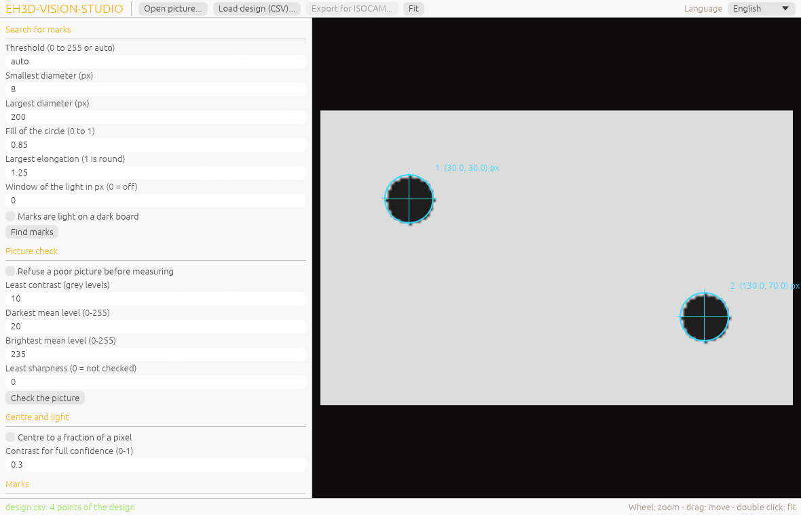

<p align="center">
  
</p>

#  EH3D-VISION-STUDIO
<p align="center"><a href="README.md">🇺🇸 English</a> | <a href="README_spa.md">🇪🇸 Español</a> | <a href="README_fra.md">🇫🇷 Français</a> | <a href="README_ita.md">🇮🇹 Italiano</a> | <a href="README_deu.md">🇩🇪 Deutsch</a> | 🇨🇳 <b>中文</b> | <a href="README_jpn.md">🇯🇵 日本語</a> | <a href="README_por.md">🇵🇹 Português</a></p>

### 摄像头图像中的基准点：标记、比例和电路板修正

<p align="center">
  
  
  
  
  
</p>

---

**诚实检查 - 当前真正能运行的内容：** 一个 Rust 库和一个命令行程序（`eh3d-vision`），有 774 个在电脑上运行的测试：在图像中找到圆形基准点，把像素转换为毫米，并计算使电路板回到设计位置所需的旋转和平移。有一个窗口（用 `--features gui` 构建，程序为 `eh3d-vision-gui`），可打开图像、显示带坐标的标记、设定比例、用网格拟合镜头畸变、与设计对齐并导出 ISOCAM 选项，但窗口尚未在屏幕上看过；没有在机器上试过，也没有用大量真实文件验证过。

---

> **安全状态：** 本程序不控制任何机器，也不是安全系统。它的输出在机器上运行之前必须由人检查；这里的任何内容都没有在真实硬件上运行过。


## 📋 速览

| | |
|---|---|
| 版本 | `0.1.2` |
| 成熟度 | 可用 |
| 测试 | 774 |
| 技术栈 | Rust |
| 真实硬件 | 未试过：这里的任何内容都没有在机器上运行过 |

**跳转到：** [概述](#-概述) · [架构](#-架构) · [快速开始](#-快速开始) · [测试](#-测试) · [结构](#-仓库结构) · [相关项目](#-相关项目)

## 🚦 项目状态

每一行是本仓库的一个部分，灯号表示它今天做到了哪一步。内容依据仓库能够展示的证据（测试、构建、运行），而不是计划。

🟢 已完成并验证 · 🟡 可用，有已知限制 · 🟠 部分完成或尚未验证 · 🔴 未完成或不可用

| 领域 | 状态 | 在这里的含义 |
|---|---|---|
| 核心 | 🟡 | 在图像中找到圆形基准点，把像素转换为毫米，并计算使电路板回到设计位置所需的旋转和平移；已在电脑上用正常和损坏的输入测试，未用大量真实文件验证。 |
| 命令行 | 🟡 | `eh3d-vision` 运行与库相同的函数并打印结果；每个错误都以消息和非零退出码返回。 |
| 测试 | 🟡 | 774 个测试通过（`cargo test`），包含正常情况、边界情况和损坏的输入，以及位于电路板上方的模拟相机：它会加入噪声、曝光错误、失效或缺失的画面、看起来像标记的灰尘或被截断的图像文件，并会被再次请求。 |
| 安全 | 🟡 | 纯安全 Rust（`forbid(unsafe_code)`；只有用各自特性构建的相机后端有一小段 unsafe）：处理收到的文件时不会 panic，错误的值会返回带原因的错误；没有独立审查。 |
| 窗口 | 🟠 | 已编写（egui，`--features gui`，程序 `eh3d-vision-gui`）：打开或拖入图像，查看带坐标的标记，用已知大小的标记设定比例，用网格拟合镜头畸变，与 CSV 设计对齐并导出 ISOCAM 选项；其逻辑已测试，但尚未构建，也未在屏幕上看过。 |
| 实时相机 | 🟠 | 相机层、标定板和电路板对位已编写，并在模拟相机和模拟工作台上测试；Windows、V4L2 和 libcamera 的后端只是骨架，没有在真实的相机、镜头或电路板上运行过。 |
| 真实硬件 | 🔴 | 未试过：这里的任何内容都没有在机器上运行过。 |
| 文档 | 🟡 | 八种语言的 README、更新日志，以及由 `docs/` 绘制的两张图。 |

## 🎯 概述

* **标记**（`src/fiducial.rs`）：用大津阈值把图像分为暗和亮，测量相连的斑点，符合预期大小的圆盘（面积、对外接圆的填充率和细长程度）即为标记，最好的排在前面；被图像边缘截断的斑点因中心不可信而被排除，标记可以是浅底深色或深底浅色。
* **比例与镜头**（`src/scale.rs`）：每个像素的毫米数来自已知大小的标记，机器的轴向上而图像向下，镜头的径向畸变用最小二乘法从标记网格中求出并校正。
* **电路板**（`src/align.rs`）：根据设计中的两个或更多基准点和摄像头找到的对应点，用最小二乘法求出旋转、平移和（若允许）尺寸，并给出以毫米为单位的残差；残差过大（认错了标记）或尺寸偏差（电路板被拉伸）的变换不被接受。

## 🧩 在 EH3D 中的角色

EH3D-VISION-STUDIO 是 EH3D Fabrication Suite 的一个程序。它以库和命令行的形式工作，用 `--features gui` 构建时还是一个与套件其他程序外观一致的窗口。它读写简单的文件，因此可以单独使用，也可以用在其他程序之间。

## 🏛️ 架构

<p align="center">
  
</p>


本仓库各部分如何配合：谁使用它、它包含什么、它依赖什么。图由 `docs/architecture.json` 绘制并与代码核对。

## 🖼️ 屏幕截图

<p align="center">
  
</p>

<p align="center"><em>载入示例图像和示例设计的窗口：找到的两个标记，各自带有中心和编号，左侧是搜索的设置。</em></p>

## ✨ 功能

* **库加命令行：** `eh3d-vision` 的每个命令都是库中的函数，套件中的其他程序无需启动进程即可调用。
* **严格的命令行：** 写错的选项（`--powr`）或多余的词会产生指明它的错误，而不是被忽略；否则程序会用默认值生成输出。
* **损坏输入的测试：** 测试还会输入空文件、乱码、巨大数字和被截断的文件，任何情况都不允许 panic。
* **不猜测：** 没有意义的值是一个说明哪个值、为什么的错误，绝不是只是看起来正确的结果。
* **读取文件的大小上限：** 命令行只在图片或点文件不超过 `vision.cfg` 中的 `max_file_mib`（默认 64 MiB）时才读取；更大的文件以代码 `file_too_large` 和文件名拒绝，无法读取的以 `file_unreadable` 拒绝，不是文本的点文件以 `file_not_text` 拒绝，且不加载任何内容。
* **默认构建没有 unsafe 代码：** 库和程序中都有 `#![forbid(unsafe_code)]`；只有实时相机的后端在用各自的特性构建时才有一小段 unsafe（几次调用，结构体大小在构建时检查）。
* **给 ISOCAM 用的标记：** `align --isocam-args` 把每一对标记打印成 `eh3d-isocam` 的选项 `--fiducial 设计X,设计Y,测量X,测量Y`。
* **窗口：** 用 `--features gui` 构建为程序 `eh3d-vision-gui`（在 Windows 上不带控制台窗口打开）：打开 PNG 或 PGM 图像，支持缩放和平移，用可编辑的数值查找标记，带坐标绘制，用已知大小的标记设定比例，用标记网格拟合镜头畸变，与 CSV 文件中的设计对齐（标记按位置与其配对，所以顺序无关），仅在对齐通过时才导出 ISOCAM 的 `--fiducial` 选项。支持八种语言，无需网络。
* **配置文件：** `vision.cfg` 保存每个调校过的数值（标记的样子、靶标的网格、可接受对齐的限度、读取的最大文件）；其中的错误会连同行号被拒绝，`examples/vision.cfg` 列出了全部。
* **亚像素级中心与置信度：** `find --refine`（或 `vision.cfg` 中的 `refine_subpixel`）对每个标记边缘的灰色像素加权，使中心精确到像素的几分之一，并输出置信度；标记与电路板几乎没有反差时置信度会降低。
* **不均匀光照：** `--flatten PX`（或 `flatten_window`）在搜索前用每个像素周围的亮度去除图像，这样板子一侧渐暗的灯光或阴影就不会遮住暗侧的标记。
* **十字形标记：** `eh3d-vision crosses 图像` 查找臂沿图像坐标轴的加号（方形外框、两条等宽的臂、四角为空）；圆盘和正方形会被排除，加上 `--turned` 则可查找任意角度的十字（见下）。
* **由靶标间距得到比例：** `eh3d-vision calibrate 图像 --pitch-mm D` 取网格中相邻标记距离的中位数，拒绝不是正对拍摄的靶标，并输出可写入 `vision.cfg` 的 `mm_per_px = ...` 行。
* **给其他程序的零件，使用简单文件：** `eh3d-vision measure 图像 --mm-per-px V` 给出每个零件的中心（相对图像中心的毫米数，x 向右，y 向上）、角度（-90 不含到 90 度）、长度、宽度和面积，格式为 CSV（`index,x_mm,y_mm,angle_deg,length_mm,width_mm,area_mm2`）或 JSON（`--format json`：`format` 为 `eh3d-vision-parts`，`version` 为 1，另有 `unit`、`image_width_px`、`image_height_px`、`mm_per_px`、`parts`）；与读取它们的程序不共享其他任何东西。没有 `--replace` 时，`--output 文件` 绝不会覆盖已有文件，也不会写入链接。
* **一次处理整个文件夹：** `eh3d-vision batch 文件夹 --report 文件.csv` 在大小限制内（最多 `batch_max_files` 张）读取每张 PNG 和 PGM 图片，每张写一行（`file,status,marks,mean_score,min_score,mean_diameter_px,detail`），状态为 `ok`、`no_marks`、`picture_unreadable` 或拒绝代码；电子表格会当作公式执行的文件名，前面会加上一个引号。
* **任意角度的方形与十字：** `eh3d-vision squares 图像` 查找旋转任意角度的方形标记（中心、边长，以及机器所见的逆时针角度，从 -45 不含到 45 度），`eh3d-vision crosses 图像 --turned` 查找臂不沿坐标轴的十字；方形的最小填充率和十字的最低得分（`square_min_fill`、`cross_min_score`）写在 `vision.cfg` 中。
* **一种或两种尺寸的圆环标记：** `eh3d-vision rings 图像` 找出带孔的圆形标记（圆环）：每个标记给出中心、外径和内径、形状得分、置信度（圆环与底色反差小时降低的得分，`full_contrast`），圆环有两种尺寸时还说明是小还是大（`--split PX` 或 `ring_split` 给出区分它们的直径，否则取在直径分成间隔至少为 `ring_size_gap` 的两组之处）。圆盘、有缺口的圆环、被边缘截断的圆环、不圆的以及孔太小或太大的（`ring_min_ratio`、`ring_max_ratio`）都会被排除。窗口里有对应的一节，按尺寸用不同颜色画出外圆和内圆。
* **被拾取零件的持放位置：** `eh3d-vision offset 图像 --package 名称` 取一张从下方拍摄的零件图像（其中只有一个零件），像 `measure` 一样测量它，像 `inspect` 一样把尺寸与封装本体比较，并给出它相对吸嘴轴线的偏移（`--nozzle-x`、`--nozzle-y` 或 `nozzle_x_mm`、`nozzle_y_mm`，以毫米计，自图像中心起，x 向右、y 向上）、相对应有持放方向的旋转（`--nominal-angle`；长宽相等的零件在四分之一圈内取最短方向，其他零件在半圈内取最短方向），以及把它放到吸嘴所要位置的修正量：相同的距离和相反的旋转。输出 CSV 或 JSON，没有 `--replace` 不会覆盖文件；零件尺寸不对、持放得比 `--max-offset`（`pick_max_offset_mm`）更远或旋转超过 `--max-turn`（`pick_max_turn_deg`）时，写完文件后退出码为 1；没有零件或不止一个零件的图像会被拒绝（`no_parts`、`parts_count`）。这只是图像上的几何：没有用到相机、吸嘴或机器。
* **托盘修正表及其窗口面板：** `eh3d-vision offset 图像 --package 名称 --each` 逐个处理图像中的每个零件（一个托盘），写出一张表，先是列 `part`（零件编号，从 1 起），然后是 `offset` 的各列，每个零件一行；任何零件不合格时退出码为 1。窗口里有同样功能的面板（`nozzle_x_mm`、`nozzle_y_mm`、`nominal_angle_deg`、`pick_max_offset_mm`、`pick_max_turn_deg`）：为打开的图像计算该表，用窗口语言列出每个零件的修正量，并保存为 `<图像>-offsets.csv`。`nominal_angle_deg` 是零件被正确吸取时的旋转角，也可写在 `vision.cfg` 中。
* **镜像相机与吸嘴轴线：** `--mirror`（`pick_mirror`）用于把零件左右翻转着看的相机：每个零件的 x 和旋转角符号取反。`eh3d-vision nozzle 图像 图像... --package 名称` 读取用同一吸嘴拾取的零件图像（每张一个零件，至少两张），写出供 `vision.cfg` 使用的 `nozzle_x_mm` 和 `nozzle_y_mm` 两行，即零件的平均位置（与测量时所用的轴线无关）；在错误输出中给出零件的离散程度（x 和 y 的标准差、最远的零件和平均旋转角）。
* **图像是否足以用于测量：** `eh3d-vision quality 图像` 以 CSV 或 JSON 给出图像的清晰度（拉普拉斯方差）、对比度（灰度标准差）和平均灰度，并将其拒绝为 `flat`、`dark`、`bright`，或在 `--min-sharpness` 大于 0 时拒绝为 `blurry`（写出文件后退出码为 1）；下限为 `--min-contrast`、`--min-mean`、`--max-mean` 和 `--min-sharpness`，或 `vision.cfg` 中的键。设置 `quality_check = yes` 后，`offset`、`nozzle` 和窗口会在从图像测量零件之前拒绝质量差的图像（`poor_picture`），窗口还有一个检查图像并显示其数值的面板。这些数值取决于相机和镜头，因此放在配置文件中，清晰度检查默认关闭；以上均未用真实相机试过。
* **两个系数的镜头，不合适则拒绝：** `eh3d-vision lens 图像` 从标记网格求出径向畸变的 `k1` 和 `k2`，并输出供 `vision.cfg` 使用的 `lens_k1 = ...` 和 `lens_k2 = ...` 两行；若拟合后标记仍离其晶格超过 `lens_max_rms` 像素（`lens_residual_too_large`）或某个系数超过 0.5（`lens_out_of_range`）则拒绝，`find --undistort` 用它们校正位置。
* **对每个零件给出判定：** `eh3d-vision inspect 图像 --package 名称 --table packages.csv` 测量图像中的零件，并把每个零件与其封装的本体尺寸比较（CSV 文件中的 `package`、`body_long_mm`、`body_short_mm`，需要时加 `tolerance_mm`；`examples/packages.csv` 里有一些）：以 CSV 或 JSON 给出 `pass` 或 `fail` 及原因（`length`、`width`、`angle`），有零件不合格时退出码为 1；公差和最大旋转角（`inspect_tolerance`、`inspect_max_angle`）写在 `vision.cfg` 中。
* **文件夹的 HTML 报告：** `eh3d-vision batch 文件夹 --html report.html` 写出一个自包含的页面（没有脚本、没有链接、没有其他文件）：图像表格、每张图像的小图（每个找到的标记画一个圆圈）和警告（无法使用的图像、没有标记的图像或得分低于 `report_low_score` 的图像），语言由 `--lang` 或 `vision.cfg` 决定。
* **窗口中的新工具：** 侧边栏新增了带每个标记置信度的亚像素中心、光照窗口、任意角度的方形与十字（画在图像上）、以毫米计的零件（保存为 `<图像>-parts.csv`）、文件夹报告（在独立线程中读取，带进度条和取消按钮；`eh3d-vision-report.html`，没有 `replace_output` 就不会覆盖已有文件）以及由标靶间距得到的比例，文字有八种语言，数值在 `vision.cfg` 中；尚未在屏幕上看过。
* **窗口中的镜头（两个系数）：** 网格按钮像 `eh3d-vision lens` 一样拟合 `k1` 和 `k2`（超过面板中的 `lens_max_rms` 就拒绝）；窗口画出拟合后的镜头把网格点阵放到的位置，便于与找到的标记比较（`show_lens_grid`），可以不用网格而取 `vision.cfg` 中的 `lens_k1` 和 `lens_k2`，也可以保存为 `<图像>-lens.cfg`。
* **窗口中的零件与封装比对，以及大型零件的拍摄：** 侧边栏读取封装表（`package_table`），把测得的零件与封装 `inspect_package` 比对（每个零件一行，绿色或红色，并说明不合格原因；`inspect_tolerance` 和 `inspect_max_angle` 是面板中的字段），并把判定保存为 `<图像>-inspection.csv`，即 `eh3d-vision inspect` 的文件；还能为大于视野的零件规划所需拍摄（视野是以毫米计的图像，零件是 `shots_part_width` 乘 `shots_part_height` 或封装本体，另有 `shots_overlap` 和 `shots_margin`），列出相机的去处并保存为 `<图像>-shots.csv`，即 `eh3d-vision shots` 的文件。未给出 `--package` 或零件尺寸时，命令行使用同样的两个新键。
* **大型零件的拍摄规划：** `eh3d-vision shots --package 名称 --fov-w MM --fov-h MM`（或 `--body-long` 与 `--body-short`）以 CSV 列出相机位置（相对零件中心的毫米数），使超过视场的零件完全可见；相邻图像重叠 `shots_overlap`，并留有 `shots_margin` 的边距；不需要相机。
* **相关法找标记：** `eh3d-vision correlate 图像 --diameter PX` 把该直径的圆盘滑过图像，在每个位置计算归一化相关（光线变亮或对比度变低都不改变它），因此阈值在光照不均时丢失的标记也能找到；位置精确到像素的小数并附带得分，最好的在前，没有哪个离更好的标记近于一个直径。它需要直径（`correlate_diameter`、`correlate_min_score`），并且比阈值搜索慢，所以耗时过长的图像会被拒绝（`correlate_too_big`）。
* **透视校正：** `eh3d-vision rectify 图像 --corners X1,Y1,...,X4,Y4 --output 文件.pgm` 根据图像中一个矩形的四个角，把图像重绘为从正上方看到的样子（带双线性采样的单应变换）；不构成凸四边形的角点会被拒绝（`bad_corners`），最大边长为 `rectify_max_side`。
* **一排焊盘：** `eh3d-vision pads 图像 --mm-per-px V` 把图像中的零件当作焊盘，给出间距（沿最佳拟合直线的距离中位数）、间距的变化、焊盘偏离排线的程度及平均尺寸，格式为 CSV 或 JSON；按 `pads_tolerance` 判定，不合格时为 `fail`，原因为 `pitch`、`row`、`expected`（`--expect-pitch`），退出码为 1。
* **前后对比：** `eh3d-vision diff 之前 之后` 比较两张同样大小的图像：灰度相差超过 `diff_threshold` 的像素、其占比、平均差和最大差、包围它们的框，以及不少于 `diff_min_area` 像素的区域；`--mask 文件.pgm` 写出变化图，变化超过 `diff_max_changed` 时退出码为 1。
* **零件的朝向：** `eh3d-vision orientation 图像 --mm-per-px V` 找出零件（与电路板不同的部分）和其上的标记（二极管的色环、1 脚的圆点：零件内部与本体不同的部分，即使它看起来像电路板），并给出从零件中心到标记的方向（自 x 轴起逆时针的度数，y 向上）、最近的四分之一圈及与它的偏差，加上 `--expect-deg` 时还给出与期望方向的偏差。零件会被拒绝（写完文件后退出码为 1），原因为 `no_mark`、`centred`、`mark_big`、`wrong_way`，未指定期望方向时为 `skewed`。
* **焊盘的封装尺寸：** `eh3d-vision footprint 图像 --pad-length MM --pad-width MM` 测量每个焊盘，并按毫米容差（`--tolerance`、`footprint_tolerance_mm`）将每个焊盘单独与设计比较：每个焊盘一行，从最上一排向下、从左到右，给出差值以及原因 `length` 和 `width`；`--count` 还检查焊盘数量（`count`），有焊盘超差时退出码为 1。
* **图像哪里清晰的分布图：** `eh3d-vision sharpmap 图像 --cells N` 把图像切成网格，给出每个格子的清晰度（拉普拉斯方差）、中位数、最弱的格子、清晰度沿 x 和沿 y 的倾斜以及较弱的格子（低于中位数的 `--min-share`）；几乎没有对比度的格子为 `empty`，不作判断。`--heat 文件.pgm` 写出分布图（模糊处较暗），有较弱格子时退出码为 1（`uneven`）。
* **由方块棋盘得到比例并出具报告：** `eh3d-vision board 图像 --pitch-mm D --square-mm S` 找出方块，求出棋盘的旋转以及沿各轴相邻方块的距离，给出沿 x、沿 y 和由边长得到的每像素毫米数，以及像素有多方（`aspect`）和距离相差多少（`spread`）；`--report 文件.txt` 写出给人看的说明，并带有用于 `vision.cfg` 的行 `mm_per_px = ...`。像素不是方的（`aspect`）、距离相差过大（`spread`）或边长与间距不符（`disagree`）时被拒绝（退出码 1）。
* **窗口里再加四个面板：** 侧边栏有相关法搜索（找到的标记列出位置和得分）、用找到的四个标记校正图像（保存为 `<图像>-rectified.pgm`）、根据测得的零件判定焊盘排（保存为 `<图像>-pads.csv`）以及把打开的图像与另一张比较（保存为 `<图像>-diff.csv` 和 `<图像>-changes.pgm`）；其数值是面板的字段（`correlate_diameter`、`correlate_min_score`、`rectify_max_side`、`pads_tolerance`、`diff_threshold`、`diff_min_area`、`diff_max_changed`），文字有八种语言。其逻辑已测试；窗口尚未在屏幕上看过。
* **机器的服务器：** `eh3d-vision server health|config|discover|check|detect|send` 通过套件的共享客户端（EH3D-COMMON 的 `eh3d-serverclient`）使用与套件其他程序相同的键（`server_address`、`server_token`、`server_machine`、`server_timeout_s`、`server_retries`、`server_mdns`）：`config` 读取服务器为该机器保存的 `vision.cfg` 的值（格式为 `text/x-eh3d-vision-config` 的最新制品 `vision-<machine>.cfg`，写成文件的行或 JSON 对象；要么全部接受，要么都不接受；连接相关的键绝不从服务器获取），并写成可用于文件的行；`send quality|offset|pads|diff|orientation|footprint|sharpmap|board` 把该命令的 JSON 结果作为制品 `vision-<kind>.json` 保存在服务器上（`POST /api/v1/artifacts`，机器和类型在其参数中）。重试和连接状态沿用共享客户端（可能已送达的请求绝不会发送两次），服务器的拒绝可按其代码用八种语言说明，令牌从不打印，并且会警告将经明文 HTTP 发往非本地地址的令牌。服务器有 `vision` 插件，所以结果也可按它的约定保存（见下面的条目）；测试对象是内存中的服务器（`server::SimServer`）和回环地址上的套接字，而不是真实服务器。
* **服务器约定格式的结果：** `eh3d-vision server send fiducials|focus|blobs 图像` 把结果保存为 EH3D-SERVER 的 `vision` 插件与通过摄像头观察的程序共用的形式：格式为 `application/json`、模式为 `eh3d.vision.result/1` 的文件 `vision-<种类>.json`，包含图像的尺寸和 SHA-256、该种类的发现（`fiducials` `{x, y, radius_px, score}`、`focus` `{score, sharp}`、`blobs` `{x, y, area_px}`；`barcode` 只检查不生成，因为这里没有读码功能）、单位（`px`）和证据（默认为 `picture`，除非 `--evidence camera|simulator` 另有指定：程序无法知道文件是否来自摄像头）。`server check 文件.json` 说明某个文档是否符合约定并指出不符的部分；不符合约定的文档在发送前就会被拒绝。对焦检查的得分在清晰度等于 `focus_reference` 时为 50。
* **服务器的模拟工位：** `eh3d-vision server detect fiducials|barcode|focus|blobs 图像 [--seed N] [--artifact]` 向服务器的 `vision` 插件（`POST /api/v1/work/jobs`，启动并读取直到结束）索取它根据图像的尺寸、哈希和种子编造的结果，每次都相同（`evidence: simulator`），放在作业的视图中或保存为制品。`station::simulate` 是内存中的服务器所用插件的移植，所以作业、结果和制品的整条链路在这里无需网络即可测试；尚未对真实服务器运行过。
* **在网络中查找服务器，作为真正的开关：** `eh3d-vision server discover` 列出本地网络中响应 `_eh3d._tcp` 的服务器的 `主机:端口`。`server_mdns` 关闭（默认）时它什么也不做，程序必须用 `--features mdns` 构建（发布版就是）才有共享客户端的解析器。找到的只是供人选择的候选项，绝不自动连接，因为网络中的任何设备都可以应答。
* **由一个示例训练的标记、旋转很大的电路板和安全的服务器列表：** `eh3d-vision train 图像 --rect X,Y,W,H --output 文件` 把围绕一个标记裁剪的矩形的平均值保存为标记文件（除非用 `--replace`，否则绝不写入已存在的文件），`eh3d-vision locate --mark 文件 图像` 通过相关性再次找到它，需要时逐步旋转，给出位置、角度和得分（`vision.cfg` 的 `train_*` 键）；`eh3d-vision pair 设计.csv 测得.csv --any-turn` 无论电路板旋转多少，也无论缺少或多出标记，都把标记与设计配对，并拒绝两种方式解释得同样好的情况（`pair_*` 键）；`discovery` 把网络上的应答变成少量格式正确的本地候选（`find_server_*` 键），`server discover` 和窗口只列出这些候选。命令用 `vision.cfg` 或 `--lang` 的语言回答，用 `--json` 给出 JSON，并以退出码 0（完成）、1（无法执行）或 2（已执行，但检查未通过：示例不一致、与邻居无法区分的标记、找不到标记、无法配对的标记）结束。所有这些都用绘制的图像和绘制它们的真值来试验；“看、移动、再看”的循环仍按位置配对，窗口还不能训练标记。
* **运动 JPEG 帧读取器、可打印的圆点卡片、图像的光照和料带的孔：** `eh3d-vision jpeg 帧` 在 `mjpeg_max_bytes` 和 `mjpeg_max_pixels` 的限制内把基线 JPEG 帧读到亮度；被截断的帧、出现在不可能位置的标记、不可能的表或数十亿像素的尺寸，都会以不变的代码拒绝（`jpeg_truncated`、`jpeg_bad_marker`、`jpeg_bad_table`、`jpeg_bad_size`、`jpeg_unsupported`、`jpeg_bad_data`），绝不会崩溃；`eh3d-vision calib-card` 以毫米为单位画出按 100 % 打印的圆点卡片，每次都相同，放不进页面则被拒绝（`card_*` 键）；`eh3d-vision light-check 图像` 说明图像的光照是否良好（平均值、过曝比例、分区、倾斜；`light_*` 键）以及不好的原因，不好时退出码为 2；`eh3d-vision tape-locate 图像` 找出元件料带的孔、与料带间距的比较和料穴（`tape_*` 键）。所有这些都用固定种子绘制的图像和帧来试验：没有使用相机，没有打印卡片，也没有拍摄料带。
* **亚像素边缘及其不确定度：** `eh3d-vision edge 图像 --from X,Y --to X,Y` 沿着横跨边缘的一条线读取图像（双线性，间隔 `edge_step_px`），把线的两端当作两侧的平坦区域，找出轮廓穿过两者中间电平的位置，给出沿线的位置和图像中的位置、对比度、过渡宽度和不确定度（一个标准差：平坦区域的噪声加上 8 位舍入，再除以穿越处的斜率）。不确定度高于 `edge_max_uncertainty_px` 时退出码为 1；没有边缘的线是 `edge_flat`。比一个像素更锐利的边缘可能偏移最多 0.05 px。
* **直方图与自动阈值：** `eh3d-vision histogram 图像 --bins N` 把灰度级分成 8 到 256 组，并给出 Otsu（标记搜索所用）、isodata 和三角形法的分割点、Otsu 两组解释的方差比例、黑色与白色像素的比例，以及三个分割点是否一致（相差在 8 级以内）；不一致时，应检查照明或 `vision.cfg` 中的 `threshold`。
* **通过容差掩码与参考图像比较：** `eh3d-vision refcheck 参考 图像 --tolerance 掩码.pgm` 比较两张同样大小的图像，允许的差异可以因位置而异：掩码像素为 0 时沿用通用的 `diff_threshold`，1 到 254 表示多允许那么多灰度级，255 表示不检查。它给出超出容差的像素、超出多少、分成多少个区域（`diff_min_area`）以及位置；`--map 文件.pgm` 把它们写成图像，超过 `diff_max_changed` 时退出码为 1。
* **镜头残差，逐个标记：** `eh3d-vision lens 图像 --residuals` 为网格的每个标记写出校正前后它偏离应有位置的距离、偏离最远的标记、离中心距离的三个区带，以及外带与内带之比：比值远大于 1 说明两个径向项不足以描述该镜头（或靶标不平）。
* **窗口中的更多功能：** 侧面板有服务器设置（来自 `eh3d-view` 的套件通用面板：地址、令牌、机器、重试、网络搜索开关、登录与会话）、角落里的连接状态、服务器搜索（仅在开关打开时，在线程中进行，给出可选候选项）、带三个分割点的直方图、由四个数字确定的线上的边缘、带容差掩码的参考比较，以及面板标题下折叠的帮助行（八种语言）。窗口尚未在屏幕上看过。
* **固定种子的测试：** `tests/fuzz.rs` 用一个不读取时钟的生成器输入任意大小的图像、任意位置的角点、任意大小的焊盘、任意位置的方块，以及损坏的配置文件、JSON、Base64 和 HTTP 应答；任何情况下都不能崩溃，输出必须合理，窗口的面板同样会处理随机图像。 `tests/fuzz_camera.rs` 对任意图像任意直线上的边缘、直方图、通过任意掩码与参考图像的比较、任意标记的残差，以及被截断、被改动或塞满乱码的约定文档做同样的事。
* **trait 之后的实时相机，仅在模拟相机上试过（`src/capture/`）：** 相机按名称和不变的键（`vendor:product:serial@port`）列出，以某种格式（YUYV、运动 JPEG、RGB、灰度）打开，给出带计数器和原始字节的画面；13 个属性各有范围，没有的属性相机会明说。程序会发现 USB 总线的负载（`capture_usb_mbps`）、黑色、重复、丢失和被截断的画面以及灯光闪烁，按张数而不是按秒等待新画面，日志交给一个函数。模拟相机会故意出故障；Windows、V4L2 和 libcamera 的后端只是骨架，放在特性 `mfoundation`、`v4l2` 和 `libcamera` 之后（默认关闭），没有在真实相机上运行过；运动 JPEG 画面会被检查，但还不能解码。
* **带编号标记的标定板（`src/charuco/`）：** `eh3d-vision charuco card` 画出白格里带标记的棋盘，以毫米为单位，按 100 % 打印；`eh3d-vision charuco calibrate IMAGE` 读取标记，在任意旋转下把角点找到亚像素精度，并用三种方式（单应、仿射、相似）拟合像素到毫米的映射。角点残差过大（`calib_max_residual_px`）、各方法给出的角点位置相差过大（`calib_max_method_gap`）或与用尺量出的一行两端外侧角点间距离不符（`calib_check_mm`）时会被拒绝；没有量过距离时，除非 `calib_allow_unchecked` 允许，否则不使用。唯一的偏移是 `camera_offset_x_mm`、`camera_offset_y_mm` 和 `camera_offset_deg`，用模拟画面做的标定不能用于真实相机。
* **看、动、再看，把电路板放回位置（`src/boardaim.rs`）：** 从不变的位姿观察基准点，算出旋转和平移，让工作台把板子往反方向移动（每次不超过 `align_max_step_mm` 和 `align_max_step_deg`，总共不超过 `align_max_total_mm`）；等到移动之后拍的画面再看一次，直到板子落在 `align_tolerance_mm` 和 `align_tolerance_deg` 之内。出问题时只会朝最安全的状态走（整步、半步、保持、中止）：误差变大就把步长减半，再变大就停下，找不到标记、画面发黑或重复、达到限制或工作台出错都会停止移动。只在模拟工作台上运行过。

## 🔒 安全与防护

| 威胁 | 防御 |
|---|---|
| 损坏、被截断或为空的文件 | 不会 panic：测试在每个位置截断有效输入并输入乱码 |
| 没有意义的数字（负数、非有限值、过大的数） | 以指出该值的错误拒绝；不会被舍入成看似合理的值 |
| 会覆盖其他文件的报告或测量文件 | 只在没有文件的位置写入；覆盖需要 `--replace`，并且绝不会通过链接写入 |
| 不安全的内存使用 | 带 `forbid(unsafe_code)` 的纯安全 Rust；只有用各自特性构建的相机后端有一小段 unsafe |
| 令牌在不该出现的地方被显示或发送 | 令牌从不被打印，也不会写入结果；服务器发来的值要么全部接受要么都不接受，连接相关的键（`server_*`）绝不从服务器获取；会警告将经明文 HTTP 发往非本地地址的令牌 |

**没有防御的内容：** 无错误产生的结果不等于经过验证的结果。这里没有任何内容了解机器的极限，程序也没有经过独立审查。请私下报告漏洞（见 [SECURITY.md](SECURITY.md)）。

## 🔌 接口

库为 `eh3d_vision_studio`（`use eh3d_vision_studio::...`），命令行为 `eh3d-vision`。命令如下；每个命令把结果打印到标准输出，把错误以非零退出码报告到标准错误。只有 `server` 命令使用网络（通过明文 HTTP 连接 `vision.cfg` 中指定的机器的服务器）；其他命令都只处理本地文件。

```text
eh3d-vision find IMAGE [--light] [--min-diam PX] [--max-diam PX] [--known-mm D] [--refine] [--undistort] [--flatten PX]   the round marks found (--known-mm gives millimetres, --refine the centre to a fraction of a pixel with a confidence, --undistort straightens the places with lens_k1 and lens_k2 of vision.cfg, --flatten takes uneven light out first)
eh3d-vision align DESIGN.csv MEASURED.csv [--scale] [--pair-nearest] [--isocam-args] [--max-rms 0.1] [--max-stretch 0.01]
eh3d-vision crosses IMAGE [--turned] [--light] [--min-size PX] [--max-size PX] [--flatten PX]   the cross-shaped marks found (plus signs; with --turned the arms may have any angle and the angle is printed)
eh3d-vision inspect IMAGE --package NAME [--table FILE] [--mm-per-px V] [--tolerance MM] [--max-angle DEG] [--light] [--flatten PX] [--format csv|json] [--output FILE] [--replace]   each part of a picture compared with the body of its package from a table (CSV with package, body_long_mm, body_short_mm), one verdict per part; exit 1 when a part fails
eh3d-vision shots (--package NAME [--table FILE] | --body-long MM --body-short MM) --fov-w MM --fov-h MM [--overlap F] [--margin MM] [--output FILE] [--replace]   the places of the camera that cover a part bigger than its field (millimetres from the centre of the part), row after row, as CSV; no camera is needed
eh3d-vision lens IMAGE [--columns C] [--rows R] [--max-rms PX] [--light] [--flatten PX] [--residuals] [--format csv|json] [--output FILE] [--replace]   the two radial factors of the lens from a grid of marks (columns and rows as grid_columns and grid_rows), refused when the marks stay farther than --max-rms pixels from their lattice; --residuals writes, mark by mark, how far each lies from its place before and after the correction, the farthest mark, three bands of distance from the centre and the ratio of the outer band to the inner one (a ratio well above 1: two radial terms are not enough)
eh3d-vision squares IMAGE [--light] [--min-size PX] [--max-size PX] [--flatten PX]   the square marks found, turned by any angle (centre, side and angle)
eh3d-vision rings IMAGE [--light] [--min-size PX] [--max-size PX] [--split PX] [--flatten PX]   the ring marks found (donuts: a round mark with a hole), with the outer and inner diameter, the size class when the rings are of two sizes (--split gives the diameter that tells small from large, else it is found from the diameters), the score of the shape and a confidence
eh3d-vision offset IMAGE --package NAME [--table FILE] [--mm-per-px V] [--nozzle-x MM] [--nozzle-y MM] [--nominal-angle DEG] [--tolerance MM] [--max-offset MM] [--max-turn DEG] [--mirror] [--each] [--light] [--flatten PX] [--format csv|json] [--output FILE] [--replace]   where a picked part is held, from a picture of it taken from below (one part in it): its offset from the axis of the nozzle and its turn from the way it should be held, the correction that puts it right, its size against the body of the package; --mirror when the camera sees the part turned over left to right; --each takes every part of the picture (a tray) and writes a table of corrections, one row for each; exit 1 when a part is the wrong size, too far off or turned too much
eh3d-vision nozzle IMAGE IMAGE... --package NAME [--table FILE] [--mm-per-px V] [--mirror] [--light] [--flatten PX] [--output FILE] [--replace]   where the axis of the nozzle is, from pictures of parts picked with it (one part in each, at least two pictures): the lines nozzle_x_mm and nozzle_y_mm for vision.cfg, with how spread the parts are
eh3d-vision quality IMAGE [--min-contrast V] [--min-mean V] [--max-mean V] [--min-sharpness V] [--format csv|json] [--output FILE] [--replace]   whether a picture is good enough to measure from: its sharpness, contrast and mean grey level, and why it is refused (flat, dark, bright or blurry); exit 1 when it is refused
eh3d-vision calibrate IMAGE --pitch-mm D [--light] [--tolerance 0.05] [--flatten PX]   the millimetres of a pixel from a target whose neighbouring marks are D millimetres apart
eh3d-vision measure IMAGE [--mm-per-px V] [--light] [--flatten PX] [--format csv|json] [--output FILE] [--replace]   the parts of a picture: centre, turn, length, width and area in millimetres, as a CSV or JSON file
eh3d-vision batch FOLDER [--light] [--flatten PX] [--report FILE.csv] [--html FILE.html] [--lang CODE] [--replace]   every PNG and PGM picture of a folder: marks, scores and diameters, or the code of what went wrong, one line each; --html writes a page that stands alone, with a drawing of each picture and the warnings, in the language of --lang or of vision.cfg
eh3d-vision correlate IMAGE [--diameter PX] [--min-score S] [--light] [--flatten PX]   the round marks found by sliding a disc of that diameter over the picture and working out the correlation at every place (a mark that the search by threshold loses on uneven light), with the place to a fraction of a pixel and the score
eh3d-vision rectify IMAGE --corners X1,Y1,X2,Y2,X3,Y3,X4,Y4 --output FILE.pgm [--size WxH] [--fill V] [--replace]   the picture drawn again as seen from straight above, from the four corners of a rectangle in it (top left, top right, bottom right, bottom left, in pixels)
eh3d-vision pads IMAGE [--mm-per-px V] [--expect-pitch MM] [--tolerance F] [--light] [--flatten PX] [--format csv|json] [--output FILE] [--replace]   a row of pads: the pitch, how much it varies, how far the pads lie from the row and their size; exit 1 when the pitch varies, a pad is off the row or the pitch is not the one asked for
eh3d-vision diff BEFORE AFTER [--threshold V] [--min-area PX] [--max-changed F] [--mask FILE.pgm] [--format csv|json] [--output FILE] [--replace]   two pictures of the same size compared: how many pixels changed, how much, where and in how many regions; exit 1 when more than --max-changed of the pixels changed
eh3d-vision orientation IMAGE [--expect-deg D] [--tolerance DEG] [--body-contrast V] [--mark-contrast V] [--min-mark-px N] [--mm-per-px V] [--format csv|json] [--output FILE] [--replace]   which way a part with a mark on it (the band of a diode, the dot of pin 1) is held: the direction from the middle of the part to the mark, the quarter of a turn it is nearest to and how far from it, and how far from the wanted direction; exit 1 when there is no mark, it is in the middle, or it points off the wanted direction (or off a quarter of a turn when none is asked for)
eh3d-vision footprint IMAGE --pad-length MM --pad-width MM [--tolerance MM] [--count N] [--mm-per-px V] [--light] [--flatten PX] [--format csv|json] [--output FILE] [--replace]   each pad of a picture judged on its own against the size of the design, with a tolerance in millimetres: one line per pad with the differences; exit 1 when a pad is off or the count is not the one asked for
eh3d-vision sharpmap IMAGE [--cells N] [--min-share F] [--heat FILE.pgm] [--format csv|json] [--output FILE] [--replace]   a map of where the picture is sharp: a grid of cells with the sharpness of each, the weak ones, the tilt along x and y and (with --heat) a picture of the map; exit 1 when a cell is much less sharp than the median
eh3d-vision board IMAGE [--square-mm D] [--pitch-mm D] [--max-aspect F] [--max-spread F] [--light] [--flatten PX] [--format csv|json] [--output FILE] [--report FILE.txt] [--replace]   the millimetres of a pixel from a board of squares (D is the side or the distance between centres), along x, along y and from the side, with a report; exit 1 when the pixels are not square, the distances between neighbours differ or the side and the pitch do not agree
eh3d-vision edge IMAGE --from X,Y --to X,Y [--step PX] [--max-uncertainty PX] [--flatten PX] [--format csv|json] [--output FILE] [--replace]   where an edge is, to a fraction of a pixel, along a line laid across it (from a point on one side to a point on the other, both inside the picture), with the uncertainty of the position (one standard deviation, from the noise of the two flat grounds and the slope of the edge), the contrast and the width of the transition; exit 1 when the uncertainty is above the limit
eh3d-vision histogram IMAGE [--bins N] [--flatten PX] [--format csv|json] [--output FILE] [--replace]   the histogram of the grey levels in 8 to 256 groups and the thresholds that Otsu, isodata and the triangle method pick, how much of the variance two groups explain and whether the three agree (the value for `threshold` of vision.cfg when the automatic one is not good)
eh3d-vision refcheck REFERENCE PICTURE [--tolerance MASK.pgm] [--threshold V] [--min-area PX] [--max-changed F] [--map FILE.pgm] [--format csv|json] [--output FILE] [--replace]   a picture compared with a reference of the same size through a mask of tolerance (a mask pixel at 0 keeps the general threshold, 1 to 254 allows that many levels more, 255 is not looked at): the pixels outside the tolerance, how much they pass it, in how many regions and where; --map writes them as a picture; exit 1 when the share is above the limit
eh3d-vision charuco card [--lang CODE] [--output FILE.svg] [--replace]   the board of calibration (squares and markers, calib_squares_x, calib_squares_y, calib_square_mm and calib_marker_seed of vision.cfg) as a drawing in millimetres to print at 100 %, with the guide in the language
eh3d-vision charuco calibrate IMAGE [--check-mm D] [--allow-unchecked] [--output FILE.cal] [--replace]   the calibration of the camera from a picture of that board: the markers are read, the corners found, the map from pixels to millimetres fitted three ways and refused when the residual, the gap between the methods or the distance D measured with a ruler between the two outer corners of a row (calib_check_mm) do not hold; without D the calibration is refused unless --allow-unchecked or calib_allow_unchecked
eh3d-vision train IMAGE --rect X,Y,W,H [--rect X,Y,W,H ...] --output FILE [--replace|--overwrite|--create] [--flatten PX] [--json]   a mark that is none of the known shapes, trained from one or more rectangles cut around it (all of the same size, from train_min_side to train_max_side): their average is kept in a file of a mark (the first line is EH3DMARK 1); a file that exists is never written over unless --replace (--overwrite says the same, --create asks for a new file, the default); exit 2 when the examples do not look like each other, have no contrast, or the mark looks like itself a few pixels away (it could not be told from its neighbours)
eh3d-vision locate --mark FILE IMAGE [--turn DEG] [--min-score S] [--flatten PX] [--json]   the places of the picture that look like a trained mark, with the angle and the score of each (--turn lets the search turn the mark up to DEG each way, 180 is every angle; train_turn_max_deg of vision.cfg when it is not given); exit 2 when the mark is not found, is ambiguous or is found more times than max_parts
eh3d-vision pair DESIGN.csv MEASURED.csv [--any-turn] [--max-turn DEG] [--tolerance MM] [--min-marks N] [--json]   which mark found goes with which mark of the design: by place by default (the same number of marks, the board nearly where it should be), or with --any-turn whatever the turn of the board, up to --max-turn (pair_max_turn_deg of vision.cfg), with a mark missing or an extra one told apart, and the turn, the shift and what is left over; exit 2 when the pairing is ambiguous (a design that looks the same when turned: narrow --max-turn), none is found or fewer marks than --min-marks are paired
eh3d-vision light-check IMAGE [--cells N] [--max-saturated F] [--max-uneven F] [--max-tilt F] [--format text|json|csv] [--output FILE] [--replace]   whether the light of a picture is good to measure from: its mean, the share burnt out, how much the zones differ and the tilt from one side to the other, and why not when it is not (light_* of vision.cfg); exit 2 when the light is not good
eh3d-vision tape-locate IMAGE [--mm-per-px V] [--light] [--pitch-mm MM] [--hole-mm MM] [--format text|json] [--output FILE] [--replace]   the holes along the edge of a tape of parts, the pitch measured against the pitch of the tape, how far the holes lie from their line, the pockets and the one nearest to the centre of the picture, where a part would be picked (tape_* of vision.cfg); exit 2 when there are too few holes, one is missing or off the line, or the pitch or the size is not right
eh3d-vision calib-card [--columns N] [--rows N] [--pitch-mm MM] [--lang CODE] [--output FILE.svg] [--replace]   the card of calibration of round dots (card_* of vision.cfg) as a drawing in millimetres to print at 100 %, with the larger dot at the top left and a bar to measure; a card that does not fit its page is refused, never drawn smaller
eh3d-vision jpeg FRAME [--output FILE.pgm] [--replace] [--json]   the brightness of the picture of a baseline JPEG frame, read within the limits mjpeg_max_bytes and mjpeg_max_pixels; a frame that is cut or wrong is refused with a code that does not change (jpeg_truncated, jpeg_bad_marker, jpeg_bad_table, jpeg_bad_size, jpeg_unsupported, jpeg_bad_data)
eh3d-vision server health|config|discover|check|detect|send KIND ... [--address HOST:PORT] [--machine ID]   the EH3D server of the machine (server_address, server_token, server_machine and server_mdns of vision.cfg): health asks whether it answers, config reads the values of the configuration file that the server keeps for the machine (written as lines for vision.cfg with --output, never over a file without --replace), discover lists the servers that answer on the local network (only with server_mdns = on and a program built with the feature mdns; they are candidates for the person to choose, never connected to by themselves), check FILE tells whether a result follows the convention of the server (schema, kind, picture, findings, units, evidence), detect fiducials|barcode|focus|blobs IMAGE [--seed N] [--artifact] asks the simulated station of the server for a result about the picture (evidence simulator), send quality|offset|pads|diff|orientation|footprint|sharpmap|board takes the arguments of the command of that name and keeps its result as JSON on the server, and send fiducials|focus|blobs IMAGE [--evidence camera|picture|simulator] [--max-findings N] keeps the result in the convention of the server with its schema
eh3d-vision-gui [IMAGE] [DESIGN.csv]   the window (a build with --features gui); on Windows it opens with no console
```

命令 `train`、`locate`、`pair`、`light-check` 和 `tape-locate` 完成时退出码为 0，无法执行时为 1（选项错误、无法读写的文件、超出限制），已执行但检查未通过时为 2。

## ⚙️ 配置

调校的数值保存在简单的 `键 = 值` 文件中，而不是代码里：程序启动所在文件夹或其旁边的 `vision.cfg`（变量 `EH3D_VISION_CONFIG` 可指定另一个文件）。它设定窗口语言、标记是深色还是浅色、阈值、直径范围、标记的填充率和伸长率、用来设定比例的标记大小、网格的列数和行数、对齐是否可以改变尺寸、对齐必须满足的限度以及读取的最大文件。`examples/vision.cfg` 列出每个键及其含义和程序启动时的值；文件不存在就使用这些值，有错误的文件会连同行号被拒绝。命令行中同样的内容以选项给出（见接口）。它还保存其他调好的值：置信度（`refine_subpixel`、`full_contrast`）、光照窗口（`flatten_window`）、比例与零件大小（`mm_per_px`、`part_min_area`、`part_max_area`、`max_parts`）、十字的范围（`cross_min_size`、`cross_max_size`、`cross_max_elongation`）、靶标的容差（`pitch_tolerance`）以及文件夹中图片的最大数量（`batch_max_files`）。 方形的最小填充率和任意角度十字的最低得分是 `square_min_fill` 和 `cross_min_score`。 方形边长的范围以及其外框可比宽度长多少是 `square_min_size`、`square_max_size` 和 `square_max_elongation`，与十字的分开。 镜头由 `lens_k1` 和 `lens_k2`（由 `lens` 求出）表示，校正后网格离其晶格的最大允许距离是 `lens_max_rms`。 `inspect` 读取的封装表是 `package_table`，零件与其封装的最大允许偏差和最大旋转角是 `inspect_tolerance` 和 `inspect_max_angle`。 HTML 报告对某张图像发出警告的得分下限是 `report_low_score`。 设定比例的标靶标记之间的距离是 `pitch_mm`，`replace_output` 决定写出的文件是否可以覆盖已存在的文件（默认不可以）。 `shots` 规划中相邻图像的重叠量和零件周围的边距是 `shots_overlap` 和 `shots_margin`。 窗口是否绘制镜头点阵由 `show_lens_grid` 决定。 `inspect` 和窗口用来比对零件的封装是 `inspect_package`，`shots` 和窗口为其规划拍摄的零件尺寸是 `shots_part_width` 和 `shots_part_height`（0 和 0：使用封装本体）。 圆环标记有外径范围（`ring_min_diameter`、`ring_max_diameter`）、内外径之比的范围（`ring_min_ratio`、`ring_max_ratio`）、环带的最小填充率（`ring_min_fill`）、伸长度（`ring_max_elongation`）、区分两种尺寸的直径（`ring_split`，0 表示自动查找）以及尺寸之间的间隔（`ring_size_gap`）。 被拾取零件图像中的吸嘴轴线是 `nozzle_x_mm` 和 `nozzle_y_mm`，允许持放的最大距离和最大旋转是 `pick_max_offset_mm` 和 `pick_max_turn_deg`（0：不检查）。 零件被正确吸取时的旋转角是 `nominal_angle_deg`，相机看到的零件是否为镜像是 `pick_mirror`，图像检查是 `quality_check` 及下限 `quality_min_contrast`、`quality_min_mean`、`quality_max_mean` 和 `quality_min_sharpness`（0：不检查）。 服务器由 `server_address`、`server_token`、`server_machine`、`server_timeout_s` 和 `server_retries` 设定（地址为空表示没有服务器）；相关法搜索是 `correlate_diameter` 和 `correlate_min_score`；校正后图像的最大边长是 `rectify_max_side`；一排焊盘的容差是 `pads_tolerance`；两张图像的比较是 `diff_threshold`、`diff_min_area` 和 `diff_max_changed`。是否在本地网络中查找服务器由 `server_mdns` 决定（默认关闭）。带标记零件的读取由 `orientation_body_contrast`、`orientation_mark_contrast`、`orientation_min_mark_px` 和 `orientation_tolerance_deg` 设定；焊盘的容差是 `footprint_tolerance_mm`；清晰度分布图是 `sharpmap_cells`、`sharpmap_min_share` 和 `sharpmap_min_contrast`；由棋盘得到比例是 `board_square_mm`（中心间距为 `pitch_mm`）、`board_max_aspect` 和 `board_max_spread`。含有令牌的 `vision.cfg` 应保持私密。 对焦结果中相当于 50 分的清晰度是 `focus_reference`，沿边缘线的采样间隔和其位置不确定度的上限是 `edge_step_px` 和 `edge_max_uncertainty_px`。实时相机、标定板和电路板对位有各自的键（`capture_*`、`calib_*`、`camera_offset_*` 和 `align_*`）：每个都有范围，超出范围的值会被拒绝，由某个键决定的错误会指出该键。 运动 JPEG 帧读取器、圆点卡片、光照检查和料带孔的查找各有自己的键（`mjpeg_*`、`card_*`、`light_*` 和 `tape_*`）：每个键都有范围，超出范围的值会被拒绝并指出键名。

## 🚀 快速开始

需要稳定版 Rust 工具链（1.88 或更新）。需要把 EH3D-COMMON 仓库克隆到本仓库旁边：图像读取器通过路径从中引入。

```bash
cargo build --release
cargo test
cargo run --release -- align examples/design.csv examples/measured.csv
cargo run --release --features gui --bin eh3d-vision-gui   # the window
cargo run --release --features gui --bin eh3d-vision-gui -- --shot screen.png --open examples/marks.pgm --open examples/design.csv   # a picture of the window
```

要在不手动打开窗口的情况下截取窗口图像，请使用 `--shot FILE.png` 运行（还可用 `--size WxH`, `--theme forge|dark|light`, `--wait N`, `--lang CODE`, `--open FILE`, `--replace`, `--mark N`, `--align`）：它按该尺寸打开，保存 PNG，不保留任何设置并自动关闭（写入文件成功时退出码为 0，否则为 1，参数错误时为 2）。 使用 `--mark N` 时，第 N 个标记（从 1 起）确定比例；使用 `--align` 时，设计会与标记对齐，因此图像会显示对齐线：从设计放置每个标记的位置到找到的标记，并标出以毫米为单位的距离（可在 `vision.cfg` 中用 `show_residuals` 关闭）。`examples/design_pair.csv` 是 `examples/marks.pgm` 中两个标记的设计。

## 🧪 测试

测试套件有 774 个测试（`cargo test`，CI 在 Windows 和 Linux 上运行）。它们检查正常情况、边界情况和损坏的输入：空文件、乱码和被截断的文件绝不会 panic。CI 还运行 `cargo fmt --check`、把警告当作错误的 `cargo clippy` 以及 `python -I tools/ci_validate.py`。

## 🏗️ 构建与发布

版本号位于 `Cargo.toml` 和 `eh3d.project.json`；每个版本在 [CHANGELOG.md](CHANGELOG.md) 中都有条目。`build.bat` / `build.sh` 构建程序，`test.bat` / `test.sh` 运行测试，`run.bat` / `run.sh` 用示例运行。版本发布在 GitHub 上。

### 下载

每个版本都提供带窗口的程序，适用于 Windows（64 位和 32 位）、Linux（64 位）和 macOS（Apple silicon 和 Intel），文件名为 `<名称>-<版本>-<系统>.zip`（Windows）或 `.tar.gz`，内含程序、许可证、自述文件、图标和示例。这些文件由 GitHub Actions 构建，列在 `SHA256SUMS` 中，并使用 EH3D 的密钥签名。要检查下载的文件，请将其哈希与旁边的 `.sha256` 文件比较（`sha256sum -c`），并用旁边的 `.sig` 文件检查签名（`ssh-keygen -Y verify`）。

## 📂 仓库结构

<p align="center">
  
</p>

<details>
<summary>目录树的文本版</summary>

```text
EH3D-VISION-STUDIO/
├── src/
│   ├── lib.rs                                   库：每个命令所使用的部分
│   ├── main.rs                                  命令行
│   ├── gui_main.rs                              作为独立程序的窗口（gui 特性）
│   ├── cli_args.rs                              命令行参数：每个小工具中的同一个文件
│   ├── align.rs                                 电路板的旋转、平移和尺寸及其与设计的配对
│   ├── batch.rs                                 一次处理整个文件夹的图片，并生成 CSV 报告
│   ├── board.rs                                 由方块棋盘得到比例：沿 x、沿 y 和由边长，附报告
│   ├── boardaim.rs                              把电路板放到设计规定的位置：看、动、再看，始终趋向最安全的状态
│   ├── capture/                                 实时相机：trait、格式、属性、USB 带宽预算、流的健康状况、模拟相机
│   ├── charuco/                                 带编号标记的标定板：角点、标定、文件与打印卡片
│   ├── config.rs                                配置文件：每个调校过的数值
│   ├── correlate.rs                             通过与所需直径圆盘的相关性找到圆形标记
│   ├── diff.rs                                  比较同一位置的两张图像：什么变了、在哪里、变了多少
│   ├── discovery.rs                             把网络应答变成安全候选的简短列表，以及按脚本应答的解析器
│   ├── cross.rs                                 十字形基准标记
│   ├── edge.rs                                  沿线的亚像素边缘及其不确定度
│   ├── fiducial.rs                              图像中的圆形标记：阈值、斑点和检查
│   ├── flatten.rs                               去除图片中不均匀的光照
│   ├── footprint.rs                             每个焊盘与设计尺寸比较判定，容差以毫米计
│   ├── grid.rs                                  由标记网格得出的镜头畸变
│   ├── inspect.rs                               把每个零件与表中封装的本体尺寸比较并给出判定
│   ├── job.rs                                   在独立线程中读取文件夹报告，带进度与取消
│   ├── lens.rs                                  由标记网格求镜头的两个系数，不合适则拒绝
│   ├── points.rs                                设计的点文件
│   ├── quality.rs                               图像是否足以用于测量：清晰度、对比度和平均灰度
│   ├── reference.rs                             通过容差掩码与参考图像比较
│   ├── histogram.rs                             直方图及 Otsu、isodata、三角形法的分割点
│   ├── report.rs                                把文件夹报告输出为八种语言的自包含 HTML 页面
│   ├── ring.rs                                  圆环标记：带孔的圆形标记，一种或两种尺寸，带置信度
│   ├── limit.rs                                 带大小上限的文件读取，每种拒绝都有代码
│   ├── measure.rs                               以毫米测量零件，输出 CSV 和 JSON 文件
│   ├── offset.rs                                被拾取零件的持放位置、修正量、托盘修正表和吸嘴轴线
│   ├── orientation.rs                           带标记零件的朝向（由标记的方向得出）
│   ├── pads.rs                                  一排焊盘：间距、间距的变化以及焊盘偏离排线的程度
│   ├── panels.rs                                窗口面板：镜头、封装、拍摄计划、拾取偏移和图像检查
│   ├── perspective.rs                           透视校正：根据四个角点，重绘为从正上方看到的图像
│   ├── scale.rs                                 像素到毫米，以及镜头的径向畸变
│   ├── server.rs                                通过共享客户端连接 EH3D 服务器，以及测试用的内存服务器
│   ├── convention.rs                            服务器约定格式的视觉结果：生成、检查、SHA-256
│   ├── station.rs                               服务器的模拟视觉工位：作业、应答、移植
│   ├── sharpmap.rs                              图像清晰度分布图：格子、较弱的格子和倾斜
│   ├── square.rs                                方形标记与任意角度旋转的十字
│   ├── tools.rs                                 侧边栏中针对图像的工具：形状、零件、文件夹报告、由间距求比例
│   ├── train.rs                                 由示例训练出的标记，通过相关性在其旋转角度上再次找到
│   ├── turnpair.rs                              无论电路板旋转多少角度、缺少或多出标记，都把标记与设计配对
│   ├── dotcard.rs                               按 100 % 打印的圆点卡片，以毫米为单位绘制
│   ├── light.rs                                 图像光照是否良好：平均值、过曝、分区和倾斜
│   ├── mjpeg.rs                                 从不轻信字节的运动 JPEG 帧读取器
│   ├── tape.rs                                  元件料带的孔与料穴，以及与料带间距的比较
│   ├── verbs.rs                                 命令 train、locate、pair、light-check、tape-locate、calib-card 和 jpeg
│   ├── shot.rs                                  窗口的截图模式（--shot）：无需屏幕即可读取和检查其参数
│   ├── shots.rs                                 仅由尺寸求出覆盖超出视场的零件所需的相机位置
│   ├── browse.rs                                打开文件窗口的文件列表
│   ├── checks.rs                                窗口面板：相关法、校正、焊盘排、图像比较
│   ├── readings.rs                              窗口面板：直方图、边缘、参考比较和服务器设置
│   ├── gui.rs                                   窗口（egui，gui 特性）：绘制状态并传递用户的操作
│   ├── lang.rs                                  窗口的文字（八种语言）
│   ├── viewport.rs                              图像的缩放和平移（纯数值）
│   └── window.rs                                无需屏幕的窗口状态：图像、标记、比例、镜头和对齐
├── tests/
│   ├── readme.rs                                运行 README 和 run 脚本所承诺内容的测试
│   ├── strict.rs                                命令行测试：它不认识的选项和词
│   ├── read_limit.rs                            命令行所读文件的大小上限测试
│   ├── exchange.rs                              读取图片并写出文件的命令的测试
│   ├── commands.rs                              correlate、rectify、pads、diff 和 server 命令的测试
│   ├── analysis.rs                              命令 orientation、footprint、sharpmap 和 board 的测试
│   ├── capture.rs                               在模拟相机上测试实时相机、标定、对位以及命令
│   ├── fuzz.rs                                  固定种子的随机输入测试：任何情况下都不能崩溃
│   ├── camera.rs                                作为程序运行的新命令：edge、histogram、refcheck、残差、server
│   ├── fuzz_camera.rs                           针对新测量和约定格式的固定种子随机输入
│   ├── fuzz_capture.rs                          针对画面读取、标定文件、对位的固定种子随机输入
│   ├── training.rs                              训练出的标记在绘制它的位置和角度被找到，以及其文件和矩形
│   ├── pairing.rs                               任意角度旋转电路板的标记按真值配对，并使用随机点
│   ├── mjpeg.rs                                 编码帧回读、任意位置截断、字节改动、超大尺寸、噪声
│   ├── newcli.rs                                新命令：文本、JSON、不覆盖文件、退出码、帮助示例
│   ├── lightfuzz.rs                             任意图像和设置下的光照、料带与卡片（固定种子）
│   ├── discovery.rs                             网络应答无论恶意还是数量多，都不会产生不安全的候选
│   ├── shot_sample.rs                           示例能在截图窗口中打开的测试
│   ├── vision.rs                                库和命令行的测试
│   └── reqs.rs                                  需求登记表的测试
├── examples/
│   ├── design.csv                               试用的示例
│   ├── design_pair.csv                          marks.pgm 中两个标记的设计
│   ├── marks.pgm                                试用的示例
│   ├── measured.csv                             试用的示例
│   ├── packages.csv                             供 inspect 使用的封装本体尺寸表
│   └── vision.cfg                               列出每个数值及其含义的配置文件
├── docs/
│   ├── architecture.json                        架构图数据
│   ├── NOT_YET.md                               本版本暂不包含的好想法及其原因和时机
│   ├── REQUIREMENTS.md                          需求登记表：每项的状态、证据和测试
│   ├── SCOPE.md                                 用途、不做什么以及永远不由它决定的事
│   ├── STATUS.md                                已有的、缺少的和仍未决定的
│   └── structure.json                           结构图数据
├── tools/                                       CI 和 README 检查及绘图工具
├── images/                                      横幅图以及架构和仓库结构图片
├── .github/                                     CI 与发布工作流、Issue 和 PR 模板
├── eh3d.project.json                            清单：版本、角色、成熟度和构建命令
├── Cargo.toml Cargo.lock                        工作区及其锁定的依赖
├── rust-toolchain.toml                          固定的 Rust 工具链
├── CHANGELOG.md                                 每个版本的变更
├── AGENTS.md                                    修改本仓库的人需要遵守的规则
├── SECURITY.md SUPPORT.md                       如何报告漏洞及在哪里提问
└── CONTRIBUTING.md CODE_OF_CONDUCT.md LICENSE   参与贡献、行为准则和许可证
```

</details>

## 🗺️ 路线图与已知限制

**目前已知的限制**

* 窗口尚未在屏幕上看过；`align` 和“看、移动、再看”的循环按位置把标记与设计配对，因此在那里旋转很大的电路板或缺失的标记会被拒绝（`pair --any-turn` 可以配对）。
* 没有在机器上试过，也没有用大量真实文件验证过，也没有独立审查。
* 它读取图像文件，实时相机只在模拟中工作（Windows、V4L2 和 libcamera 的后端只是骨架，没有在真实相机上运行过），只能找圆形、方形和十字形标记，只在测试绘制的图像上试过，没有用真实电路板的照片试过。零件的角度按矩形由其像素测得，因此不是矩形的零件得到的是其长轴的角度。
* 服务器没有视觉插件，所以程序使用存储的制品（结果用 `POST /api/v1/artifacts`，机器的配置用 `GET /api/v1/artifacts` 和 `GET /api/v1/artifacts/{id}`），名称和格式是自己的（`vision-<kind>.json`、`vision-<machine>.cfg`）；目前只针对内存中的服务器和回环地址上的套接字进行测试，通过 mDNS 查找服务器（`server_mdns`）只是一个没有链接解析器的开关。

**下一步**

* 读取机器的实时摄像头（EH3D-NODE-BUNGARD-AUX），用真实电路板的照片试验，并把命令中已有的新标记训练放进窗口。
* 在屏幕上查看窗口并完善它。
* 用真实文件和套件的其他程序进行试用。
* 编写实时后端（来自 Media Foundation、V4L2 和 libcamera 的画面），用真实镜头试验标定板、在纸上试验圆点卡片、用真实工作台试验对位。

## 🌍 语言

README 和文本提供英语、西班牙语、法语、意大利语、德语、汉语、日语和欧洲葡萄牙语版本。

## 🔗 相关项目

* [EH3D-COMMON](https://github.com/JuanenRac/EH3D-COMMON)：共享 crate，其中包括图像读取器
* [EH3D-PHOENIX-PNP](https://github.com/JuanenRac/EH3D-PHOENIX-PNP): 贴片装配
* [EH3D-ISOCAM](https://github.com/JuanenRac/EH3D-ISOCAM): 铜箔隔离铣削
* [EH3D-PHOENIX-CNC](https://github.com/JuanenRac/EH3D-PHOENIX-CNC): 机器控制程序
* [EH3D-NODE-BUNGARD-AUX](https://github.com/JuanenRac/EH3D-NODE-BUNGARD-AUX): 带摄像头的钻头节点
* [EH3D-SUITE-LAUNCHER](https://github.com/JuanenRac/EH3D-SUITE-LAUNCHER): 查找并启动套件程序的中心

## 📚 文档

* [更新日志](CHANGELOG.md)
* [范围](docs/SCOPE.md)： 程序的用途、不做什么，以及永远不由它决定的事。
* [需求](docs/REQUIREMENTS.md)： 功能登记表、每项的状态以及证明它的测试。
* [状态](docs/STATUS.md)： 已有的、缺少的和仍未决定的。
* [暂不包含](docs/NOT_YET.md)： 本版本暂不包含的好想法。
* [修改仓库的规则](AGENTS.md)： 修改本仓库的人需要遵守的规则。
* [架构与结构数据](docs/architecture.json)：绘制两张图所用的数据。

## 🤝 参与贡献与社区

* 提交拉取请求前请运行 `cargo fmt --check`、`cargo clippy --all-targets -- -D warnings`、`cargo test` 和 `python -I tools/ci_validate.py`：必须全部通过。见 [CONTRIBUTING.md](CONTRIBUTING.md) 和[行为准则](CODE_OF_CONDUCT.md)。
* README 有八种语言：修改文字要在八个文件中同时进行，两张图由 `tools/make_architecture.py` 和 `tools/make_structure.py` 根据 `docs/architecture.json` 和 `docs/structure.json` 绘制。
* 请私下报告漏洞：[SECURITY.md](SECURITY.md)。问题、想法和报告：electrohobby3d@gmail.com（[SUPPORT.md](SUPPORT.md)）。

## 👤 作者

**JuanenRac (Electro Hobby 3D)** · electrohobby3d@gmail.com

## 📜 许可证

软件：GPL-3.0-or-later。见 [LICENSE](LICENSE)。套件的硬件设计使用 CERN OHL-S。
